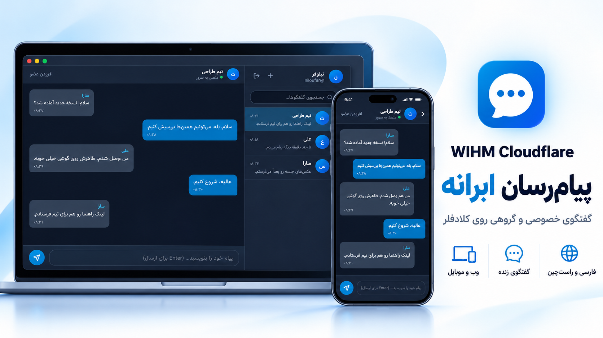

<div align="center">

<h1 dir="ltr">WIHM Cloudflare</h1>

<p dir="rtl">ابرانه؛ پیام‌رسان فارسی برای گفتگوی خصوصی و گروهی</p>



<p dir="rtl">
  <a href="docs/EASY-INSTALL.fa.md"><strong>نصب آسان و خودکار</strong></a>
  ·
  <a href="#local-setup">اجرای محلی</a>
  ·
  <a href="#cloudflare-deploy">انتشار روی کلادفلر</a>
</p>

</div>

<div dir="rtl">

ابرانه در مرورگر اجرا می‌شود و می‌توانید آن را روی گوشی و رایانه نصب کنید. میزبانی برنامه و ذخیرهٔ پیام‌ها روی کلادفلر انجام می‌شود؛ برای راه‌اندازی به سرور اختصاصی نیاز ندارید.

## نصب با نصب‌کنندهٔ فارسی

برای ویندوز، مک، لینوکس و **اندروید با ترموکس**، [راهنمای نصب آسان](docs/EASY-INSTALL.fa.md) را باز کنید. نصب‌کننده دیتابیس، کلید امنیتی و انتشار را خودکار انجام می‌دهد؛ ویرایش فایل و نصب Git یا Wrangler لازم نیست. فقط دسترسی حساب کلادفلر و نام پیام‌رسان را وارد می‌کنید.

[دریافت نصب‌کنندهٔ ویندوز](https://github.com/DarkPoesidon/WIHM-Cloudflare/releases/latest/download/wihm-installer.zip) · [نصب با گوشی اندروید](docs/EASY-INSTALL.fa.md#اندروید-فقط-با-گوشی) · [آپدیت بدون حذف اطلاعات](docs/UPDATE.fa.md) · [پلن توسعه](docs/ROADMAP.fa.md)

راهنمای دستورهای زیر برای توسعه‌دهندگان و نصب دستی است. [راهنمای مفصل نصب دستی](docs/INSTALL.fa.md) هم در دسترس است.

## امکانات

نسخهٔ برنامه: **1.4.1**؛ [تغییرات و راهنمای ارتقا](docs/releases/1.4.1.fa.md).

- صف ارسال روی دستگاه و تلاش مجدد بدون ساخت پیام تکراری.
- وضعیت ارسال، تحویل و مشاهدهٔ گفتگو؛ شمارندهٔ نخوانده‌ها.
- مدیریت دستگاه‌های متصل و خروج از نشست‌های دیگر.
- [مدیریت کاربران، وضعیت سرویس و پیدا کردن کاربران سرورهای دیگر با رضایت](docs/SERVICE-MANAGEMENT.fa.md)؛ ارسال پیام خارجی و رمزگذاری سرتاسری هنوز فعال نیستند.
- [به‌روزرسانی با تأیید یا خودکار از داخل برنامه](docs/AUTO-UPDATE.fa.md)؛ انتخاب مستقل هر دستگاه و کنترل سرور برای صاحب سرویس.
- [خواندن کانال عمومی تلگرام یا اتصال ربات برای کانال خودتان/خصوصی](docs/TELEGRAM.fa.md)؛ متن و کپشن، با لینک رسانهٔ اصلی.

- پاسخ، ویرایش، حذف و واکنش به پیام؛ جستجوی فارسی داخل گفتگو.
- پروفایل و عکس، تغییر رمز، تم روشن/تیره و اندازهٔ نوشته.
- اعلان مرورگر/گوشی، بی‌صداکردن و آرشیو؛ سنجاق و پیام‌های ذخیره‌شده.
- گروه با نقش مالک/مدیر/عضو و دعوت قابل لغو؛ ثبت‌نام آزاد/دعوتی و گزارش مزاحمت.
- [راهنمای کامل استفاده از امکانات](docs/DAILY-USE.fa.md).
- رابط فارسی و راست‌چین، پنل جمع‌شوندهٔ دسکتاپ و تنظیمات دسته‌بندی‌شده برای گوشی و رایانه.
- دریافت زندهٔ پیام‌ها و اتصال دوباره پس از قطع اینترنت.
- نمایش وضعیت اتصال و نشانگر در حال نوشتن.
- دریافت پیام‌های قدیمی‌تر از تاریخچهٔ گفتگو.
- نصب از طریق مرورگر، بدون نیاز به فایل نصب جداگانه.

این نسخه رمزگذاری سرتاسری ندارد. صف محلی جای پشتیبان را نمی‌گیرد و رسید مشاهده تأیید قطعی خواندن توسط انسان نیست.

<details>
<summary>سرویس‌های استفاده‌شده در کلادفلر</summary>

| سرویس | کاربرد |
| --- | --- |
| Workers | اجرای درخواست‌ها و احراز هویت |
| Durable Objects | مدیریت ارتباط زنده و ذخیرهٔ پیام‌های هر گفتگو در SQLite |
| D1 | نگهداری کاربران، عضویت‌ها و نسخهٔ سراسری پیام‌ها |
| Static Assets | میزبانی فایل‌های رابط کاربری |

</details>

## ساختار پروژه

<details>
<summary>نمایش ساختار فایل‌ها</summary>

<div dir="ltr">

```text
├── public/                 # کلاینت و اپلیکیشن PWA
│   ├── index.html         # اسکلت اصلی رابط کاربری
│   ├── style.css          # استایل‌های مدرن و واکنش‌گرا (RTL)
│   ├── app.js             # منطق برنامه، مدیریت وب‌سوکت و API
│   ├── manifest.json      # فایل پیکربندی PWA برای نصب
│   ├── sw.js              # Service Worker برای کش و آفلاین
│   └── icon.svg           # آیکون وکتور اپلیکیشن
├── src/                    # کدهای بک‌اند و سرورلس کلادفلر
│   ├── index.ts           # ورودی اصلی Worker، روت‌های API و ارتقای WebSocket
│   ├── chatRoom.ts        # Durable Object با دیتابیس SQLite داخلی و وب‌سوکت
│   ├── auth.ts            # سیستم هش PBKDF2 و توکن JWT مبتنی بر Web Crypto
│   └── types.ts           # تایپ‌های داده و پروتکل پیام‌های وب‌سوکت
├── schema.sql              # اسکیما و جداول دیتابیس Cloudflare D1
├── wrangler.toml           # فایل پیکربندی سرویس‌های کلادفلر
└── package.json            # اسکریپت‌ها و وابستگی‌ها
```

</div>

</details>

<a id="local-setup"></a>
## اجرای محلی

### ۱. نصب وابستگی‌ها

<div dir="ltr">

```bash
npm ci
```

</div>

### ۲. تنظیم کلید امنیتی محلی

این دستور را یک بار در پوشهٔ پروژه اجرا کنید؛ اگر `.dev.vars` موجود باشد، آن را بازنویسی نمی‌کند:

<div dir="ltr">

```bash
node -e "require('node:fs').writeFileSync('.dev.vars', 'JWT_SECRET=' + require('node:crypto').randomBytes(32).toString('hex') + '\n', {flag:'wx'})"
```

</div>

کلید در `.dev.vars` نگهداری می‌شود و نباید منتشر یا وارد مخزن شود. بدون `JWT_SECRET` اختصاصی با حداقل ۳۲ بایت، API و اتصال وب‌سوکت پاسخ 503 می‌دهند. کلید پیش‌فرض عمومی حذف شده است؛ توکن‌های قدیمی مبتنی بر آن معتبر نیستند و کاربران باید دوباره وارد شوند.

### ۳. مقداردهی اولیه دیتابیس لوکال (D1)

<div dir="ltr">

```bash
npm run db:init:local
```

</div>

### ۴. اجرای سرور توسعه

<div dir="ltr">

```bash
npm run dev
```

</div>
سپس مرورگر را باز کرده و به آدرس `http://localhost:8787` مراجعه کنید.
برای آزمایش دو کاربر، از دو مرورگر متفاوت یا یک پنجرهٔ عادی و یک پنجرهٔ ناشناس استفاده کنید؛ زبانه‌های عادی یک مرورگر فضای ورود مشترک دارند.

<a id="cloudflare-deploy"></a>
## انتشار روی کلادفلر

برای انتشار نسخه زنده روی اکانت کلادفلر خود:

### ۱. ورود به حساب کلادفلر در ترمینال

<div dir="ltr">

```bash
npx wrangler login
```

</div>

### ۲. ساخت دیتابیس D1 در کلادفلر

<div dir="ltr">

```bash
npx wrangler d1 create messenger-db --update-config=false
```

</div>
پس از اجرای دستور، شناسه `database_id` نمایش داده می‌شود. آن را در فایل `wrangler.toml` جلوی `database_id` جایگزین کنید.

### ۳. اعمال اسکیمای جداول روی دیتابیس ریموت

<div dir="ltr">

```bash
npm run db:init:remote
```

</div>

### ۴. ساخت فایل کلید اختصاصی محیط اصلی

یک فایل خصوصی با کلیدی تصادفی و مستقل از کلید محلی بسازید. دستور زیر فایل موجود را بازنویسی نمی‌کند:

<div dir="ltr">

```bash
node -e "require('node:fs').writeFileSync('.env.production', 'JWT_SECRET=' + require('node:crypto').randomBytes(32).toString('hex') + '\n', {flag:'wx'})"
```

</div>

فایل `.env.production` در `.gitignore` قرار دارد؛ آن را عمومی نکنید و کلید را داخل `wrangler.toml` ننویسید. تغییر کلید، توکن‌های قبلی را نامعتبر می‌کند. در به‌روزرسانی‌ها همین کلید قبلی را نگه دارید.

### ۵. انتشار سراسری روی شبکه کلادفلر

<div dir="ltr">

```bash
npm run deploy -- --secrets-file .env.production
```

</div>
این دستور کد و کلید را با هم روی Cloudflare ثبت می‌کند. در پایان، آدرس نصب شما (با ساختاری مانند `https://cloudflare-messenger.<your-subdomain>.workers.dev`) چاپ می‌شود. نمونهٔ آدرس را با آدرس واقعی خروجی خودتان جایگزین کنید.

## بررسی تغییرات

<div dir="ltr">

```bash
npm run typecheck
npm test
```

</div>

تست‌ها از دیتابیس موقت و شبیه‌ساز محلی Cloudflare استفاده می‌کنند و دیتابیس اصلی یا `.wrangler/state` را تغییر نمی‌دهند. تست‌های کلاینت، منطق برنامه را با DOM و شبکهٔ شبیه‌سازی‌شده بررسی می‌کنند؛ تست مرورگر و دستگاه واقعی جداگانه لازم است.

## گروه‌ها و تاریخچه

در پنجرهٔ گفتگوی جدید، «ساخت گروه» را بزنید، نام گروه را وارد کنید، کاربران را جستجو و انتخاب کنید و گروه را بسازید. اعضای فعلی می‌توانند از «افزودن عضو» در سربرگ گروه استفاده کنند. کاربران خارج از گروه اجازهٔ افزودن عضو یا خواندن پیام‌ها را ندارند.

تاریخچه همچنان آرایهٔ JSON برمی‌گرداند. `GET /api/chats/:id/messages` پارامتر `limit` بین ۱ تا ۱۰۰ (پیش‌فرض ۵۰) و `before=<createdAt>:<id>` می‌پذیرد. برای صفحهٔ قبلی از زمان و شناسهٔ اولین پیام صفحه استفاده کنید. ترتیب زمان و شناسه از جاافتادن پیام‌های هم‌زمان جلوگیری می‌کند. در رابط برنامه، دکمهٔ «پیام‌های قبلی» همین کار را انجام می‌دهد.

ساخت هم‌زمان گفتگوی خصوصی برای یک زوج کاربر اکنون یک شناسهٔ مشترک می‌سازد. گفتگوهای موجود حفظ می‌شوند؛ گفتگوهای تکراری قدیمی برای جلوگیری از حذف یا جابه‌جایی تاریخچه، خودکار ادغام نمی‌شوند.

## نصب روی گوشی و رایانه

- **روی اندروید (Chrome / Samsung Internet):** وارد آدرس سایت شوید و بنر "نصب اپلیکیشن پیام‌رسان" یا گزینه "Install app" را در منوی مرورگر لمس کنید.
- **روی iOS / iPhone (Safari):** دکمه Share را بزنید و گزینه **Add to Home Screen** را انتخاب کنید.
- **روی ویندوز / مک (Chrome / Edge):** روی آیکون نصب در نوار آدرس کلیک کنید.

</div>
