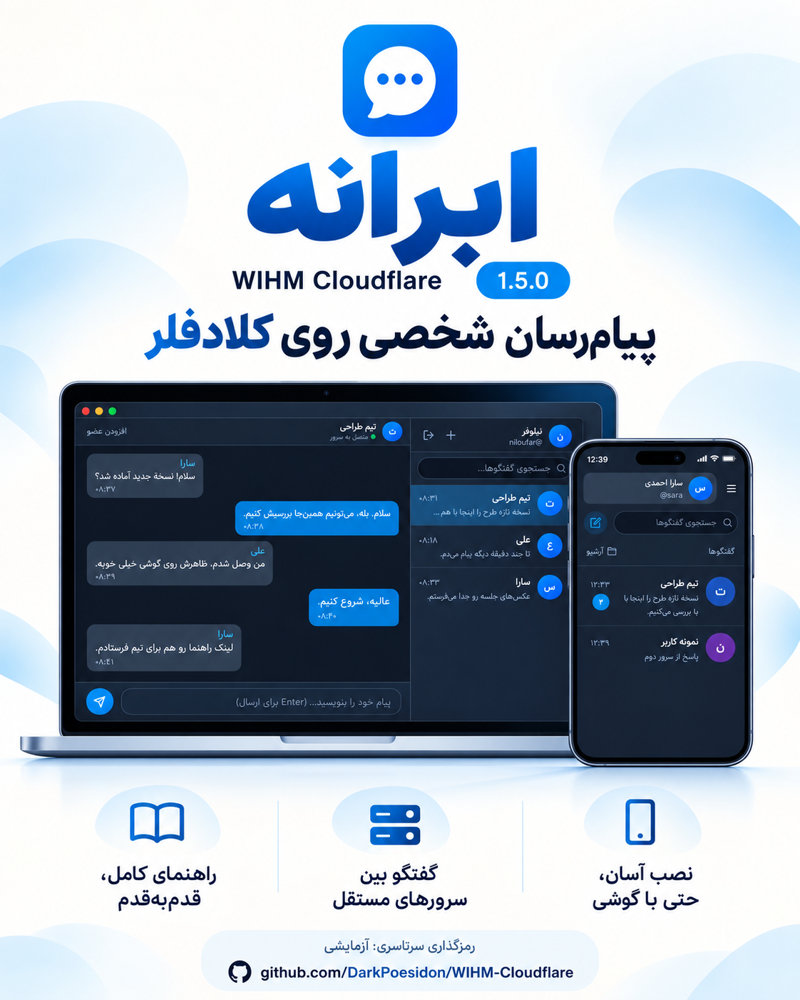

# فایل‌های آمادهٔ معرفی ابرانه ۱.۵.۰

- [پوستر PNG](wihm-cloudflare-1.5.0-telegram.png)
- [متن کوتاه تلگرام؛ آمادهٔ کپی](telegram.fa.md)
- [مشخصات و متن تولید پوستر](poster-prompt.md)
- [شروع راهنماها برای کاربر تازه‌کار](../../../docs/START-HERE.fa.md)

برای ارسال در تلگرام، PNG را به‌عنوان عکس انتخاب و تمام متن فایل `telegram.fa.md` را در کپشن بچسبانید. اگر حفظ کیفیت اصلی تصویر مهم است، آن را به‌صورت فایل هم می‌توانید بفرستید. متن را خودتان ارسال می‌کنید؛ چیزی در کانال شما خودکار منتشر نشده است.

پوستر با ابزار داخلی image_gen و با مرجع هویت بصری و رابط واقعی پروژه ساخته شده است؛ تصویر ترکیب تبلیغاتیِ نمایندهٔ رابط است و اسکرین‌شات مستندِ اجرای یک نصب واقعی نیست. فایل قبلی پوستر در `docs/assets` حفظ شده است. امکانات تصویر و متن با نسخهٔ ۱.۵ تطبیق داده شده‌اند؛ رمزگذاری ممیزی‌شده، تماس گروهی، ارسال فایل و دسترسی بدون اینترنت ادعا نشده است.

