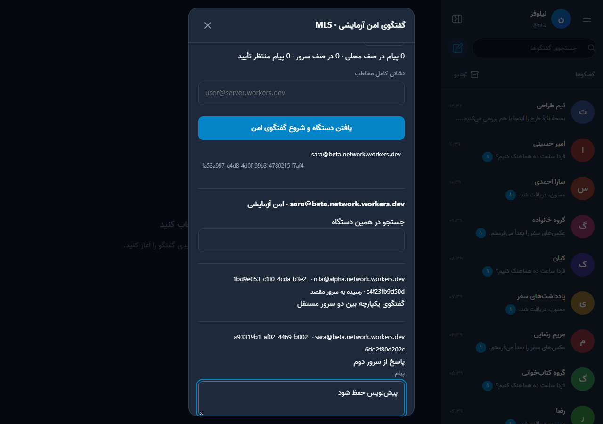

# استفاده از امکانات نسخهٔ ۱.۵

این راهنما برای کاربری است که نصب‌کننده را یک بار اجرا کرده است. برنامه روی همان حساب کلادفلر می‌ماند؛ سرور جدا لازم نیست. برای نصب نخست، [راهنمای نصب ساده](EASY-INSTALL.fa.md) را بخوانید.

## فهرست

- [ارتقای نسخه](#ابتدا-نسخه-را-بهروز-کنید)
- [گفتگو بین سرورها](#پیدا-کردن-مخاطب-سرور-دیگر-و-شروع-گفتگو)
- [رمزگذاری و بازیابی دستگاه](#معنای-رمزگذاری-آزمایشی)
- [کلید عبور و رمزساز](#ورود-امنتر)
- [پشتیبان و بازیابی سرور](#پشتیبان-کامل-سرور-و-بازیابی)
- [دامنهٔ شخصی](#دامنه-شخصی)
- [کانال و ربات](#کانال-ربات-و-وبهوک)
- [تماس و مصرف سرویس](#تماس-و-مصرف-سرویس)

## ابتدا نسخه را به‌روز کنید

۱. مدیر هر سرور «تنظیمات ← به‌روزرسانی ← سرور پیام‌رسان» را باز کند و آپدیت سرور را تأیید کند. اگر این بخش دیده نمی‌شود، [فعال‌کردن مدیریت و آپدیت](AUTO-UPDATE.fa.md) را انجام دهید.

۲. اگر به‌روزرسان سرور آماده نیست، آخرین نصب‌کننده را با **همان حساب و نام قبلی پیام‌رسان** اجرا کنید. نام تازه، نصب جدا می‌سازد. دیتابیس و کلید قبلی را عوض نکنید.

۳. سپس هر کاربر در قسمت «نسخهٔ این دستگاه» نسخهٔ تازه را دریافت کند. ارتقای سرور و دریافت نسخهٔ دستگاه دو مرحله‌اند. برای ارتباط بین دو سرور، هر دو باید نسخهٔ ۱.۵ یا جدیدتر داشته باشند.

## پیدا کردن مخاطبِ سرور دیگر و شروع گفتگو

۱. مخاطب در «تنظیمات ← کاربران سرورهای دیگر» گزینهٔ «دیگران بتوانند من را با نشانی دقیق پیدا کنند» را روشن و ذخیره کند. نشانی نمایش‌داده‌شده را برای شما بفرستد؛ مانند `sara@chat.account.workers.dev`.

۲. شما دکمهٔ «گفتگوی جدید» کنار جستجوی گفتگوها را بزنید. **نشانی کامل** مخاطب را بنویسید؛ نوشتن نام کوچک یا فقط نام کاربری برای جستجوی سرور دیگر کافی نیست.

۳. روی نتیجه و «گفتگو» بزنید. دستگاه مخاطب نمایش داده می‌شود. نیازی به حساب دوم، واردکردن توکن کلادفلر یا ردوبدل‌کردن کلید سرور بین مدیران نیست.

۴. هر طرف در بخش «هویت این دستگاه و بازیابی»، اثرانگشت دستگاه خودش را می‌بیند. این رشته را از یک راه مستقل و مطمئن، مثلاً ملاقات یا تماس شناخته‌شده، مقایسه کنید. اثرانگشت تأییدشدهٔ مخاطب را در فرم وارد کنید. نمایش یک نام یا آواتار، اثبات هویت فرد نیست.

۵. مخاطب دعوت را در فهرست اصلی گفتگوها می‌بیند. او هم دستگاه شما را تأیید کند؛ سپس پیام‌ها قابل خواندن می‌شوند. گفتگوهای بین سرورها در همان فهرست اصلی می‌آیند و پنجرهٔ باز به‌صورت دوره‌ای همگام می‌شود. دکمهٔ «همگام‌سازی» برای بررسی فوری هم وجود دارد.

۶. پیام در دسترس بودن مقصد فوراً به سرور آن ارسال می‌شود. هنگام قطع مقصد، متن رمز‌شده در صف می‌ماند و دوباره ارسال می‌شود. «رسیده به سرور مقصد» به معنی خوانده‌شدن توسط شخص نیست. اعلانِ پیام امن، متن و نام فرستنده را نشان نمی‌دهد؛ ارسال اعلان پس‌زمینه پس از دریافت پیام آغاز و در صورت شکست دوره‌ای تکرار می‌شود و اجازهٔ مرورگر و اتصال به سرویس اعلان لازم است.

اگر نتیجه پیدا نشد: نسخهٔ هر دو سرور، نشانی دقیق و اجازهٔ خود مخاطب را بررسی کنید. مدیر می‌تواند ارتباط یا پیدا شدن کاربران سرورش را صریحاً خاموش کند؛ این انتخاب دور زده نمی‌شود. برای سرور تازه، ارتباط خودکار فعال است، ولی **حساب‌ها تا رضایت خودشان خصوصی‌اند**. فعال‌بودن گزینهٔ حساب شما، اجازهٔ نمایش مخاطب را تغییر نمی‌دهد.

نام دامنهٔ جایگزین به هویت اصلیِ ثابت سرور برمی‌گردد. افزودن دامنه، حساب دوم نمی‌سازد. انتقال حساب به سرور مستقل دیگر یا مهاجرت نام کاربری هنوز پشتیبانی نمی‌شود. اگر کلید ثبت‌شدهٔ سرور تغییر کند، ارتباط بدون تأیید دوباره ادامه پیدا نمی‌کند؛ مدیر می‌تواند کلید صحیح را از راه مستقل بررسی و در تنظیمات اتصال سرورها ثبت کند.

## معنای «رمزگذاری آزمایشی»

این مسیر از پروتکل استاندارد MLS استفاده می‌کند، ولی کتابخانهٔ مرورگری آن ممیزی مستقل امنیتی ندارد. برچسب آزمایشی عمداً نمایش داده می‌شود. گفتگوهای معمولی قدیمی و گروه‌ها خودکار رمزگذاری نمی‌شوند؛ متن آن‌ها برای سرور قابل دسترسی است.

هر گفتگوی امن مخصوص **دو دستگاه تأییدشده** است. ورود در گوشی دوم، تاریخچهٔ رمزگشایی‌شدهٔ گوشی اول را خودکار منتقل نمی‌کند. برای دستگاه تازه، گفتگوی تازه با تأیید تازه بسازید. جستجوی پیام و پاسخ به پیام در همین دستگاه انجام می‌شود. سرورها همچنان نشانی طرفین، زمان و اندازهٔ پیام رمز‌شده را می‌بینند. میزبانِ آلوده می‌تواند کد وب مخرب تحویل دهد؛ این محدودیتِ اعتماد به برنامهٔ وب با E2EE برطرف نمی‌شود.

پیش از پاک‌کردن حافظهٔ مرورگر، «هویت این دستگاه و بازیابی» را باز کنید، رمز حداقل ۱۲ نویسه‌ای انتخاب کنید و فایل بازیابی بگیرید. فایل و رمز را جدا نگه دارید. این فایل **تاریخچهٔ خواندنی همان دستگاه** را برمی‌گرداند و هویت تازه می‌سازد؛ ادامهٔ کلید نشست قدیمی و پیام‌های دریافت‌نشده را بازیابی نمی‌کند. پس از بازیابی، دوباره دستگاه‌ها را تأیید کنید. از بخش «دستگاه‌های امن و لغو دسترسی» دستگاه گم‌شده را لغو کنید؛ لغو دسترسی نسخه‌ای را که قبلاً روی دستگاه ذخیره شده پاک نمی‌کند.

### داخل گفتگوی امن چه کار کنم؟

۱. گفتگو را از فهرست اصلی یا **تنظیمات ← گفتگوی رمز‌شده · آزمایشی** باز کنید. اگر هنوز دعوت منتظر تأیید دارید، دکمهٔ دعوت را بزنید و اثرانگشت کاملِ دستگاه فرستنده را با راهی مستقل مقایسه کنید؛ تأیید نام کافی نیست.

۲. در قسمت **پیام** بنویسید و **ارسال رمز‌شده** را بزنید. پیام امن حداکثر ۸۰۰۰ نویسه دارد. اگر پیام در صف است، صفحه را با پاک‌کردن حافظهٔ مرورگر «تعمیر» نکنید؛ صف و کلیدها روی همان دستگاه‌اند.

۳. برای پاسخ، شناسهٔ پیامِ موردنظر را که کنار همان پیام نمایش داده می‌شود کپی و در **شناسهٔ پیام برای پاسخ اختیاری** بگذارید، سپس متن پاسخ را بفرستید. این قسمت هنوز دکمهٔ پاسخِ یک‌لمسیِ گفتگوی معمولی را ندارد.

۴. در **جستجو در همین دستگاه** بخشی از متن را بنویسید. فقط تاریخچه‌ای جستجو می‌شود که همین دستگاه رمزگشایی کرده؛ سرور جستجوی متن امن انجام نمی‌دهد.

۵. پنجرهٔ باز دوره‌ای تازه می‌شود. برای تلاش فوری **همگام‌سازی** را بزنید. پیامِ «منتظر تأیید» با فعال‌کردن اعلان خواندنی نمی‌شود؛ تأیید دستگاه لازم است.

۶. **مسدودکردن نشانی** در این پنجره مستقل از مسدودکردن مخاطبِ گفتگوی معمولی است؛ فهرست «افراد مسدودشده» معمولی، ابزار مدیریت این مسدودیت امن نیست. فقط برای توقف ارتباط با همان نشانی آن را بزنید.

### گرفتن فایل و بازگرداندن تاریخچهٔ امن

۱. در **هویت این دستگاه و بازیابی**، برای فایل رمز حداقل ۱۲ نویسه‌ای انتخاب و **دریافت فایل بازیابی** را بزنید. فایل دانلودشده را خارج از همین مرورگر نگه دارید؛ رمز را جدا حفظ کنید.

۲. این فایل را با پشتیبان کامل سرویس یکی ندانید. برای بازیابی آن، در همان حساب و نشانیِ اصلی، بخش هویت را باز و رمز فایل را وارد کنید؛ سپس **بازیابی فایل** و فایل `wihm-secure-recovery.json` را انتخاب کنید.

۳. اگر صف ارسال فعلی دارید، ابتدا تحویلش دهید. بازیابیِ فایل روی حساب دیگری پذیرفته نمی‌شود. بازیابی، هویت قبلی را لغو و هویت تازه می‌سازد؛ تاریخچهٔ واردشده فقط خواندنی است.

۴. برای ادامهٔ ارسال، با دستگاه تازه و تأیید تازه گفتگوی جدید بسازید. واردکردن فایل بازیابی به معنی برگشتن پیام‌های هنوز دریافت‌نشده یا ادامهٔ کلید نشست قبلی نیست.

فایل بازیابی به **نشانی اصلی حساب** هم وابسته است. اگر حساب را به سروری مستقل با نشانی تازه ببرید، واردکردن فایل امنِ نشانی قبلی در حساب تازه پشتیبانی نمی‌شود. افزودن نام مستعار به همان سرور با انتقال حساب به سرور مستقل یکی نیست. پیش از جابه‌جایی، دسترسی سالم به تاریخچهٔ قبلی و فایل آن را حفظ کنید.

## ورود امن‌تر

۱. «تنظیمات ← کلید عبور و ورود دومرحله‌ای» را باز کنید. عنوان دقیق گزینه‌های زیر در همین صفحه دیده می‌شود.

۲. برای کد دومرحله‌ای، مراحل زیر را کامل انجام دهید؛ صرف دیدن کلید راه‌اندازی به معنی فعال‌شدن نیست. پس از فعال‌سازی، ورود با رمز و تغییر رمز به کد دومرحله‌ای یا کد بازیابی نیاز دارد.

۳. برای Passkey، افزودن کلید عبور را بزنید و تأیید سیستم‌عامل با اثرانگشت، چهره، PIN یا کلید امنیتی را انجام دهید. هنگام ورود بعدی، «ورود با کلید عبور» را بزنید. مرورگر باید این امکان را پشتیبانی کند و صفحه HTTPS باشد. کلید عبور به دامنه وابسته است؛ هنگام تغییر دامنه، ابتدا با روش قبلی وارد شوید و کلید عبور مناسب دامنهٔ تازه بسازید.

۴. پیش از حذف روش قبلی، روش تازه را امتحان کنید. رمز و کدهای بازیابی را برای مدیر سرویس نفرستید. برنامهٔ تولید کد و قابلیت‌های سیستم‌عامل، خدمات بیرون از پیام‌رسان‌اند.

### فعال‌کردن رمزساز؛ بدون فرض وجود QR

۱. یک برنامهٔ رمزسازِ قابل اعتماد روی دستگاه خودتان داشته باشید. داخل ابرانه، در بخش **برنامهٔ رمزساز (TOTP)**، **فعال‌کردن** را بزنید.

۲. رمز فعلی حساب را وارد و **ادامه** را بزنید. صفحهٔ **تأیید برنامهٔ رمزساز**، یک **کلید راه‌اندازی** نشان می‌دهد؛ این صفحه QR الزامی ندارد.

۳. در برنامهٔ رمزساز، افزودن حساب با **Setup key / ورود دستی کلید** را انتخاب کنید. یک نام مانند `ابرانه - sara` بدهید و کلید نمایش‌داده‌شده را وارد کنید. نوع **زمان‌محور / TOTP**، ۶ رقم، الگوریتم **SHA1** و بازهٔ ۳۰ ثانیه است. کلید را در چت برای خودتان یا دیگری نفرستید.

۴. کد ۶ رقمی ساخته‌شده را با ارقام انگلیسی در ابرانه وارد و **فعال‌کردن و دریافت کدهای بازیابی** را بزنید. راه‌اندازی پنج دقیقه اعتبار دارد؛ اگر تمام شد، از ابتدا کلید تازه بگیرید.

۵. هشت کد بازیابی فقط همان بار نمایش داده می‌شوند. **کپی کدها** را بزنید و بیرون از همان گوشی، در محل امن نگه دارید. هر کد فقط یک بار و همراه رمز حساب قابل استفاده است. این کدها، فایل بازیابی پیام‌های امن نیستند.

۶. وضعیت رمزساز باید «فعال» شود. فعال‌سازی نشست‌های دیگر را خارج می‌کند؛ انتظار ورود دوباره روی آن‌ها طبیعی است. یک بار ورود با رمز و کد تازه را در مرورگر دیگر امتحان کنید؛ تا مطمئن نشده‌اید، نشست سالم فعلی را نبندید.

۷. برای ساخت مجدد کدهای گم‌شده، **ساخت دوبارهٔ کدهای بازیابی** را بزنید و رمز و کد فعلی/بازیابی را بدهید؛ کدهای قبلی باطل می‌شوند. برای خاموش‌کردن رمزساز، **غیرفعال‌کردن** و تأیید همان صفحه لازم است.

### ساخت و استفاده از کلید عبور / Passkey

۱. **افزودن کلید عبور** را بزنید. رمز فعلی و اگر رمزساز فعال است، کد تازه را وارد کنید؛ برای دستگاه نام قابل تشخیص مثل «گوشی من» بگذارید.

۲. **ثبت کلید روی دستگاه** را بزنید. پنجرهٔ خود سیستم‌عامل باز می‌شود؛ با روش پیشنهادی همان دستگاه، ساخت کلید را تأیید کنید. لغوکردن پنجره، کلیدی ثبت نمی‌کند.

۳. نام کلید باید در فهرست **کلیدهای عبور** دیده شود. در یک صفحهٔ ورودِ دیگر، نام کاربری را بنویسید و **ورود با کلید عبور** را بزنید. تأیید سیستم‌عامل لازم است؛ ابرانه تصویر اثرانگشت شما را دریافت نمی‌کند.

۴. برای حذف، کنار همان کلید **حذف** را بزنید و فرم رمز/کد را تکمیل کنید. حذف از ابرانه، با حذف کلید در مدیر رمز سیستم‌عامل یکی نیست. ورود با رمز حساب همچنان مسیر جداگانه‌ای است.

اگر هم رمز حساب و هم روش‌های دومرحله‌ای/بازیابی را از دست بدهید، این نسخه مسیر تضمین‌شدهٔ بازیابی با ایمیل یا دخالت مدیر ندارد. پیش از فعال‌سازی، کدهای بازیابی را بیرون از گوشی ذخیره کنید.

## پشتیبان کامل سرور و بازیابی

۱. مدیر «تنظیمات ← پشتیبان سرویس» را باز کند. رمز فعلی حساب و در صورت فعال‌بودن، کد دومرحله‌ای را وارد کند. **رمز فایل پشتیبان جداست**؛ حداقل ۱۲ نویسهٔ قوی انتخاب کنید و بیرون از دستگاه نگه دارید.

۲. هنگام گرفتن پشتیبان، نوشتن داده موقتاً متوقف می‌شود تا تاریخچهٔ اتاق‌ها و نمایهٔ دیتابیس با هم سازگار باشند. کاربران ممکن است پیام توقف موقت ببینند؛ صف دستگاه حفظ می‌شود. صفحه را تا پایان باز نگه دارید. محدودیت این نسخه ۲۰۰ گفتگو، فایلِ بازشدهٔ ۳۲ MiB و ۱۵ دقیقه برای هر نوبت است. عبور از حد، خطا می‌دهد و داده را حذف نمی‌کند.

۳. فایل رمز‌شده را دانلود و نسخهٔ دیگری از آن را نگه دارید. رمز فایل از مرورگر به سرور پیام‌رسان فرستاده نمی‌شود. فایل شامل رمزهای هش‌شدهٔ حساب‌ها و کلیدهای برنامه است؛ آن را عمومی نکنید. توکن مدیریت کلادفلر داخل پشتیبان نیست. فایل بازیابی دستگاه امن را هم جداگانه بگیرید؛ پشتیبان سرور کلید خصوصی دستگاه شما را ندارد.

۴. برای بازگرداندن، **نصب‌کنندهٔ دقیقاً هم‌نسخه با فایل** لازم است. در [فهرست ریلیزها](https://github.com/DarkPoesidon/WIHM-Cloudflare/releases)، نسخهٔ متناظر مانند `installer-v1.5.0` را باز و ZIP یا tar.gz نصب‌کنندهٔ همان نسخه را بگیرید؛ آخرین نسخه لزوماً هم‌نسخهٔ فایل قدیمی شما نیست. نصب‌کننده را باز، حساب را متصل و **نام تازه** برای مقصد انتخاب کنید؛ نصب فعلی را نگه دارید. پس از «بررسی نام و حساب»، قسمت **بازیابی پشتیبان روی نصب تازه** را باز و فایل و رمز آن را وارد کنید. در این مرحله دامنهٔ اختصاصی را خالی بگذارید؛ اتصال دامنه را بعد از بررسی مقصد انجام دهید.

۵. بازیابی فقط روی نصب خالیِ قابل شناسایی یا همان بازیابی نیمه‌تمام انجام می‌شود. اگر قطع شد، همان فایل، حساب و نام مقصد را دوباره استفاده کنید. نصب‌کننده به‌خاطر فایل اشتباه یا مقصدِ پُر، نصب فعال دیگری را پاک نمی‌کند.

۶. پس از پایان، با **حساب و رمز قبلی** وارد مقصد شوید؛ ثبت‌نام تازه لازم نیست. گفتگوها و تاریخچه را بررسی کنید. نشست‌های قبلی و اشتراک‌های اعلان برنمی‌گردند؛ دوباره وارد و اعلان را فعال کنید. کدهای بازیابی دومرحله‌ای تازه بگیرید. اتصال ربات تلگرام، توکن‌ها و وب‌هوک کانال را دوباره تنظیم کنید.

۷. پیدا شدن کاربران و ارتباط امنِ مقصدِ بازیابی‌شده عمداً خاموش‌اند؛ مدیر پس از بررسی نشانی مقصد آن‌ها را فعال کند. دستگاه‌های امن قبلی لغو می‌شوند؛ دستگاه تازه را تأیید کنید. پشتیبان سرور تاریخچهٔ امنِ رمزگشایی‌شده را برنمی‌گرداند؛ فایل بازیابی دستگاه هم فقط برای نشانی حسابِ متناظر پذیرفته می‌شود و راه انتقال تاریخچه به حسابِ یک سرور تازه نیست.

برای بازگشت از یک ارتقای نامناسب، نصب فعال را با دیتابیس قدیمی جایگزین نکنید. پشتیبان و نصب‌کنندهٔ هم‌نسخهٔ قبلی را روی نصب تازه بازیابی و بررسی کنید؛ سپس انتقال نشانی را جداگانه انجام دهید. بازگرداندن مستقیم نسخهٔ قدیمی روی دیتابیس ارتقایافته در این نسخه خودکار نیست.

## دامنهٔ شخصی

۱. دامنه باید در همان حساب کلادفلر، در یک Zone فعال باشد. سه مجوز نصب را نگه دارید و در توکن این دو ردیف را برای همان دامنه اضافه کنید: **Zone → Zone → Read** و **Zone → DNS → Read**. در **Zone Resources**، **Include → Specific zone** و همان دامنه را انتخاب کنید؛ قسمت **Account Resources** همچنان حساب نصب است. اتصال Worker از مجوز Workers Scripts نصب استفاده می‌کند؛ نام تازه‌ای برای حساب پیام‌رسان نسازید.

۲. در نصب‌کننده، دامنهٔ کامل مانند `chat.example.com` را در قسمت دامنهٔ اختیاری بنویسید؛ `https://`، مسیر و پورت ننویسید.

۳. نصب‌کننده مالکیت و تداخل رکورد را بررسی می‌کند. اگر رکورد یا سرویس دیگری روی این نام باشد، آن را خودکار جایگزین نمی‌کند. نامِ آزاد دیگری انتخاب کنید یا تداخل را آگاهانه در پنل کلادفلر برطرف کنید.

۴. پس از ثبت، منتظر آماده‌شدن DNS و گواهی HTTPS بمانید و نشانی را در مرورگر باز کنید. ثبت نگاشت دامنه به معنی آماده‌شدن فوری گواهی نیست. آدرس قبلی `workers.dev` حفظ می‌شود. نصب‌کننده سرویس پولی را خودکار فعال نمی‌کند.

## کانال، ربات و وب‌هوک

کانال ابرانه، آینهٔ تلگرام نیست. صاحب کانال داخل همین سرویس پست می‌گذارد و مشترکان آن را می‌خوانند. برای تلگرام از [مسیر تلگرام](TELEGRAM.fa.md) استفاده کنید.

### اولین کانال و دعوت مشترک

۱. **تنظیمات ← کانال‌های این پیام‌رسان ← ساخت کانال** را بزنید؛ نام و حالت عمومی/خصوصی را انتخاب و **ساخت کانال** را تأیید کنید.

۲. صفحهٔ **دعوت کانال** دو خط نشان می‌دهد: خط اول **شناسهٔ کانال** و خط دوم **کد دعوت** است. هر دو را همان لحظه کپی و امن نگه دارید؛ این‌ها نام کاربری یا رمز حساب نیستند.

۳. از **بازگشت** وارد پست‌ها شوید. متن را بنویسید و **انتشار پست** را بزنید. مالک و مدیر انتشار این قسمت را دارند؛ مشترک عادی ندارد.

۴. مخاطب باید در همان نصب حساب داشته باشد. برای کانال عمومی می‌تواند **کانال‌های عمومی** را باز و کانال را انتخاب و مشترک شود. برای خصوصی، در **عضویت با دعوت** شناسه و کد دعوت را جدا وارد و **عضویت** را بزند. لازم نیست به او توکن ربات بدهید.

۵. با **نوسازی پست‌ها** نسخهٔ تازه و با **پست‌های قبلی** تاریخچه را بخوانید. ویرایش و **حذف پست** برای حساب مجاز است؛ حذفِ پست، نسخهٔ قبلاً کپی‌شده را از دستگاه دیگران پس نمی‌گیرد.

۶. از **مدیران، ربات و وب‌هوک**، **ساخت کد دعوت جدید** کد قبلی را نامعتبر می‌کند؛ شناسه ثابت می‌ماند. دعوت تازه را فقط برای افراد موردنظر بفرستید.

۷. در **مدیران انتشار**، فرم **شناسهٔ کاربر** شناسهٔ داخلی حساب را می‌خواهد، نه نام کاربری. نقش «مدیر انتشار» یا «مشترک؛ برداشتن مدیریت» را انتخاب و **ذخیرهٔ نقش** را بزنید. این نسخه هنوز انتخاب مدیر با جستجوی نام را ندارد؛ اگر شناسهٔ داخلی را از مسیر مدیریت/API ندارید، این قسمت فنی را انجام ندهید. مالک بدون افزودن مدیر دوم می‌تواند پست منتشر کند.

۸. **حذف کامل کانال** اقدام برگشت‌ناپذیر داخل سرویس است؛ برای ترک یک کانال از حذف کامل استفاده نکنید.

### توکن ربات و وب‌هوک؛ بخش اختیاری برای اتصال نرم‌افزار

این بخش برای کسی است که برنامهٔ گیرنده یا ربات دارد؛ برای نصب و استفادهٔ عادی لازم نیست. توکن ربات ابرانه با توکن BotFather متفاوت است.

۱. «تنظیمات ← کانال‌های این پیام‌رسان» را باز و «ساخت کانال» را بزنید. عمومی یا خصوصی بودن را انتخاب کنید. کانال عمومی از فهرست کانال‌های عمومی همان سرور پیدا می‌شود؛ کانال خصوصی با دعوت در دسترس است.

۲. مالک و مدیران پست متنی منتشر می‌کنند؛ مشترک پست‌ها را می‌خواند. مالک می‌تواند مدیر اضافه یا حذف کند. سقف هر مالک پنج کانال و هر کانال ۱۰۰۰ پست است؛ پست‌های قبلی برای آزادکردن فضا خودکار حذف نمی‌شوند. کانال‌ها رمزگذاری سرتاسری ندارند و فعلاً بین سرورها همگام نمی‌شوند. آینهٔ تلگرام بخش جداگانه‌ای است: [راهنمای تلگرام](TELEGRAM.fa.md).

۳. در مدیریت کانال، توکن ربات را با دسترسی خواندن یا نوشتن و مدت اعتبار بسازید. توکن فقط یک بار نشان داده می‌شود؛ ذخیره کنید و فقط در سربرگ `Authorization: Bearer TOKEN` بفرستید. مسیر دقیق `/api/channel-api/CHANNEL_ID/posts` همان‌جا نمایش داده می‌شود. توکن فقط برای همان کانال است؛ در صورت افشا فوراً لغوش کنید.

۴. برای وب‌هوک، نشانی HTTPS مقصد را ثبت کنید. مقصد باید `workers.dev` یا دامنه‌ای باشد که مدیر در فهرست دامنه‌های مجاز گذاشته است. برنامه کلید امضا را یک بار نشان می‌دهد؛ گیرنده باید HMAC-SHA256 را روی `X-WIHM-Timestamp + "." + rawBody` با `X-WIHM-Signature` مقایسه و زمان و شناسهٔ رویداد را برای رد بازپخش کنترل کند. وب‌هوک متن پست را برای مقصد می‌فرستد؛ مقصد را آگاهانه انتخاب کنید. پس از پنج تلاش ناموفق، تحویل متوقف می‌شود.

در فرم توکن، نام، مجوز **خواندن / نوشتن / خواندن و نوشتن** و انقضای ۱ تا ۹۰ روز را انتخاب و **ساخت توکن** را بزنید. توکنِ خواندن اجازهٔ انتشار نمی‌دهد. **لغو** همان توکن دسترسی آن را قطع می‌کند. حداکثر ده توکن فعال مجاز است؛ توکن را در آدرس URL یا ریپوی عمومی نگذارید.

در فرم وب‌هوک **تنظیم یا تعویض وب‌هوک** را بزنید؛ کلید تازه را فقط به برنامهٔ گیرنده بدهید. تعویض یا **حذف وب‌هوک و صف**، صف قبلی را حذف می‌کند؛ پست‌های کانال حذف نمی‌شوند. سقف صف هر کانال ۱۰۰ رویداد است؛ صف پُر انتشار تازه را متوقف می‌کند. گیرندهٔ خراب را اصلاح کنید؛ ارسالِ دوبارهٔ پست به‌عنوان پست تازه می‌تواند محتوا را تکراری کند.

## تماس و مصرف سرویس

در گفتگوی خصوصی معمولی همان سرور، هر دو طرف گفتگو را باز کنند. دکمهٔ تماس صوتی یا تصویری را بزنید؛ مرورگر اجازه میکروفون یا دوربین می‌خواهد و مخاطب باید تماس را بپذیرد. تماس مستقیم WebRTC می‌تواند IP طرفین را آشکار کند. تماس بین سرورها، تماس گروهی و سرور واسط TURN در این نسخه نیستند؛ برخی شبکه‌ها بدون TURN وصل نمی‌شوند. سقف تماس ۱۵ دقیقه است.

«مدیریت سرویس ← وضعیت سرویس» تعداد حساب‌ها، گفتگوها و حجم D1 در صورت اعلام کلادفلر را نشان می‌دهد. هشدار ۴۰۰ MiB یک آستانهٔ احتیاطی است، نه سهمیهٔ قطعی طرح شما. این عدد حجم Durable Objects، مصرف درخواست‌ها و مجموع سهمیهٔ حساب را پوشش نمی‌دهد؛ برای آن‌ها داشبورد کلادفلر مرجع است. فایل و رسانه هنوز آپلود نمی‌شوند.

اگر اجرای سرور به‌اجبار در میانهٔ عملیات قطع شده باشد، پشتیبان ممکن است به بررسی مدیر نیاز پیدا کند؛ برای حفظ سازگاری داده، برنامه نشانگر عملیات ناتمام را خودکار پاک نمی‌کند. [محدودیت‌های بررسی‌شده](releases/1.5.0-audit.md).
