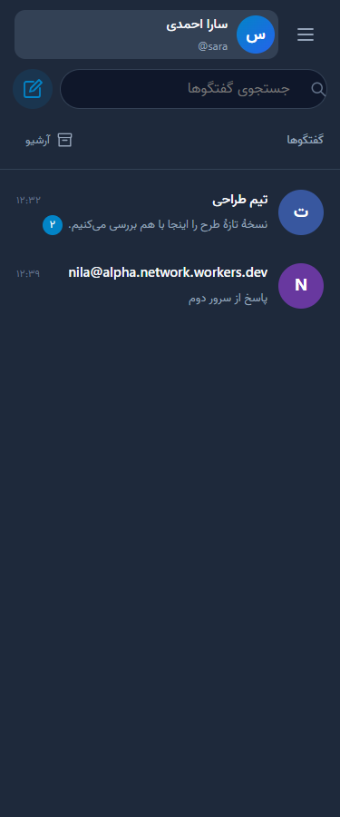

# راهنمای کامل استفاده از ابرانه

برای نسخهٔ **۱.۵.۰**؛ از اولین ورود تا گفتگو، گروه، اعلان و امکانات پیشرفته. برای انجام این مراحل، کاربر عادی به کلادفلر، ترموکس یا دسترسی مدیر نیاز ندارد. [انتخاب مسیر](START-HERE.fa.md).

## فهرست سریع

- [ثبت‌نام و ورود](#ثبتنام-و-اولین-ورود) و [نصب آیکون](#نصب-آیکون-برنامه)
- [اولین پیام](#اولین-پیام-خصوصی) و [وضعیت پیام/قطع اینترنت](#معنی-وضعیت-پیام-و-قطع-اینترنت)
- [ساخت گروه](#ساخت-گروه-تازه) و [اعضا و دعوت](#اعضا-و-دعوت-گروه)
- [پاسخ، ویرایش و حذف](#پاسخ-ویرایش-و-حذف-پیام)، [ذخیره و سنجاق](#واکنش-سنجاق-و-ذخیره)، [جستجو و آرشیو](#جستجو-آرشیو-و-بیصداکردن)
- [پروفایل و رمز](#پروفایل-ظاهر-و-رمز)، [اعلان‌ها](#اعلان-گوشی-و-مرورگر)، [مسدودکردن](#مسدودکردن-و-گزارش)
- [امکانات پیشرفته](#راه-استفاده-از-امکانات-پیشرفته)، [خروج و دستگاه گم‌شده](#خروج-از-حساب-و-دستگاه-گمشده)، [رفع اشکال](#رفع-اشکال-برنامه)

## اول لینک درست را باز کنید

۱. از صاحب پیام‌رسان، لینک عمومی‌ای مانند `https://my-chat.account.workers.dev` بگیرید. این مثال است؛ لینک واقعی سرویس خودتان را باز کنید.

۲. اگر لینک با `127.0.0.1` شروع می‌شود، لینک نصب‌کننده است؛ از او لینک عمومی را بخواهید. کد مدیریت و توکن کلادفلر برای استفادهٔ عادی لازم نیستند.

۳. اگر چند ابرانه با آدرس‌های متفاوت می‌شناسید، حساب هر نصب مستقل است. واردکردن رمزِ یک نصب در نصب دیگری لزوماً حساب شما را پیدا نمی‌کند. از [نشانی بین سرورها](ADVANCED.fa.md#پیدا-کردن-مخاطب-سرور-دیگر-و-شروع-گفتگو) برای ارتباط بدون ساخت حساب دوم استفاده کنید.

## ثبت‌نام و اولین ورود

۱. در صفحهٔ ورود، **ثبت‌نام** را بزنید. نام کاربری انگلیسی ۳ تا ۲۰ کاراکتری با حرف، عدد یا `_` انتخاب کنید؛ نام نمایشی فارسی را بعداً از پروفایل تنظیم می‌کنید.

۲. یک رمز حداقل ۸ کاراکتری انتخاب کنید؛ رمز طولانی و غیرتکراری بهتر است. نام کاربری و رمز را در جای مطمئن نگه دارید. بازیابی با ایمیل وجود ندارد؛ اگر رمز را فراموش کردید، از مدیر سرور لینک بازیابی بخواهید.

۳. ثبت‌نام را بفرستید. اگر سرویس فقط دعوتی است، صاحب سرویس باید لینک دعوت **ثبت‌نام** بدهد؛ آن لینک را باز و همان‌جا ثبت‌نام کنید. دعوت گروه به‌تنهایی اجازهٔ ساخت حساب نمی‌دهد.

۴. برای ورود بعدی، **ورود** را انتخاب کنید و نام کاربری و رمز همان نصب را بنویسید. اگر رمزساز را فعال کرده‌اید، کد جاری یا یکی از کدهای بازیابی استفاده‌نشده را در قسمت دومرحله‌ای وارد کنید. تا قبل از فعال‌سازی، آن قسمت را خالی بگذارید.

۵. **ورود با کلید عبور** فقط وقتی کار می‌کند که قبلاً برای همین دامنه Passkey ساخته باشید؛ سپس تأیید سیستم‌عامل با اثرانگشت، چهره، PIN یا کلید امنیتی انجام می‌شود. [ساخت کلید عبور و رمزساز](ADVANCED.fa.md#ورود-امنتر).

۶. اگر پیام «تلاش زیاد» دیدید، تلاش سریع و پشت‌سرهم را متوقف کنید و بعداً دوباره امتحان کنید. چند بار ثبت‌نام با نام‌های تازه، حساب قبلی و پیام‌های آن را برنمی‌گرداند.

## نصب آیکون برنامه

این مرحله اختیاری است؛ سرور تازه نمی‌سازد و حساب شما را عوض نمی‌کند. ابتدا لینک عمومی پیام‌رسان را در مرورگر به‌روز باز کنید.

| دستگاه | مراحل |
| --- | --- |
| اندروید با مرورگر | در منوی مرورگر «Install app / نصب برنامه» یا «Add to Home screen / افزودن به صفحهٔ اصلی» را انتخاب و تأیید کنید؛ آیکون ابرانه را از صفحهٔ اصلی باز کنید |
| آیفون و آیپد | لینک را در Safari باز کنید، Share / اشتراک‌گذاری و سپس Add to Home Screen را بزنید؛ برنامه را از آیکون تازه باز کنید |
| ویندوز، مک و لینوکس | اگر مرورگر دکمهٔ نصب کنار نوار آدرس دارد از آن استفاده کنید؛ گزینهٔ «نصب برنامه روی دستگاه» ممکن است در منوی ابرانه هم ظاهر شود |

اگر گزینهٔ نصب در مرورگر نیست، همچنان می‌توانید از تب معمولی استفاده کنید. نصب PWA روی دستگاه با اجرای نصب‌کنندهٔ سرور فرق دارد. در برنامهٔ بومی اندروید، اگر آن نسخه را جداگانه دارید، بخش اعلان‌ها می‌تواند تنظیمات بومیِ باتری و سرویس پس‌زمینه را نشان بدهد؛ این راهنما نصب APK بومی منتشرنشده‌ای را وعده نمی‌دهد.

## اولین پیام خصوصی

۱. با دکمهٔ **گفتگوی جدید** کنار نوار جستجوی گفتگوها شروع کنید. نوار «جستجوی گفتگوها» برای پیدا کردن گفتگوهای موجود است؛ ایجاد مخاطب تازه از دکمهٔ گفتگوی جدید انجام می‌شود.

۲. نام کاربری مخاطبی را که در **همین سرور** ثبت‌نام کرده وارد کنید. نتیجه را انتخاب و **گفتگو** را بزنید.

۳. در کادر پایین، متن بنویسید و دکمهٔ ارسال را بزنید. در رایانه می‌توانید از Enter برای ارسال و Shift+Enter برای رفتن به خط بعد استفاده کنید.

۴. از مخاطب بخواهید پاسخ دهد. اگر گوشی در صفحهٔ فهرست است، روی گفتگوی تازه بزند. گفتگوهای قدیمی‌تر با اسکرول تاریخچه یا دریافت پیام‌های قبلی در دسترس‌اند.

۵. برای مخاطبِ سرور دیگر، در همان گفتگوی جدید **نشانی کامل** مثل `sara@other.account.workers.dev` را وارد کنید؛ [مراحل تأیید دستگاه و گفتگوی امن](ADVANCED.fa.md#پیدا-کردن-مخاطب-سرور-دیگر-و-شروع-گفتگو) لازم است. جستجوی نام کوچک، همهٔ کاربران همهٔ سرورها را فهرست نمی‌کند.

## معنی وضعیت پیام و قطع اینترنت

| وضعیت | معنی عملی |
| --- | --- |
| در انتظار / در صف | پیام روی همین دستگاه مانده و هنوز ذخیره‌شدن آن روی سرور تأیید نشده است |
| ارسال شد | سرور پیام را پذیرفته و ذخیره‌شدن آن تأیید شده است |
| تحویل شد | دستگاه مخاطب دریافت پیام را گزارش کرده است |
| خوانده شد | برنامهٔ مخاطب مشاهدهٔ گفتگو را گزارش کرده؛ تضمینِ خواندن انسانی نیست |
| رسیده به سرور مقصد، در گفتگوی امن | سرور مقصد متن رمز‌شده را پذیرفته؛ معنی خوانده‌شدن یا تأیید اثرانگشت توسط شخص را نمی‌دهد |

۱. در قطع اینترنت، پیام عادی در صف همان دستگاه می‌ماند و پس از برگشت اتصال دوباره تلاش می‌شود؛ برای همان متن چند بار دکمهٔ ارسال را نزنید.

۲. پیش از خروج از حساب، پاک‌کردن دادهٔ مرورگر یا حذف برنامه، پیام‌های صف را بررسی کنید. خروج صریح از حساب صف عادیِ آن حساب روی دستگاه را پاک می‌کند. صف، پشتیبان دائمی نیست.

۳. اگر پیام شکست‌خورده یا دسترسی گفتگو بسته است، متن خطا را بخوانید؛ مسدودیت یا حذف عضویت با ارسال دوبارهٔ پی‌درپی برطرف نمی‌شود.

## ساخت گروه تازه

۱. **گفتگوی جدید ← ساخت گروه** را بزنید.

۲. نام گروه را وارد کنید و کاربران همین نصب را جستجو و انتخاب کنید. برای برداشتن انتخاب، دوباره روی همان کاربر بزنید.

۳. دکمهٔ **ساخت گروه** همراه تعداد افراد انتخاب‌شده را بزنید. سازنده مالک گروه می‌شود. سقف گروه در این نسخه ۱۰۰ نفر است و عضوگیریِ گروه بین سرورها پیاده نشده است.

۴. برای افزودن عضو، نقش مدیر، دعوت و خروج، بخش [اعضا و دعوت گروه](#اعضا-و-دعوت-گروه) را ادامه دهید. گروه عادی رمزگذاری سرتاسری ندارد.

در منوی اصلی شمارهٔ نسخه را می‌بینید. اگر هنوز `WIHM 1.3.0` دریافت نشده، [راهنمای آپدیت](UPDATE.fa.md) را انجام دهید. کاربران عادی فقط پیام‌رسان را می‌بندند و دوباره باز می‌کنند؛ اجرای نصب‌کننده کار صاحب سرویس است.

## پنل گفتگوها و دستگاه‌های من

1. در رایانه، دکمهٔ جمع‌کردن کنار نام حساب را بزنید؛ پنل به نواری از آواتارها تبدیل می‌شود و فضای گفتگو بیشتر می‌شود. با همان دکمه پنل را باز کنید. این انتخاب روی همان مرورگر نگه داشته می‌شود.
2. در حالت جمع‌شده، آواتار هر گفتگو و شمارندهٔ پیام نخوانده باقی می‌ماند؛ با زدن آواتار وارد گفتگو شوید. نگه‌داشتن نشانگر روی آن نام گفتگو را نشان می‌دهد.
3. روی گوشی، فهرست و گفتگو تمام‌صفحه‌اند. فلش بالای گفتگو شما را به فهرست برمی‌گرداند.
4. برای نشست‌ها، **منوی اصلی ☰ ← تنظیمات ← دستگاه‌های من** را باز کنید. خروج از یک دستگاه دیگر یا همهٔ دستگاه‌های دیگر از همین صفحه انجام می‌شود. بستن صفحهٔ دستگاه‌ها شما را به تنظیمات برمی‌گرداند.
5. اگر مرورگر اجازه بدهد، گزینهٔ **نصب برنامه روی دستگاه** در منوی اصلی نمایش داده می‌شود. پیشنهاد نصب روی کادر نوشتن قرار نمی‌گیرد. در مرورگرهایی که این گزینه را ندارند از منوی خود مرورگر «افزودن به صفحهٔ اصلی» را بررسی کنید.

## پاسخ، ویرایش و حذف پیام

1. کنار هر پیامِ ارسال‌شده دکمهٔ **⋯** را بزنید.
2. برای پاسخ، **پاسخ** را انتخاب کنید. نام و بخشی از پیام بالای کادر نوشتن ظاهر می‌شود. متن خودتان را بنویسید و ارسال کنید. علامت **✕** پاسخ را لغو می‌کند.
3. برای تغییر پیام خودتان، **ویرایش** را انتخاب کنید، متن را تغییر دهید و دکمهٔ ارسال را بزنید. کنار پیام «ویرایش‌شده» دیده می‌شود. ویرایش به اینترنت نیاز دارد؛ در صورت خطا متن داخل کادر می‌ماند.
4. **حذف فقط برای من** پیام را برای حساب شما پنهان می‌کند؛ طرف مقابل همچنان پیام را دارد. این کار گزینهٔ بازگردانی ندارد.
5. **حذف برای همه** متن پیام را از تاریخچهٔ سرویس حذف و جای آن عبارت «این پیام حذف شده است» می‌گذارد. صاحب پیام می‌تواند پیام خودش را حذف کند. مالک و مدیر گروه می‌توانند پیام دیگران را هم در همان گروه حذف کنند. پیام حذف‌شده قابل ویرایش یا بازیابی از داخل برنامه نیست.

برای ویرایش پیام خودتان محدودیت زمانی تعیین نشده است؛ پیام باید هنوز حذف نشده باشد. حذف پیام نمی‌تواند اسکرین‌شات، متن کپی‌شده، اعلان قبلاً تحویل‌شده یا دادهٔ موجود در پشتیبان‌های صاحب سرویس را پس بگیرد. متن نقل‌قولِ پیام حذف‌شده هم در رابط تازه پنهان می‌شود.

## واکنش، سنجاق و ذخیره

1. از **⋯** یک شکلک را انتخاب کنید. هر حساب برای هر پیام یک واکنش دارد؛ انتخاب شکلک دیگر آن را عوض می‌کند. انتخاب دوبارهٔ همان شکلک واکنش را برمی‌دارد.
2. **ذخیرهٔ پیام** آن را در فهرست شخصی شما قرار می‌دهد. از در **منوی اصلی ☰**، **پیام‌های ذخیره‌شده** را باز کنید. با **برداشتن از ذخیره‌ها** فقط نشان آن حذف می‌شود.
3. ذخیره به معنی کپی مستقل نیست؛ ویرایش یا حذف پیام اصلی، پنهان‌کردن آن برای خودتان یا خروج از گروه روی دسترسی شما اثر دارد. با **ذخیره‌های قبلی** نتیجه‌های قدیمی‌تر را ببینید.
4. **سنجاق / برداشتن سنجاق** یک پیام را بالای گفتگو نشان می‌دهد. هر گفتگو یک پیام سنجاق‌شده دارد. در گروه فقط مالک و مدیر اجازه دارند؛ در گفتگوی خصوصی هر دو نفر می‌توانند آن را تغییر دهند.

## جستجو، آرشیو و بی‌صداکردن

1. گفتگو را باز کنید و بالای صفحه **⌕** را بزنید. عبارت را بنویسید و **جستجو** را انتخاب کنید. با **نتایج بیشتر** پیام‌های قدیمی‌تر را ببینید.
2. جستجو داخل همین گفتگو است. «ی/ي»، «ک/ك»، اعراب معمول فارسی و نیم‌فاصله در پیام‌های تازه یکسان‌سازی می‌شوند. پیام حذف‌شده یا پنهان‌شده برای حساب شما در نتایج نیست.
3. بالای گفتگو **⋯** را بزنید. **آرشیو گفتگو** آن را به بخش **آرشیو** در بالای فهرست گفتگوها منتقل می‌کند. آرشیوکردن پیام را حذف یا اعلان را قطع نمی‌کند؛ پیام تازه هم گفتگو را خودکار از آرشیو خارج نمی‌کند.
4. **بی‌صدا کردن** اعلان این گفتگو را برای حساب شما قطع می‌کند؛ پیام‌ها همچنان می‌رسند. **روشن‌کردن اعلان** آن را برمی‌گرداند.
5. **سنجاق گفتگو** آن را بالاتر از گفتگوهای دیگر قرار می‌دهد. این تنظیم با سنجاقِ یک پیام درون گفتگو فرق دارد.

## پروفایل، ظاهر و رمز

1. بالای فهرست گفتگوها **منوی اصلی ☰ ← تنظیمات** را باز کنید؛ زدن نام یا عکس خودتان هم تنظیمات را باز می‌کند.
2. **ویرایش پروفایل** را باز و نام نمایشی و **دربارهٔ من** را وارد کنید. نام کاربری ورود با تغییر نام نمایشی عوض نمی‌شود.
3. **انتخاب عکس** یک عکس معمولی از دستگاه می‌گیرد و خودکار کوچک می‌کند. عکس خیلی بزرگ را ابتدا کوچک کنید. فرستادن فایل و عکس داخل گفتگو در اولویت چهارم است.
4. از صفحهٔ اصلی تنظیمات، **ظاهر و نوشته‌ها** را باز کنید. ظاهر **تیره**، **روشن** یا **هماهنگ با دستگاه** و اندازهٔ نوشته را انتخاب کنید؛ **ذخیرهٔ تنظیمات** را بزنید.
5. از صفحهٔ اصلی تنظیمات، **رمز عبور و امنیت** را باز و رمز فعلی و دو بار رمز تازهٔ حداقل ۸ کاراکتری را وارد و **تغییر رمز** را بزنید. این دستگاه وارد حساب می‌ماند و نشست‌های دیگر باطل می‌شوند. رمز را در جای مطمئن نگه دارید؛ این نسخه بازیابی رمز با ایمیل ندارد.

## اعلان گوشی و مرورگر

**اول یک آزمایش روشن انجام دهید:** اعلان را فعال کنید، صفحهٔ برنامه را به پس‌زمینه ببرید و از یک حساب دیگر پیام تازه بفرستید. فعال‌بودن تیکِ نمایش متن، به‌تنهایی اشتراک اعلان دستگاه را ایجاد نمی‌کند.

1. پیام‌رسان را با آدرس `https://` باز کنید. از **منوی اصلی ← تنظیمات ← اعلان‌ها**، در بخش **اعلان این دستگاه** **فعال‌کردن اعلان** را بزنید.
2. اگر مرورگر اجازه خواست، اجازه بدهید. درخواست اجازه فقط با زدن همین دکمه انجام می‌شود.
3. اگر می‌خواهید متن پیام روی صفحهٔ قفل دیده شود، **نمایش متن پیام در اعلان** را روشن و تنظیمات را ذخیره کنید. حالت پیش‌فرض فقط دریافت پیام تازه را اعلام می‌کند.
4. با **قطع اعلان این دستگاه** فقط اشتراک همین مرورگر قطع می‌شود. برای دستگاه دیگر همان‌جا جداگانه اعلان را فعال کنید.
5. اگر اجازه مسدود شده، از تنظیمات سایت در مرورگر اجازهٔ اعلان را باز کنید و دوباره دکمهٔ فعال‌سازی را بزنید. اگر پیام خطای تنظیم سرور دیدید، صاحب سرویس باید نصب‌کنندهٔ جدید را با همان نام قبلی اجرا کند.

اعلان به سرویس اعلان مرورگر، دسترسی شبکه و تنظیمات باتری/اعلان دستگاه وابسته است. در آیفون و آیپد، iOS/iPadOS 16.4 یا جدیدتر و افزودن برنامه به صفحهٔ اصلی لازم است؛ صفحهٔ معمولیِ بازشده در مرورگر کافی نیست. مرورگرهای درون بعضی اپ‌ها یا حالت خصوصی ممکن است اعلان را پشتیبانی نکنند. خروج از حساب، لغو نشست، حذف از گروه یا مسدودشدن گفتگوی خصوصی اجازهٔ ارسال اعلان تازه به آن نشست را قطع می‌کند؛ اعلان تحویل‌شده ممکن است روی دستگاه بماند. اگر اشتراک مرورگر منقضی شد یا داده‌هایش پاک شد، اعلان را دوباره فعال کنید.

### اگر اعلان نمی‌آید، این ترتیب را انجام دهید

۱. از **تنظیمات ← اعلان‌ها**، **فعال‌کردن اعلان** را بزنید؛ اجازهٔ سایت در مرورگر و اعلان خود مرورگر در تنظیمات سیستم‌عامل را بررسی کنید. حالت Do Not Disturb / مزاحم نشوید را هم بررسی کنید.

۲. **آزمایش نمایش دستگاه** را بزنید. اگر آن را نمی‌بینید، مشکل در اجازه یا نمایش همین دستگاه است؛ این آزمایش شبکه و سرور را بررسی نمی‌کند.

۳. **آزمایش ارسال سرور** را بزنید. پیام «پذیرفت» فقط پذیرش سرویس اعلان را نشان می‌دهد؛ دسترسی شبکه به سرویس اعلان مرورگر، تنظیمات باتری یا صفحهٔ قفل هنوز می‌تواند نمایش را محدود کند.

۴. اگر اشتراک منقضی یا نامعتبر است، **قطع اعلان این دستگاه** و سپس **فعال‌کردن اعلان** را بزنید. در خطای HTTP 413 مطمئن شوید سرور دست‌کم اصلاحات ۱.۴.۲ یا نسخهٔ جدیدتر را دارد؛ [آپدیت سرور](AUTO-UPDATE.fa.md).

۵. روی اندروید، اعلان مرورگر/اپ را از تنظیمات گوشی باز و محدودیت پس‌زمینه را بررسی کنید. روی iOS 16.4 یا جدیدتر، از **آیکون افزوده‌شده به صفحهٔ اصلی** وارد شوید؛ تب معمولی کافی نیست.

۶. اگر از اپ بومیِ دارای گزینه‌های بومی استفاده می‌کنید، بخش **تنظیمات ← اعلان‌ها** می‌تواند «غیرفعال‌سازی محدودیت باتری»، «تنظیمات شروع خودکار» و «آزمایش اعلان دستگاه» را نشان دهد. این گزینه‌ها با Web Push مرورگر یکی نیستند؛ وجود آن‌ها اثبات تحویل اعلان در همهٔ گوشی‌ها نیست.

اعلان گفتگوی امن متن و نام فرستنده را نشان نمی‌دهد؛ روشن‌کردن پیش‌نمایش، سرور را قادر به خواندن متن امن نمی‌کند.

منابع: [راهنمای WebKit دربارهٔ اعلان برنامه‌های صفحهٔ اصلی](https://webkit.org/blog/13966/webkit-features-in-safari-16-4/)، [PushManager.subscribe](https://developer.mozilla.org/en-US/docs/Web/API/PushManager/subscribe). آزمون محلی رمزگذاری و فیلتر گیرندگان با تحویل اعلان روی گوشی واقعی یکسان نیست.

## اعضا و دعوت گروه

1. گروه را باز کنید و بالای آن **⋯** را بزنید. نقش خودتان و اعضا را می‌بینید.
2. سازندهٔ گروه **مالک** است. مالک می‌تواند مدیر تعیین کند، نقش مدیر را بردارد و مالکیت را به یکی از اعضا منتقل کند. هر گروه یک مالک دارد.
3. مالک و مدیر می‌توانند نام گروه را تغییر دهند، عضو اضافه کنند، دعوت بسازند و پیام‌های گروه را حذف یا سنجاق کنند. مدیر نمی‌تواند مالک یا مدیر دیگر را حذف کند؛ مالک می‌تواند مدیر را حذف کند.
4. برای افزودن مستقیم، بالای گروه **افزودن عضو** را بزنید و کاربران موجود را انتخاب کنید. سقف فعلی هر گروه ۱۰۰ نفر است.
5. در اطلاعات گروه **دعوت‌نامه‌های گروه** را باز کنید. اعتبار و تعداد استفاده را انتخاب و **ساخت لینک دعوت** را بزنید. لینک را همان لحظه کپی کنید؛ متن اصلی آن دوباره نمایش داده نمی‌شود. فهرست قبلی وضعیت مصرف و دکمهٔ **لغو** دارد.
6. دریافت‌کننده لینک را باز و با حساب خود وارد می‌شود. دعوت گروه اجازهٔ ثبت‌نام در سرویس دعوتی را نمی‌دهد؛ برای ساخت حساب تازه دعوتِ ثبت‌نامِ مدیر سرویس هم لازم است.
7. با **خروج از گروه** عضویت و دسترسی به تاریخچه قطع می‌شود. مالک، اگر عضو دیگری هست، باید اول مالکیت را منتقل کند. حذف عضو، اتصال زندهٔ او را هم قطع می‌کند. دعوت مصرف‌شده/لغوشده راه ورود دوباره نیست؛ برای عضویت دوباره دعوت تازه یا افزودن مستقیم لازم است.

در ارتقای گروه‌های نسخه‌های ۱.۰ و ۱.۱، مالک از ترتیب اولیهٔ ثبت عضویت سازنده تعیین می‌شود؛ برابر بودن زمان عضویت اعضا باعث انتخاب تصادفی مالک نمی‌شود.

## مسدودکردن و گزارش

1. در گفتگوی خصوصی، **⋯** بالای صفحه و سپس **مسدودکردن مخاطب** را بزنید. ارسال خصوصی از هر دو سمت بسته می‌شود؛ گروه مشترک همچنان قابل استفاده است.
2. برای برگرداندن ارتباط، از همان پنجره یا **منوی اصلی ← تنظیمات ← افراد مسدودشده**، **رفع مسدودیت** را بزنید. اگر طرف مقابل هم شما را مسدود کرده باشد، مسدودیت او با این کار برداشته نمی‌شود.
3. از اطلاعات مخاطب **گزارش مزاحمت** یا از منوی یک پیام **گزارش پیام** را انتخاب کنید. دلیل را بنویسید. گزارش برای مدیر همین سرویس است؛ در گزارش پیام، متن آن پیام هم همراه گزارش ثبت می‌شود.

## فعال‌سازی مدیریت برای صاحب سرویس

1. در پایان نصب یا ارتقا، نصب‌کننده **کد مدیریت سرویس** نشان می‌دهد. آن را برای دیگران نفرستید و قبل از بستن نصب‌کننده کپی کنید.
2. در پیام‌رسان با حساب خودتان وارد شوید. **منوی اصلی ← تنظیمات ← مدیریت سرویس** را باز و کد را وارد کنید.
3. حساب شما مدیر سرویس می‌شود. اولین ثبت‌نام‌کننده خودکار مدیر نیست. کد، مدیری را که قبلاً تعیین شده جایگزین نمی‌کند؛ در نصب‌های بعدی نیاز به فعال‌سازی مجدد مدیر ندارید.
4. در **مدیریت سرویس**، ثبت‌نام **آزاد**، **فقط با دعوت‌نامهٔ ثبت‌نام** یا **بسته** را انتخاب و ذخیره کنید. حالت بسته جلوی ورود کاربران موجود را نمی‌گیرد.
5. برای حالت دعوتی، **دعوت‌نامه‌های ثبت‌نام** را باز کنید و لینک بسازید. این لینک با دعوتِ گروه فرق دارد. اعتبار، سقف استفاده و لغو برای این دعوت‌ها هم وجود دارد.
6. **گزارش‌های مزاحمت** را بخوانید و پس از بررسی علامت بزنید. علامتِ بررسی‌شده حساب مخاطب را خودکار مسدود یا حذف نمی‌کند. برای غیرفعال‌کردن حساب، از **مدیریت کاربران** استفاده کنید؛ [راهنمای مدیر](SERVICE-MANAGEMENT.fa.md).

اگر پیش از فعال‌سازی کد را گم کردید، نصب‌کنندهٔ تازه را با همان حساب کلادفلر و همان نام سرویس اجرا کنید تا کد تازه بدهد. نصب‌کننده رمز حساب پیام‌رسان شما را نمی‌داند و آن را بازنشانی نمی‌کند.

## به‌روزرسانی و کانال‌های تلگرام

در **منوی اصلی ← تنظیمات ← به‌روزرسانی** بررسی دستی، تأیید دریافت و حالت خودکار را انتخاب کنید؛ [راهنمای کامل](AUTO-UPDATE.fa.md). صاحب سرویس پس از آماده‌سازی یک‌باره، بخش مدیریت آپدیت سرور را هم در همین صفحه دارد.

از **منوی اصلی ← کانال‌های تلگرام**، کانال عمومی اضافه کنید؛ برای کانال خودتان یا خصوصی، **تنظیمات ← اتصال تلگرام** را باز کنید. [راهنمای هر دو روش و محدودیت‌ها](TELEGRAM.fa.md). این نسخه متن و کپشن را می‌گیرد و رسانه را با لینک اصلی باز می‌کند؛ تاریخچهٔ قبل از اتصال ربات دریافت نمی‌شود.

## راه استفاده از امکانات پیشرفته

این بخش مسیر ورود به هر امکان را مشخص می‌کند. مراحل کامل و محدودیت هرکدام در [راهنمای پیشرفته](ADVANCED.fa.md) آمده است؛ لازم نیست تنظیمات فنی فایل‌های پروژه را تغییر دهید.

| کاری که می‌خواهید | مسیر داخل برنامه | راهنمای مرحله‌ای |
| --- | --- | --- |
| پیدا شدن توسط افراد سرور دیگر | تنظیمات ← کاربران سرورهای دیگر ← ذخیرهٔ حریم خصوصی | [شروع گفتگوی بین سرورها](ADVANCED.fa.md#پیدا-کردن-مخاطب-سرور-دیگر-و-شروع-گفتگو) |
| گفتگوی امن | دکمهٔ «+» ← گفتگوی امن جدید | [رمزگذاری و تاریخچهٔ امن](ADVANCED.fa.md#معنای-رمزگذاری-آزمایشی) |
| اثرانگشت/PIN برای ورود یا کد دومرحله‌ای | تنظیمات ← کلید عبور و ورود دومرحله‌ای | [Passkey و رمزساز](ADVANCED.fa.md#ورود-امنتر) |
| ساخت یا خواندن کانال داخل ابرانه | تنظیمات ← کانال‌های این پیام‌رسان | [کانال، مدیر، ربات و وب‌هوک](ADVANCED.fa.md#کانال-ربات-و-وبهوک) |
| تماس صوتی یا تصویری | گفتگوی خصوصی معمولی ← دکمهٔ تماس | [تماس و محدودیت شبکه](ADVANCED.fa.md#تماس-و-مصرف-سرویس) |
| دانلود پشتیبان سرور | تنظیمات ← پشتیبان سرویس؛ فقط مدیر | [پشتیبان و بازیابی](ADVANCED.fa.md#پشتیبان-کامل-سرور-و-بازیابی) |
| مدیریت حساب‌های کاربران | تنظیمات ← مدیریت سرویس ← وضعیت و مدیریت سرویس | [راهنمای مدیر](SERVICE-MANAGEMENT.fa.md) |

گفتگوی معمولی، گروه و کانال رمزگذاری سرتاسری ندارند. گفتگوی امن دو دستگاه با MLS **آزمایشی** جداست و نیاز به تأیید دستگاه دارد. رمزگذاری اعلان Web Push به‌تنهایی، گفتگوی معمولی را E2EE نمی‌کند.

## خروج از حساب و دستگاه گم‌شده

۱. برای بستن صفحه لازم نیست از حساب خارج شوید. برای خروج عمدی، **منوی اصلی ← خروج از حساب** را بزنید و هشدار صف ارسال را بخوانید.

۲. اگر دستگاهی گم شد، از یک دستگاه قابل اعتماد وارد همان حساب شوید و **تنظیمات ← دستگاه‌های من** را باز کنید. نشست گم‌شده یا سایر دستگاه‌ها را خارج کنید.

۳. اگر از گفتگوی امن استفاده می‌کردید، در **تنظیمات ← دستگاه‌های گفتگوی امن**، هویت امن همان دستگاه را هم لغو کنید. نشست ورود و هویت رمزگذاری دو چیز جدا هستند.

۴. اگر احتمال افشای رمز وجود دارد، رمز را تغییر دهید. لغو نشست و هویت، اسکرین‌شات یا متن قبلاً ذخیره‌شده روی دستگاه را از راه دور پاک نمی‌کند.

۵. پیش از پاک‌کردن حافظهٔ مرورگر یا جابه‌جایی گوشی، فایل بازیابی تاریخچهٔ امن را بگیرید. پشتیبان سرور، جای فایل بازیابی دستگاه امن را نمی‌گیرد.

## رفع اشکال برنامه

| مشکل | قدم بعدی |
| --- | --- |
| نام کاربری یا رمز قبول نمی‌شود | لینک نصب درست را بررسی کنید؛ حساب‌ها روی نصب‌های مختلف مستقل‌اند. نام نمایشی فارسی به جای نام کاربری ورود نیست |
| ثبت‌نام بسته یا دعوتی است | از مدیر لینک دعوت ثبت‌نام بخواهید؛ دعوت گروه کافی نیست |
| مخاطب در جستجوی همان سرور نیست | او باید در همان نصب ثبت‌نام کرده باشد؛ برای سرور دیگر نشانی کامل `user@host` را وارد کنید |
| کاربر سرور دیگر پیدا نمی‌شود | هر دو سرور را به نسخهٔ ۱.۵ یا جدیدتر ارتقا دهید؛ رضایت نمایش مخاطب، نشانی دقیق و خاموش‌نشدن شبکه توسط مدیر مقصد را بررسی کنید |
| دستگاه امنی برای مخاطب نیست | مخاطب یک بار نسخهٔ تازهٔ برنامه را باز کند؛ از بخش گفتگوی امن همگام‌سازی کند. مرورگر به‌روز و HTTPS لازم است |
| دعوت امن رسیده ولی متن خوانده نمی‌شود | اثرانگشت دستگاه فرستنده را از راه مستقل تأیید کنید؛ اعتماد خودکار به اسم و عکس انجام نمی‌شود |
| اثرانگشت تغییر کرده است | ارسال را متوقف و با مخاطب بررسی کنید. دستگاه یا بازیابی تازه ممکن است کلید تازه بسازد؛ تأیید قبلی را کورکورانه تکرار نکنید |
| پیام در صف است یا اتصال مجدد می‌بینید | اینترنت، دسترسی به نشانی همان سرور و متن خطا را بررسی کنید؛ صف دستگاه را با پاک‌کردن دادهٔ مرورگر از بین نبرید |
| «نسخهٔ این دستگاه به‌روز است» ولی امکان جدید نیست | بخش «سرور پیام‌رسان · مدیر سرویس» جداست؛ مدیر باید سرور را هم آپدیت کند. [مراحل دقیق](AUTO-UPDATE.fa.md) |
| بخش مدیرِ آپدیت دیده نمی‌شود | مدیریت حساب خودتان را با کد پایان نصب فعال کنید؛ کاربران عادی این کنترل را ندارند |
| اعلان نمی‌آید | بخش [اعلان گوشی و مرورگر](#اعلان-گوشی-و-مرورگر) و دو آزمایش دستگاه/سرور را به ترتیب انجام دهید |
| کیبورد گوشی صفحه را به هم ریخته | ابتدا سرور و نسخهٔ دستگاه را به نسخهٔ تازه ارتقا دهید و صفحه را دوباره باز کنید؛ پیش‌نویس را قبل از بستن دستی کپی کنید |
| تماس وصل نمی‌شود | سرور و هر دو دستگاه را به ۱.۵.۱ یا جدیدتر ارتقا دهید؛ HTTPS و مجوز میکروفون/دوربین را بررسی کنید. مدیر می‌تواند TURN را از بخش مدیریت سرویس فعال کند؛ [راهنمای تماس](ADVANCED.fa.md#تماس-و-مصرف-سرویس) |
| فایل یا عکس قابل ارسال نیست | این نسخه هنوز پیوست ندارد. پیام صوتی و تصویری با دو دکمهٔ کنار کادر پیام ضبط می‌شوند |
| دکمهٔ ضبط پیام صوتی یا تصویری دیده نمی‌شود یا کار نمی‌کند | برنامه باید روی HTTPS باز شده باشد و مرورگر اجازهٔ میکروفون و دوربین داشته باشد |
| تاریخچهٔ امن گوشی قبلی روی گوشی تازه نیست | همگام‌سازی همهٔ دستگاه‌های امن خودکار نیست؛ از فایل بازیابی همان دستگاه برای تاریخچهٔ فقط‌خواندنی و هویت تازه استفاده کنید |
| رمزساز کد را قبول نمی‌کند | ساعت دستگاه را خودکار کنید، کد تازه با ارقام انگلیسی بگیرید؛ هر کد فقط یک بار پذیرفته می‌شود |

اگر مشکل ادامه داشت، فقط نسخهٔ سرور/دستگاه، نام مرورگر، مرحله و متن خطا را گزارش کنید. رمز، توکن، کدهای بازیابی، کلید رمزساز و محتوای خصوصی گفتگو را عمومی نکنید.

## تمرین کوتاه برای مطمئن‌شدن از یادگیری

- [ ] با حساب خودم وارد شده و نام نمایشی را تغییر داده‌ام.
- [ ] با یک نفر در همان نصب پیام رفت‌وبرگشت داشته‌ام.
- [ ] پاسخ، ویرایش، ذخیره و آرشیو را امتحان کرده‌ام.
- [ ] تفاوت تست اعلانِ دستگاه با ارسالِ سرور را می‌دانم.
- [ ] می‌دانم آپدیت دستگاه و سرور دو بخش جدا هستند.
- [ ] می‌دانم گروه و چت معمولی امنِ سرتاسری نیستند و بازیابی دستگاه امن فایل جدا دارد.

[بازگشت به شروع](START-HERE.fa.md) · [راهنمای امکانات پیشرفته](ADVANCED.fa.md) · [آپدیت](AUTO-UPDATE.fa.md)

