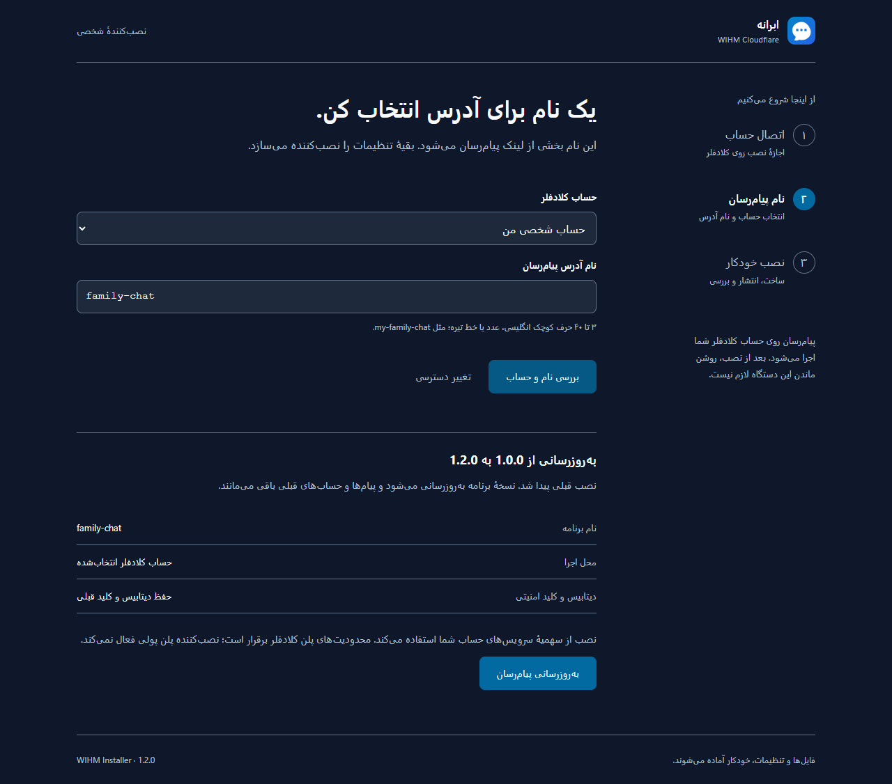

<div dir="rtl">

# نصب آسان ابرانه

نصب‌کننده، دیتابیس، جدول‌ها، کلید امنیتی و انتشار پیام‌رسان را خودش انجام می‌دهد. فایل تنظیمات را ویرایش نمی‌کنید و Git، npm یا Wrangler هم لازم ندارید. مراحل نصب در یک صفحهٔ فارسی در مرورگر انجام می‌شود.

این روش برای **Windows 10/11، macOS، لینوکس و اندروید با ترموکس** آماده شده است. رایانه‌های x64 و ARM64 پشتیبانی می‌شوند؛ لینوکس به محیط سازگار با Node.js رسمی نیاز دارد، مثل Ubuntu 22.04 یا جدیدتر. نسخهٔ ترموکس از Node.js خود ترموکس استفاده می‌کند. iPhone و iPad نمی‌توانند این نصب‌کنندهٔ محلی را اجرا کنند؛ پس از نصب با یکی از دستگاه‌های بالا، خود پیام‌رسان در مرورگر آن‌ها قابل استفاده است.



## ۱. نصب‌کننده را باز کنید

### ویندوز

1. [آخرین بستهٔ نصب‌کننده](https://github.com/DarkPoesidon/WIHM-Cloudflare/releases/latest/download/wihm-installer.zip) را دانلود کنید. برای نصب قبلی، [راهنمای آپدیت](UPDATE.fa.md) را بخوانید.
2. روی فایل ZIP راست‌کلیک کنید و **Extract All** را بزنید. نصب‌کننده را از داخل ZIP اجرا نکنید.
3. پوشهٔ `WIHM-Installer` را باز کنید و روی **Start-Windows.cmd** دوبار کلیک کنید. نمایش پسوند فایل‌ها ممکن است در ویندوز خاموش باشد؛ در این حالت نام فایل `Start-Windows` است.
4. منتظر بمانید تا صفحهٔ فارسی در مرورگر باز شود. اگر Node.js لازم باشد، از سایت رسمی آن دریافت می‌شود؛ نیازی به نصب دستی یا دسترسی Administrator نیست.
5. پنجرهٔ سیاه را تا پایان نصب باز نگه دارید.

اگر مرورگر یا ویندوز فایل را به‌دلیل ناشناخته‌بودن مسدود کرد، ابتدا مطمئن شوید بسته را از همین مخزن گرفته‌اید. این بسته امضای تجاری ویندوز ندارد. راه جایگزین، اجرای دستور زیر در PowerShell است؛ نتیجه همان نصب‌کننده است:

<div dir="ltr">

```powershell
$setup = Join-Path $env:TEMP 'wihm-install.ps1'; Invoke-WebRequest 'https://raw.githubusercontent.com/DarkPoesidon/WIHM-Cloudflare/main/installer/install.ps1' -OutFile $setup; powershell -NoProfile -ExecutionPolicy Bypass -File $setup
```

</div>

### اندروید؛ فقط با گوشی

1. **Termux** را از [F-Droid](https://f-droid.org/packages/com.termux/) یا [منبع رسمی ترموکس](https://github.com/termux/termux-app#installation) دریافت و نصب کنید. این راهنما برای نسخهٔ استاندارد F-Droid/GitHub و Android 7 یا جدیدتر است.
2. ترموکس را باز کنید و صبر کنید آماده شود.
3. دستور زیر را کامل کپی کنید، روی صفحهٔ ترموکس نگه دارید، **Paste** را بزنید و سپس Enter:

<div dir="ltr">

```bash
apt-get update && apt-get -y -o Dpkg::Options::=--force-confold dist-upgrade && apt-get install -y curl && curl -fsSL https://raw.githubusercontent.com/DarkPoesidon/WIHM-Cloudflare/main/installer/install.sh -o "$HOME/wihm-install.sh" && bash "$HOME/wihm-install.sh"
```

</div>

4. ابتدا بسته‌های ترموکس با هم به‌روز می‌شوند تا ابزار دریافت فایل و کتابخانه‌های آن ناسازگار نشوند؛ تنظیمات موجود حفظ می‌شوند. سپس ابزارهای لازم خودکار نصب می‌شوند و صفحهٔ فارسی در مرورگر گوشی باز می‌شود. نصب به روت، رایانه یا ویرایش فایل نیاز ندارد. بار اول ممکن است چند دقیقه طول بکشد؛ تا پایان کار صبر کنید.
5. اگر مرورگر باز نشد، لینک `http://127.0.0.1:.../#...` را که ترموکس نشان می‌دهد **کامل** کپی و در مرورگر باز کنید؛ قسمت بعد از `#` هم لازم است.
6. ترموکس را نبندید و **Force stop** نکنید. هنگام رفتن به مرورگر، آن را در پس‌زمینه نگه دارید. اگر گوشی فرایند را بست، همان دستور را دوباره اجرا کنید و همان نام قبلی پیام‌رسان را وارد کنید.

### مک و لینوکس

1. Terminal را باز کنید.
2. دستور زیر را کامل کپی کنید و Enter بزنید:

<div dir="ltr">

```bash
curl -fsSL https://raw.githubusercontent.com/DarkPoesidon/WIHM-Cloudflare/main/installer/install.sh -o /tmp/wihm-install.sh && bash /tmp/wihm-install.sh
```

</div>

3. نصب‌کننده و در صورت نیاز Node.js از منابع رسمی دریافت می‌شوند. صفحهٔ فارسی باز می‌شود؛ Terminal را نبندید.
4. اگر مرورگر باز نشد، لینک کامل نمایش‌داده‌شده را در مرورگر همان دستگاه باز کنید.

روی لینوکس اگر دستور `curl` پیدا نشد، در Ubuntu/Debian یک بار `sudo apt install curl ca-certificates` را اجرا کنید و دوباره دستور بالا را بزنید. بسته‌های رسمی Node.js روی بعضی توزیع‌ها مثل Alpine یا لینوکس‌های خیلی قدیمی قابل اجرا نیستند؛ روی آن‌ها ابتدا Node.js 22 یا جدیدتر را از مخزن همان سیستم نصب کنید.

## ۲. حساب کلادفلر را متصل کنید

این تنها بخش نصب است که اجازهٔ خود شما را لازم دارد. نصب‌کننده رمز حساب را نمی‌خواهد. مراحل زیر در خود صفحهٔ نصب هم نمایش داده می‌شوند.

1. در صفحهٔ نصب، **ساخت کد دسترسی** را بزنید.
2. وارد حساب شوید؛ اگر حساب ندارید، یک حساب رایگان بسازید و ایمیل خود را تأیید کنید.
3. فرم ساخت توکن با نام و مجوزهای لازم از قبل آماده می‌شود. در **Account Resources**، مقدار **Include → Specific account** و حساب خودتان را انتخاب کنید.
4. **Continue to summary** و سپس **Create Token** را بزنید.
5. کد را کپی کنید؛ به نصب‌کننده برگردید، در **کد دسترسی کلادفلر** بچسبانید و **اتصال حساب** را بزنید.

اگر پس از ورود به حساب، فرم آماده نمایش داده نشد، به نصب‌کننده برگردید و دوباره **ساخت کد دسترسی** را بزنید. این لینک از [قالب رسمی توکن کلادفلر](https://developers.cloudflare.com/fundamentals/api/how-to/account-owned-token-template/) استفاده می‌کند و تأیید نهایی با صاحب حساب است.

<details>
<summary>فقط اگر فرم آماده باز نشد: ساخت دستی توکن</summary>

1. [صفحهٔ API Tokens](https://dash.cloudflare.com/profile/api-tokens) را باز کنید.
2. **Create Token** و سپس **Create Custom Token** را انتخاب کنید.
3. نام توکن را `WIHM Installer` بگذارید و در قسمت **Permissions** این سه ردیف را اضافه کنید:

| دسته | نام مجوز | دسترسی |
| --- | --- | --- |
| Account | Account Settings | Read |
| Account | Workers Scripts | Edit |
| Account | D1 | Edit |

4. در **Account Resources**، مقدار **Include → Specific account** و حساب خودتان را انتخاب کنید.
5. **Continue to summary** و سپس **Create Token** را بزنید.
6. کد نمایش‌داده‌شده را کپی کنید؛ به صفحهٔ نصب برگردید و در **کد دسترسی کلادفلر** بچسبانید.
7. **اتصال حساب** را بزنید. اگر مجوز کافی نباشد، نصب‌کننده پیام خطا نشان می‌دهد.

</details>

توکن فقط در حافظهٔ نصب‌کننده نگه داشته می‌شود. نصب‌کننده آن را برای کلادفلر می‌فرستد و در فایل یا مخزن ذخیره نمی‌کند. لینک محلی مخصوص همین دستگاه است؛ آن را برای دیگران نفرستید. می‌توانید پس از پایان کار، توکن را در کلادفلر حذف کنید؛ اجرای پیام‌رسان به آن وابسته نیست.

## ۳. نام را انتخاب کنید و نصب را بزنید

1. حساب کلادفلر خود را از فهرست انتخاب کنید.
2. یک نام انگلیسی کوتاه مثل `my-family-chat` انتخاب کنید. نام بین ۳ تا ۴۰ کاراکتر، با حرف کوچک انگلیسی در ابتدا و شامل حرف کوچک، عدد یا خط تیره باشد؛ در انتها خط تیره نگذارید.
3. **بررسی نام و حساب** را بزنید.
4. خلاصه را بخوانید و **نصب پیام‌رسان** را بزنید. اگر با همین نصب‌کننده قبلاً نصب کرده باشید، دکمهٔ **به‌روزرسانی پیام‌رسان** نمایش داده می‌شود.
5. منتظر بمانید همهٔ مراحل انجام شود. فایل‌ها، آدرس، دیتابیس، جدول‌ها و کلید امنیتی خودکار آماده می‌شوند.
6. پس از نمایش **نصب تمام شد**، **باز کردن پیام‌رسان** را بزنید.
7. در خود پیام‌رسان **ثبت‌نام** کنید؛ این حساب با حساب کلادفلر متفاوت است. نصب‌کننده رمز پیش‌فرض یا حساب مدیر آماده نمی‌سازد.
8. در صفحهٔ پایان نصب، **کپی کد مدیریت** را بزنید. این کد فقط برای صاحب سرویس است؛ آن را برای دیگران نفرستید.
9. در پیام‌رسان با حساب خودتان، **منوی اصلی ← تنظیمات ← مدیریت سرویس** را باز، کد را وارد و **فعال‌سازی مدیریت این حساب** را بزنید. حالا وضعیت ثبت‌نام و گزارش‌ها را مدیریت می‌کنید. در ارتقا اگر مدیر قبلاً تعیین شده نیازی به تکرار نیست.
10. **کپی لینک** را در نصب‌کننده بزنید و لینک عادی برنامه را برای دوستانتان بفرستید. ثبت‌نام در ابتدا آزاد است؛ اگر از مدیریت، حالت دعوتی را انتخاب کردید باید برای ساخت حساب به آن‌ها دعوت‌نامهٔ ثبت‌نام بدهید.
11. برای نگه‌داشتن لینک و مشخصات نصب، **ذخیرهٔ مشخصات** را بزنید. این فایل کد مدیریت و توکن کلادفلر را ذخیره نمی‌کند.
12. **پایان و بستن نصب‌کننده** را بزنید. بعد می‌توانید ترموکس یا Terminal را ببندید و دستگاه را خاموش کنید؛ پیام‌رسان روی کلادفلر اجرا می‌شود.

برای پاسخ، ویرایش، اعلان گوشی، مدیریت گروه و دعوت، [راهنمای سادهٔ امکانات](DAILY-USE.fa.md) را بخوانید.

کلادفلر برای حساب‌های تازه ممکن است تأیید ایمیل یا پذیرش شرایط Workers را بخواهد. این اجازه را باید خود صاحب حساب بدهد. نصب‌کننده پلن پولی فعال نمی‌کند؛ مصرف، سهمیه‌ها و هزینه‌های احتمالی تابع پلن حساب شما هستند.

## اگر نصب قطع شد

- **اینترنت قطع شد یا کلادفلر پاسخ نداد:** اینترنت را وصل کنید و **تلاش دوباره** را بزنید. اگر نصب‌کننده بسته شده، دوباره بازش کنید و همان حساب و همان نام را انتخاب کنید.
- **دسترسی کافی نیست:** مجوزهای سه‌گانه و حساب انتخاب‌شده هنگام ساخت توکن را بررسی کنید. دکمهٔ **اصلاح تنظیمات** و سپس **تغییر دسترسی** اجازه می‌دهد توکن تازه وارد کنید.
- **برنامه یا دیتابیس هم‌نام وجود دارد:** برای جلوگیری از تغییر برنامه‌های دیگر، نصب متوقف می‌شود. نام دیگری انتخاب کنید. این نسخه برنامه‌هایی را که قبلاً دستی نصب شده‌اند خودکار به‌روزرسانی نمی‌کند.
- **منتشر شد؛ بررسی اتصال باقی ماند:** کلادفلر انتشار را تأیید کرده، اما نصب‌کننده هنوز پاسخ سالم از لینک نگرفته است. کمی صبر کنید؛ لینک را با اینترنت دیگر باز کنید. بعضی شبکه‌ها `workers.dev` را مسدود می‌کنند. انتشار موفق، تضمین دسترسی همهٔ شبکه‌ها نیست.
- **ترموکس بسته شد:** دوباره اجرا کنید و همان نام را بزنید. در تنظیمات گوشی، محدودیت باتری ترموکس را بردارید و هنگام نصب برنامه را در پس‌زمینه نگه دارید.
- **خطای دریافت فایل:** دسترسی اینترنت به GitHub، nodejs.org و Cloudflare را بررسی کنید. نصب‌کننده صحت فایل بسته و Node.js را با SHA-256 بررسی می‌کند؛ فایل ناقص را اجرا نمی‌کند.

در نصب دوباره، کلید امنیتی و دیتابیس نصب قبلی حفظ می‌شوند. جدول‌ها با دستورهای بدون حذف اطلاعات ایجاد می‌شوند. اگر دیتابیس نصب قبلی حذف شده باشد یا برنامهٔ موجود متعلق به این نصب‌کننده نباشد، ادامه داده نمی‌شود. هیچ گزینهٔ پاک‌کردن پیام‌ها در نصب‌کننده وجود ندارد.

## برای توسعه‌دهندگان

<div dir="ltr">

```bash
npm ci
npm run installer:build
npm run installer:start
```

</div>

خروجی در `dist/WIHM-Installer` ساخته می‌شود. Node.js 22 یا جدیدتر برای اجرای بسته کافی است؛ کاربر نهایی به `node_modules`، Wrangler، workerd یا ابزار کامپایل نیاز ندارد. این تفاوت به اجرای همان نصب‌کننده روی ترموکس کمک می‌کند. اطلاعات غیرمحرمانهٔ نصب برای بازیابی مرحلهٔ نیمه‌تمام در پوشهٔ خانگی کاربر، مسیر `.wihm-cloudflare/installations` نگه داشته می‌شود.

منابع فنی: [بارگذاری مستقیم فایل‌های Cloudflare](https://developers.cloudflare.com/workers/static-assets/direct-upload/)، [انتشار Worker](https://developers.cloudflare.com/api/resources/workers/subresources/scripts/methods/update/)، [نصب ترموکس](https://github.com/termux/termux-app#installation).

</div>
