# Owner's guide: building your Abraneh messenger from scratch

This guide is for someone who wants a private messenger for themselves, their family, friends or group. **No technical knowledge is needed.** It walks through everything in order, from creating a Cloudflare account to sending the link to your friends and keeping the server up to date.

If someone else built the server and you only received a link, this guide is not for you. Read the [user guide](GUIDE-USER.en.md).

*[نسخهٔ فارسی](GUIDE-ADMIN.fa.md)*

## What you will have at the end

- A private messenger that runs on **your own Cloudflare account**, at a link like `https://my-family-chat.my-family-chat-1a2b3c4d.workers.dev`
- An admin account inside the messenger, used to control sign-ups, create invitations and update the server
- The Abraneh app on your own phone or computer
- An invitation link for your friends

| | |
| --- | --- |
| **Time** | About 30 to 45 minutes the first time |
| **Cost** | Free. A free Cloudflare account is enough for a family or a small group. The installer never turns on a paid plan |
| **Device** | A Windows, Mac or Linux computer, **or** just an Android phone. An iPhone cannot build the server, but works perfectly for using it |
| **Not needed** | A server or hosting, a domain, programming, a bank card |
| **Needed** | An email address you can open, and an internet connection that reaches Cloudflare and GitHub |

After installation, **your computer or phone does not need to stay on.** The messenger runs on Cloudflare, not on your device.

> **About the installer's language:** the installer's own page is in Persian. This guide gives each Persian button label together with its meaning, so you can follow it without reading Persian. The messenger itself has an English option.

## Contents

1. [A few words to know](#words)
2. [If you are in Iran, read this first](#iran)
3. [Step 1: Create a Cloudflare account](#step-1)
4. [Step 2: Download and open the installer](#step-2)
5. [Step 3: Create an access token in Cloudflare](#step-3)
6. [Step 4: Choose a name and install](#step-4)
7. [Step 5: Keep the link and the admin code](#step-5)
8. [Step 6: Create your account and become admin](#step-6)
9. [Step 7: Install the app on your own device](#step-7)
10. [Step 8: Invite your friends](#step-8)
11. [Everyday admin tasks](#manage)
12. [Updating the server and the apps](#update)
13. [Backups](#backup)
14. [Your own domain (optional)](#domain)
15. [Free plan limits](#limits)
16. [Security checklist](#security)
17. [If something goes wrong](#problems)
18. [Common questions](#faq)

<a id="words"></a>

## 1. A few words to know

Do not mix these up. Most people who get stuck mix up two of them.

| Name | What is it? | Who needs it? |
| --- | --- | --- |
| **Cloudflare** | The company whose computers run your messenger | — |
| **Cloudflare account** | The email and password you use on the Cloudflare website | Only you |
| **Installer** | A small program that builds the messenger on your Cloudflare account. You need it once | Only you |
| **Access token (API Token)** | A long code that lets the installer work on your Cloudflare account | Only you. **Never give it to anyone** |
| **Messenger link** | The address that starts with `https://` and ends with `workers.dev`. Everyone uses it | Everyone |
| **Messenger account** | The username and password you create inside Abraneh. Different from the Cloudflare account | You and every user |
| **Admin code** | A code shown at the end of installation that makes your messenger account the admin | Only you. **Never give it to anyone** |
| **Invitation link** | A link you create so one person can make an account | The person you invite |

> **About privacy:** as the server owner you technically have access to the messenger's database. Normal chats and groups are not end-to-end encrypted. Only "secure chats" are. Tell your users this honestly.

<a id="iran"></a>

## 2. If you are in Iran, read this first

Some of the websites this guide uses are sometimes blocked on Iranian internet. The situation keeps changing, so treat this as general advice.

**While building the server (once):**

- **Cloudflare sign-up and sign-in:** if `dash.cloudflare.com` does not open or fails halfway, turn on a VPN for this step.
- **Downloading from GitHub:** if the installer download from `github.com` does not start or stops, try again with a VPN or another connection.
- **Termux on Android:** downloading from F-Droid may also need a VPN.
- A VPN does not cause problems during installation. If installation stops with a connection error, run it again with the same name. Nothing breaks.

**Day to day:**

- `workers.dev` addresses are blocked on some Iranian connections and open on others. **Before inviting people, test the link on mobile data and on home internet, without a VPN.**
- If the link does not open without a VPN, there are two ways around it:
  1. **Your own domain:** buy a domain and connect it. This is the most stable option. See [your own domain](#domain).
  2. **A proxy in the apps:** the Android and Windows apps have a proxy setting, so users can route only Abraneh through a proxy. See the [user guide](GUIDE-USER.en.md#proxy).
- The messenger needs international internet. It does not work on a fully domestic network.

<a id="step-1"></a>

## 3. Step 1: Create a Cloudflare account

If you already have a Cloudflare account, skip to [step 2](#step-2).

1. Open the [Cloudflare sign-up page](https://dash.cloudflare.com/sign-up).

2. Type your email in **Email**. Use an address you can really open, because Cloudflare sends a message to it.

3. Type a strong password in **Password**: at least 12 characters, with upper and lower case letters, numbers and symbols. Write it down somewhere safe.

4. If you see "Verify you are human" or an "I'm not a robot" box, complete it yourself.

5. Click **Sign up**.

6. Open your email. There is a message from Cloudflare with a title like "Verify your email address". If it is not in the inbox, check **Spam** or **Promotions**. Click the link or button in it.

7. You return to Cloudflare. It may suggest things like "Add a domain", "Add a site", buying a domain or choosing a plan. **None of these are needed.** The Free plan is enough. If it asks what you want to do, pick anything or skip until you reach the main page (the Dashboard).

8. **(Recommended)** Turn on two-factor authentication for the Cloudflare account: click the account icon at the top, open **Profile**, then **Authentication**, and enable **Two-Factor Authentication**. All of the messenger's data lives in this account, so it should be well protected.

**Result:** you can sign in to the Cloudflare dashboard. Cloudflare's pages change from time to time. If a button looks slightly different, don't worry.

> Leave the Cloudflare website here. Nothing else needs to be done on it. The installer does the rest.

<a id="step-2"></a>

## 4. Step 2: Download and open the installer

Read only the part for your device: [Windows](#windows) · [Android](#android) · [Mac and Linux](#mac-linux)

<a id="windows"></a>

### Windows 10 and 11

1. Click this link to download the file: **[wihm-installer.zip](https://github.com/DarkPoesidon/Abraneh/releases/latest/download/wihm-installer.zip)**

> If you open the [latest release page](https://github.com/DarkPoesidon/Abraneh/releases/latest) yourself, take only `wihm-installer.zip`. **Source code**, the **APK** and **setup.exe** are not for this.

2. Open your **Downloads** folder. Press the Windows key and `E` together to open File Explorer, and choose **Downloads** on the left.

3. **Right-click** `wihm-installer.zip` and choose **Extract All…**, then click **Extract**.

> Do not run anything from inside the ZIP. Always extract it first.

4. A new folder opens. Go into **WIHM-Installer**.

5. **Double-click** **Start-Windows** (or `Start-Windows.cmd`).

6. Windows may show a blue "Windows protected your PC" window. Click **More info**, then **Run anyway**. The warning appears because the file has no commercial signature. Only use the file from the link above.

7. A **black window** opens. The first time, the installer downloads Node.js from its official website by itself. This can take a minute or two. You don't install anything by hand, and Administrator rights are not needed.

8. Shortly after, **the installer page opens in your browser**. Go to [step 3](#step-3).

> **Do not close the black window until you finish.** Closing it stops the installer.

<details>
<summary>If Start-Windows does not work</summary>

Open **PowerShell** from the Start menu, copy this whole line, right-click in PowerShell to paste it, and press Enter:

```powershell
$setup = Join-Path $env:TEMP 'wihm-install.ps1'; Invoke-WebRequest 'https://raw.githubusercontent.com/DarkPoesidon/Abraneh/main/installer/install.ps1' -OutFile $setup; powershell -NoProfile -ExecutionPolicy Bypass -File $setup
```

</details>

<a id="android"></a>

### Android (phone only, no computer)

No root is needed. This works on Android 7 and later.

1. Download **Termux** from the [Termux page on F-Droid](https://f-droid.org/packages/com.termux/). Scroll down and, under **Packages**, tap **Download APK** for the first version.

> The Termux in Google Play is outdated and does not work. Use F-Droid only.

2. Open the downloaded file. If the phone says installing from this source is not allowed, tap **Settings**, turn on **Allow from this source**, go back and tap **Install**.

3. Open Termux and wait until it is ready and shows a `$`.

4. Copy this **whole** command:

```bash
apt-get update && apt-get -y -o Dpkg::Options::=--force-confold dist-upgrade && apt-get install -y curl && curl -fsSL https://raw.githubusercontent.com/DarkPoesidon/Abraneh/main/installer/install.sh -o "$HOME/wihm-install.sh" && bash "$HOME/wihm-install.sh"
```

5. In Termux, hold your finger on the screen, tap **Paste**, then press Enter on the keyboard.

6. Wait a few minutes. If Termux asks a question ending in `[Y/n]`, type `y` and press Enter.

7. The installer page opens in the phone's browser. If it does not, find the link starting with `http://127.0.0.1:` in Termux, copy it **completely** and paste it into the browser. Go to [step 3](#step-3).

> Do not close Termux until installation ends. If the phone closes it, run the same command again and enter **the same name** in the installer. Nothing is lost.

<a id="mac-linux"></a>

### Mac and Linux

1. Open **Terminal**. On a Mac: press `Command` and `Space`, type `Terminal` and press Enter.

2. Copy this command, paste it into Terminal and press Enter:

```bash
curl -fsSL https://raw.githubusercontent.com/DarkPoesidon/Abraneh/main/installer/install.sh -o /tmp/wihm-install.sh && bash /tmp/wihm-install.sh
```

3. The installer page opens in your browser. Keep Terminal open until you finish.

<a id="step-3"></a>

## 5. Step 3: Create an access token in Cloudflare

To build the messenger on your Cloudflare account, the installer needs permission. That permission is called an **access token** or **API Token**. You never give the installer your Cloudflare password.

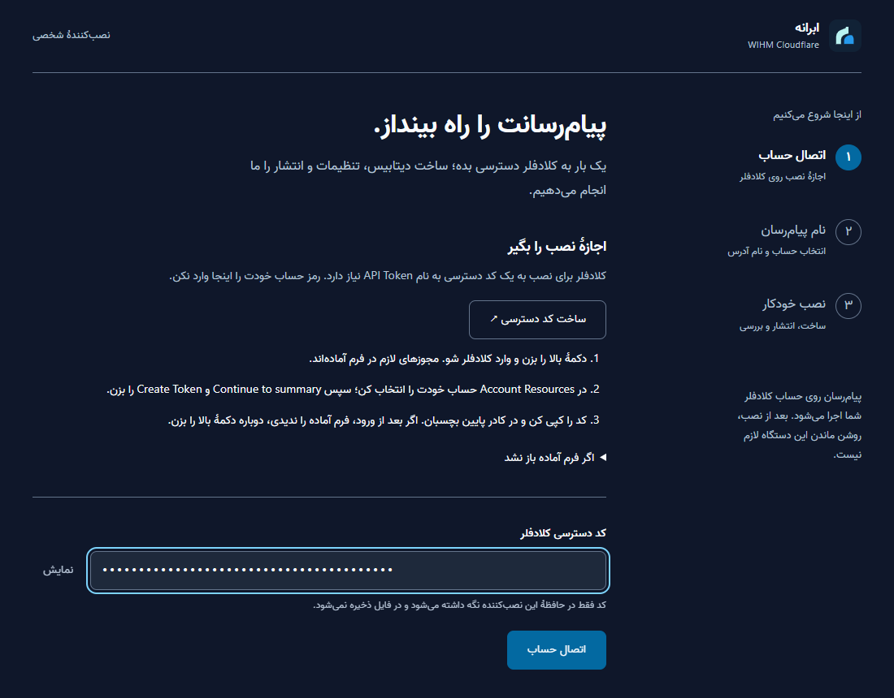

1. On the installer page, click **ساخت کد دسترسی ↗** ("Create access token"). A new browser tab opens on Cloudflare.

2. If Cloudflare asks, sign in with your Cloudflare email and password. If you land on another page after signing in, return to the installer and click the button again.

3. You see a page for creating a token, with three permissions already filled in. You don't need to change them.

4. Further down, find **Account Resources**. Set the first box to **Include**, the second to **Specific account**, and the third to your account (usually your email followed by "'s Account").

5. Click **Continue to summary** at the bottom, then **Create Token** on the next page.

6. Cloudflare shows a long code. Click **Copy** next to it.

> Cloudflare shows this code **only once**. If you closed the page before copying it, just create a new one.

7. Return to the installer tab. Paste the code into the box labelled **کد دسترسی کلادفلر** ("Cloudflare access token") and click **اتصال حساب** ("Connect account").

> Never send this code to anyone, post it in a group or screenshot it. Whoever has it can work on your Cloudflare account.

<details>
<summary>If the ready-made form does not open and you don't see three permissions</summary>

1. Open the [Cloudflare API Tokens page](https://dash.cloudflare.com/profile/api-tokens).

2. Click **Create Token**. At the bottom, next to **Create Custom Token**, click **Get started**.

3. In **Token name**, type `WIHM Installer`.

4. Under **Permissions**, create these three rows. Click **+ Add more** for the second and third:

| First box | Second box | Third box |
| --- | --- | --- |
| Account | Account Settings | Read |
| Account | Workers Scripts | Edit |
| Account | D1 | Edit |

5. Continue from item 4 above (Account Resources).

</details>

<a id="step-4"></a>

## 6. Step 4: Choose a name and install

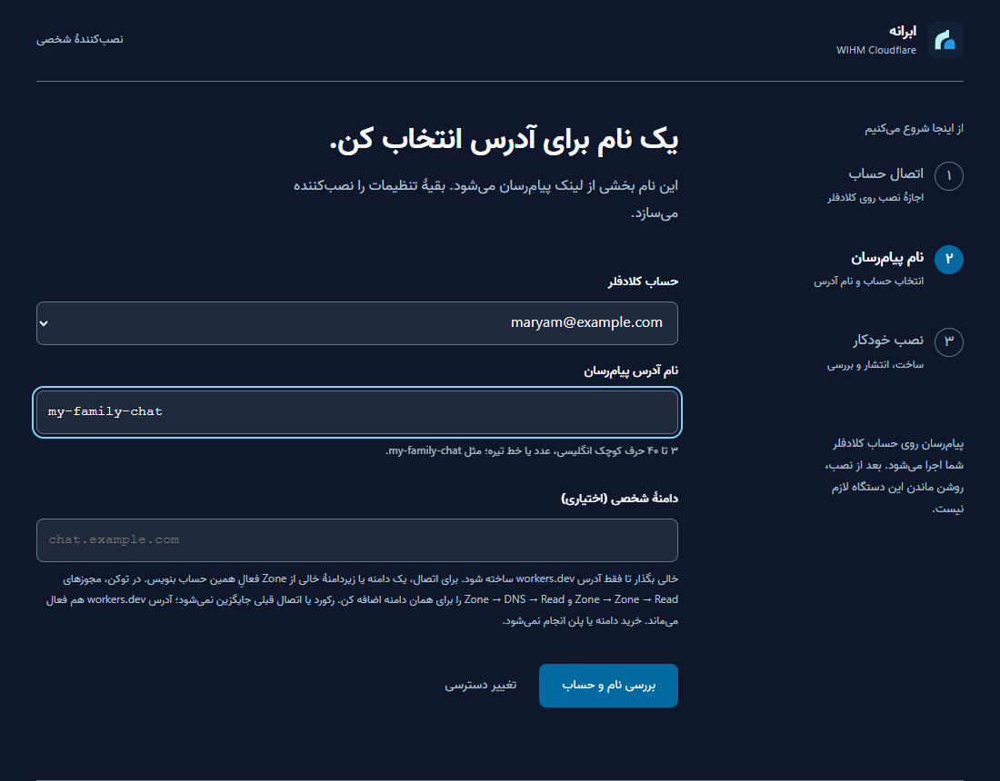

1. Under **حساب کلادفلر** ("Cloudflare account"), choose your account. If you have only one, it is already selected.

2. Under **نام آدرس پیام‌رسان** ("Messenger address name"), type a short English name, like `my-family-chat` or `ali-friends`.
   - **Lowercase** English letters, numbers and hyphens (`-`) only
   - 3 to 40 characters, starting with a letter
   - The name becomes part of the messenger's link. Don't use your full name, phone number or anything sensitive
   - **Write this name down.** You need exactly this name again to update or repair the messenger

3. Leave **دامنهٔ شخصی (اختیاری)** ("Custom domain, optional") **empty**. You can add a domain later.

4. Click **بررسی نام و حساب** ("Check name and account").

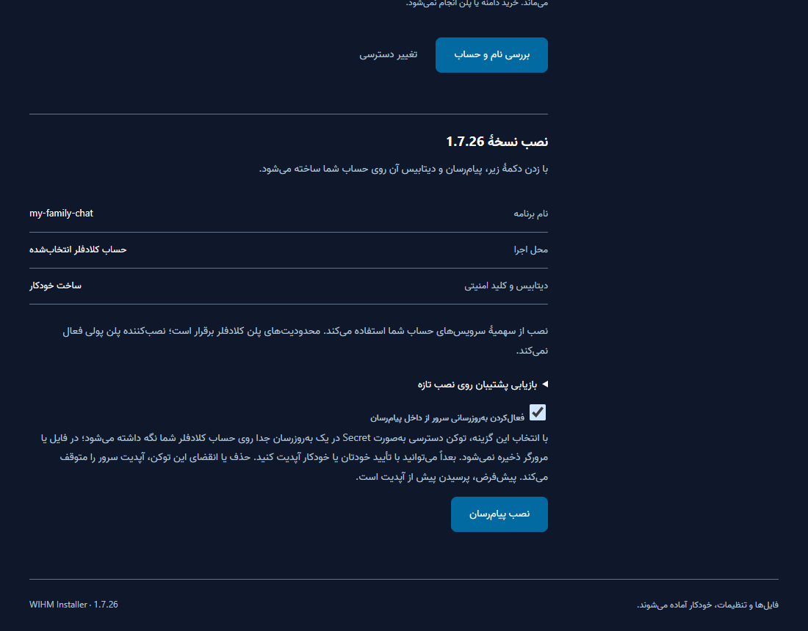

5. You see a summary. **Tick** **فعال‌کردن به‌روزرسانی سرور از داخل پیام‌رسان** ("Enable server updates from inside the messenger"). With it, you install future versions with one button inside the messenger and never need the installer again.

> With this option, your access token is kept encrypted on your own Cloudflare account. **Don't delete that token on Cloudflare later**, or in-app updates stop working.

6. Don't open **بازیابی پشتیبان روی نصب تازه** ("Restore a backup onto a new install"). It is only for moving an old messenger.

7. Click **نصب پیام‌رسان** ("Install messenger").

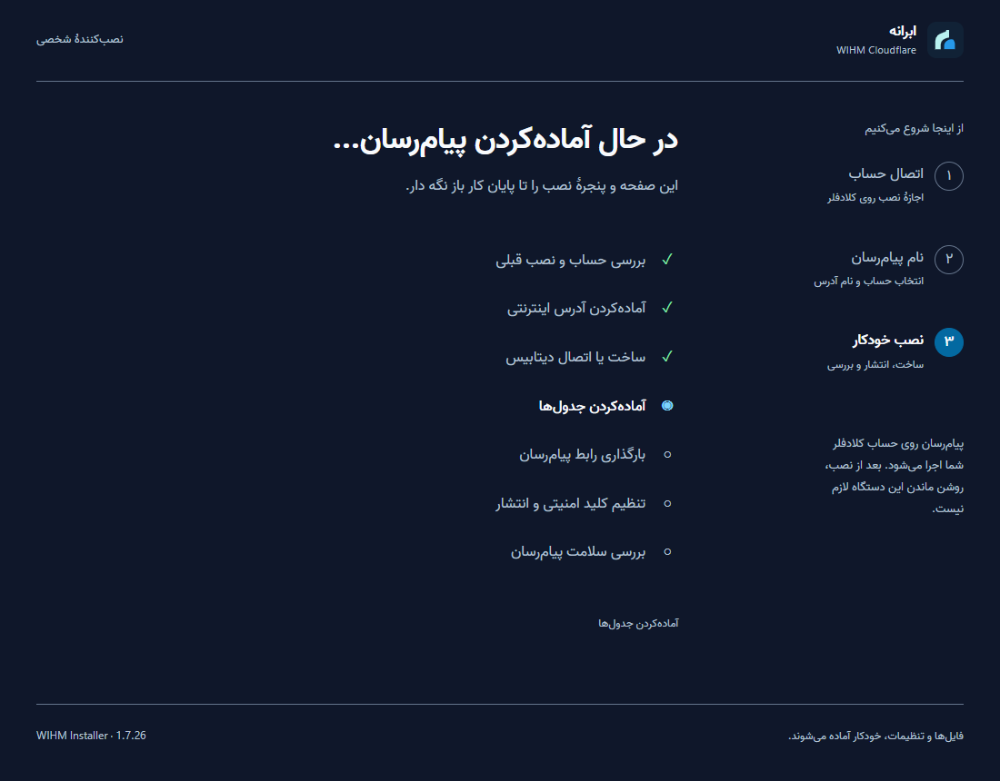

8. The installer goes through seven steps and ticks each one. It usually takes a minute or two. **Don't close this page or the black window (or Termux).**

If a step turns red, read its message. Usually you fix what it says and click **تلاش دوباره** ("Try again"). Everything already created is kept. See also [if something goes wrong](#problems).

<a id="step-5"></a>

## 7. Step 5: Keep the link and the admin code

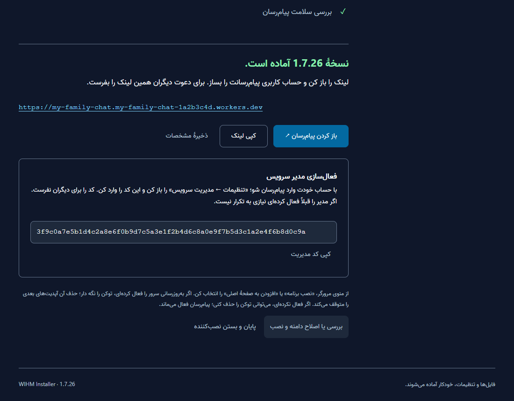

Installation is done. The link and code in the picture are only examples. The final page has two important things:

**A) The messenger link**, like `https://my-family-chat.my-family-chat-1a2b3c4d.workers.dev`

1. Click **کپی لینک** ("Copy link") and keep the link somewhere safe, for example in a note.

2. Click **ذخیرهٔ مشخصات** ("Save details"). A small text file with the link, name and account is downloaded. Keep it.

**B) The admin code**, a long code in the box **فعال‌سازی مدیر سرویس** ("Activate the service admin")

3. Click **کپی کد مدیریت** ("Copy admin code"). You need it until the end of the next step. It is **not** saved in the details file.

4. Click **باز کردن پیام‌رسان ↗** ("Open messenger"). The messenger opens in a new tab. **Don't close the installer yet.**

> **Don't confuse the two links:** a link starting with `http://127.0.0.1:` is only the installer page on your own device and works for nobody else. The right link starts with `https://` and ends with `workers.dev`.

<a id="step-6"></a>

## 8. Step 6: Create your account and become admin

A new messenger has no users at all, not even you. First you register, then you use the admin code to make your account the admin.

**Create your account:**

1. On the messenger page, click **English** if you prefer English.

2. Click the **Register** tab.

3. Fill in three boxes:
   - **Display name:** the name others see, like "Maryam"
   - **Username:** English letters, numbers and `_` only, 3 to 20 characters, like `maryam`. Others find you by it
   - **Password:** at least 8 characters. **Don't lose it.** The admin's password cannot be recovered inside the app

4. Click **Create account**. You are signed in.

> This account is different from your Cloudflare account. Don't use your Cloudflare email and password here.

**Become admin:**

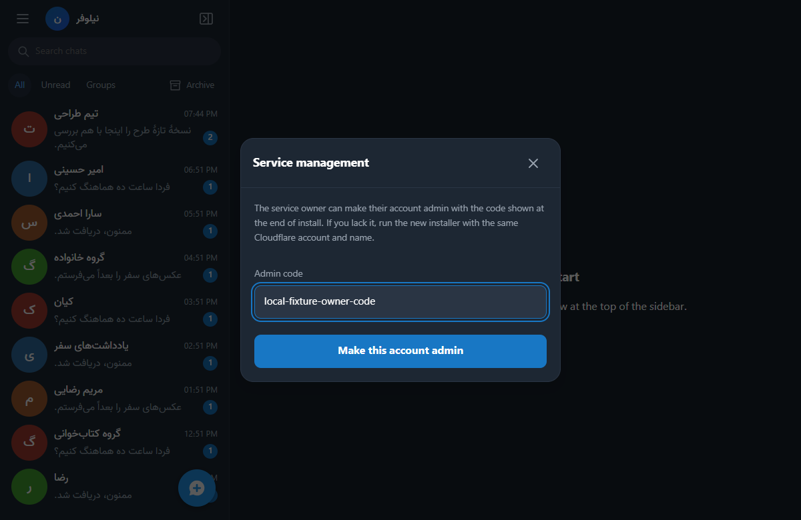

5. Open the main menu: on a phone, the three dots at the top; on a computer, the three lines above the chat list. Choose **Settings** and scroll down to **Service management**.

6. Paste the admin code into **Admin code** and click **Make this account admin**.

7. The main menu now shows **Admin panel**. You are the admin.

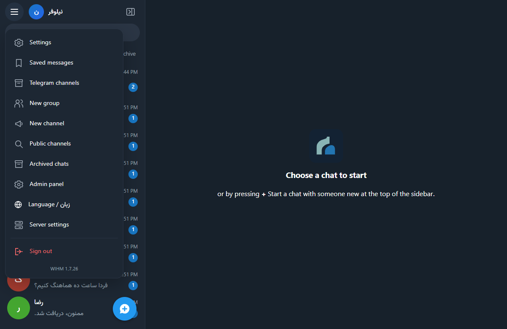

> The first person to register does **not** become admin automatically. If you skip this step, the messenger has no admin.

8. Return to the installer tab and click **پایان و بستن نصب‌کننده** ("Finish and close the installer"). Now close the black window or Termux too. **You can turn your computer off.** The messenger stays on at Cloudflare.

<a id="step-7"></a>

## 9. Step 7: Install the app on your own device

The messenger works in a browser, but the apps are more convenient and give better notifications. Every app is on the [latest release page](https://github.com/DarkPoesidon/Abraneh/releases/latest):

| Device | What to do |
| --- | --- |
| Android 5 and later | Install the [Android app](https://github.com/DarkPoesidon/Abraneh/releases/latest/download/wihm-messenger-android-universal.apk) and enter the messenger link in it |
| Windows 10 and 11 | Run the [Windows installer](https://github.com/DarkPoesidon/Abraneh/releases/latest/download/wihm-messenger-windows-setup.exe) and enter the messenger link |
| iPhone and iPad | Open the link in Safari and tap **Add to Home Screen** |
| Mac and other browsers | Open the link in Chrome or Edge and install it from the address bar |

Step-by-step instructions for each device are in the [user guide's installation section](GUIDE-USER.en.md#install). Sign in with the username and password from step 6.

<a id="step-8"></a>

## 10. Step 8: Invite your friends

### First decide who can join

A new messenger has **open registration**: anyone with the link can create an account. For a private group, switch to **invitation only**.

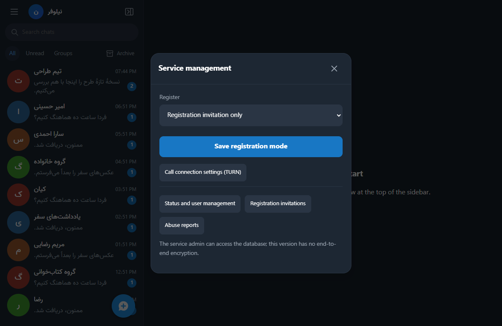

1. Open **Main menu → Settings → Service management**.

2. In **Register**, choose one:

| Option | Meaning |
| --- | --- |
| **Open; anyone can create an account** | Anyone with the messenger link can register |
| **Registration invitation only** | Only someone you give an invitation link to can register. **Recommended** |
| **Closed; existing accounts only** | No new accounts at all |

3. Click **Save registration mode**.

### Create an invitation link

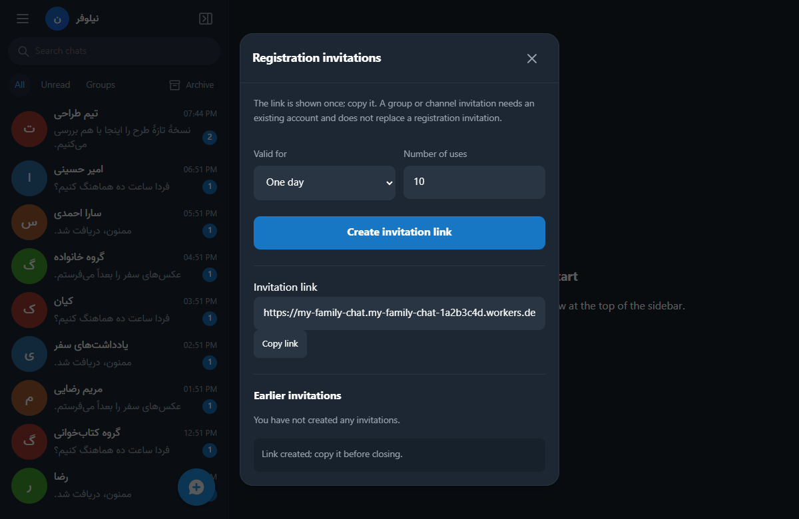

4. On the same page, click **Registration invitations**.

5. Under **Valid for**, choose one hour, one day or one week. Under **Number of uses**, enter how many people can register with this link: `1` for one person, `10` for the whole family.

6. Click **Create invitation link**, then immediately **Copy link**.

> The invitation link is shown **only once**. If you closed the window before copying it, create a new one.

An invitation link looks like `https://my-family-chat....workers.dev/#register=...`. The part after `#register=` is the invitation key. Always send the whole link.

### Send the link to your friend

7. Send the link over a channel you trust, such as a messaging app or SMS. You can copy this text and replace the links:

> Hi! For our family messenger, please:
>
> 1. Open this link in your phone's browser and create an account: **[invitation link]**
>
> 2. Then install the app. Android: https://github.com/DarkPoesidon/Abraneh/releases/latest/download/wihm-messenger-android-universal.apk
>
> 3. When the app asks for the server address, enter: **[messenger link, without the #register part]**
>
> Guide: https://github.com/DarkPoesidon/Abraneh/blob/main/docs/GUIDE-USER.en.md

> **Why the browser first?** The apps only take the server address and don't keep the invitation key. So people register with the invitation link in a browser, then sign in to the app with the same username and password.

8. When your friend has an account, ask for their username. In the messenger, tap the blue **New chat** button, search for the username and send a message.

### Inviting to a group or channel

A registration invitation is different from a group invitation. For a group or channel, tap its name at the top of the chat and choose **Invitation links**. Group links end with `#join=` and only work for people who already have an account. They also open these links once in a browser; after that the group appears in their app too.

<a id="manage"></a>

## 11. Everyday admin tasks

### The admin panel

Open it from **Main menu → Admin panel**.

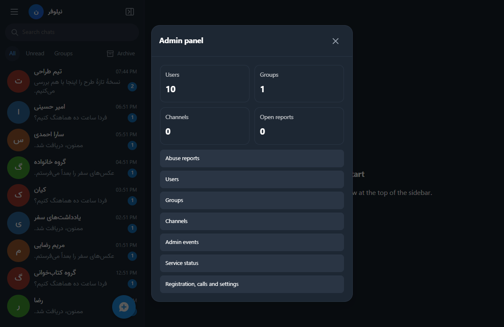

| Section | What it does |
| --- | --- |
| **Abuse reports** | Reports users made about messages or people. You can delete the message for everyone, disable the account or suspend the chat |
| **Users** | Search users, disable or re-enable accounts |
| **Groups** and **Channels** | Search, suspend or delete groups and channels |
| **Admin events** | What admins did recently |
| **Service status** | Version, database health and counts |
| **Registration, calls and settings** | The Service management page: registration mode, invitations and call settings |

### A user forgot their password

1. Open **Main menu → Settings → Service management → Status and user management**.

2. Find the user by username and click **Create password reset link**.

3. Give the link **only to that person**, over a safe channel. They open it and set a new password.

- The link works once, for one hour.
- All of that user's devices are signed out.
- If the user has two-step sign-in, it stays on.
- Whoever has the link can change that user's password, so never post it in a group.

> **The admin's own password cannot be reset this way, and a new admin code does not create another admin.** Keep your password safe and also create a passkey under **Settings → Passkeys and two-step sign-in**.

### An abusive user

- In **Admin panel → Users**, **disable** their account. All their devices are signed out at once and they can't sign in. You can re-enable it later.
- If registration is open, switch it to **invitation only**.

### Calls don't connect on some networks

Voice and video calls work on most connections without setup. If they fail on a particular network, use **Service management → Call connection settings (TURN)**. Details are in [advanced features](ADVANCED.fa.md#تماس-و-مصرف-سرویس) (Persian).

### Secure chats

The text of secure chats is not on the server. You can't read, recover or back it up. To report abuse in a secure chat, the recipient has to send you the text themselves.

<a id="update"></a>

## 12. Updating the server and the apps

Abraneh has three parts, each updated separately:

| Part | Who updates it? | Where? |
| --- | --- | --- |
| **The server** (on Cloudflare) | Only you, once for everyone | Inside the messenger: **Settings → Updates** |
| **The messenger page on each device** | Each user, on their own device | The same page, under **Messenger on this device** |
| **The Android or Windows app** | Each user | The app offers new versions itself |

Every version is published on one page: the [latest release page](https://github.com/DarkPoesidon/Abraneh/releases/latest). The server installer, the Android app and the Windows app are all there.

### Updating the server

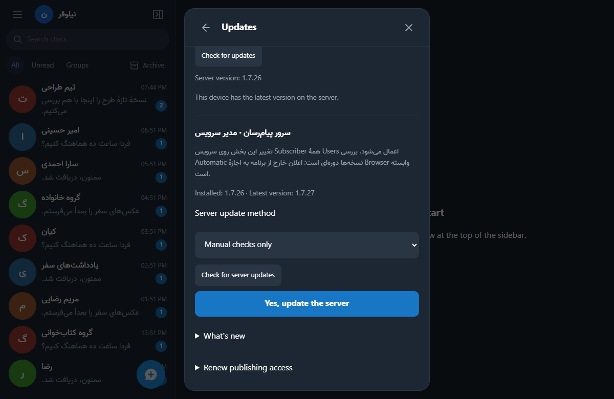

1. Open **Main menu → Settings → Updates** and scroll down to the server section (labelled **سرور پیام‌رسان · مدیر سرویس**, "Messenger server · service admin").

2. Click **Check for server updates**. If there is a new version, it appears next to **Latest version**.

3. To see what changed, open **What's new**.

4. Click **Yes, update the server** and confirm. Messages and accounts are kept. It takes a few minutes, and closing the page does not stop it.

**Server update method** has three options:

| Option | Meaning |
| --- | --- |
| **With my approval** | The server finds new versions and tells you. It installs only when you press the button |
| **Automatic** | The server installs new versions by itself |
| **Manual checks only** | It checks only when you press "Check for server updates" |

<details>
<summary>If it says server updates are not enabled yet</summary>

That means you didn't tick the in-app update option during installation, or you deleted the access token on Cloudflare.

1. Download the installer again as in [step 2](#step-2). Make sure you get the **new** version.

2. Create a new access token ([step 3](#step-3)).

3. Enter **the same account and exactly the same name**. The installer finds the existing installation and shows "update from … to …".

4. Tick **فعال‌کردن به‌روزرسانی سرور از داخل پیام‌رسان** and click **به‌روزرسانی پیام‌رسان** ("Update messenger").

> A new name builds a **separate, empty** messenger, and messages are not moved to it. Always use the same name.

</details>

### Updating the apps

After the server update, each user refreshes the messenger page on their device: **Settings → Updates → Check for updates**. The Android app checks for a new version every time it opens. The Windows app checks every few hours. Both show a window when one is available. [Details for users](GUIDE-USER.en.md#updates).

<a id="backup"></a>

## 13. Backups

A backup is one encrypted file with every account, group and normal message. If you ever lose the Cloudflare account or want to move the messenger to another account, this file brings everything back.

1. Open **Main menu → Settings → Service backup**.

2. In **Current admin password**, enter your messenger password. If you use two-step sign-in, enter its code too.

3. In **New file password; at least 12 characters**, enter a separate password and repeat it in **Repeat file password**.

4. Click **Start and download backup** and wait for the file to download. Meanwhile, sending messages is paused for everyone, and resumes by itself within 15 minutes at most. So take backups when nobody is in the middle of something important.

5. Keep the file somewhere safe, like a USB stick or personal cloud storage. **Write the file password down separately.** Without it, the file cannot be opened at all.

- Secure chats are not in the backup, because their text is not on the server.
- Take a backup once a month, or before anything important.
- Restoring is done with the installer, onto a new name. [Backup and restore details](ADVANCED.fa.md#پشتیبان-کامل-سرور-و-بازیابی) (Persian).

<a id="domain"></a>

## 14. Your own domain (optional)

With your own domain, the messenger link becomes shorter and more familiar, like `https://chat.example.com`. In Iran it is also usually more stable than `workers.dev`.

**You need:** a domain, like `example.com`, active in the same Cloudflare account (its status in the Cloudflare dashboard is **Active**).

**In short:**

1. Add the domain to Cloudflare (**Add a domain**) and wait until it is active.

2. When creating the access token, add two more permissions: **Zone → Zone → Read** and **Zone → DNS → Read**.

3. Run the installer with **the same account and name** and enter an unused subdomain, like `chat.example.com`, in the custom domain box.

The `workers.dev` link keeps working. Accounts are shared, but users must sign in once more on the new address. [Full custom domain guide](ADVANCED.fa.md#دامنه-شخصی) (Persian).

<a id="limits"></a>

## 15. Free plan limits

The free plan is enough for a family or a group of friends. The main limit is the database (D1): **100,000 rows written per day**. The allowance resets every day at 00:00 UTC.

- If the allowance runs out, **no messages or data are lost**, but the app stops working with "The service action failed" until it resets.
- See usage in the Cloudflare dashboard under **Storage & Databases → D1**.
- Keep the server updated. Newer versions write less.
- An open secure chat checks for new messages every 5 seconds. Left open all day, it uses about 17,000 rows.
- With many users, the paid **Workers Paid** plan has a much higher limit.

<a id="security"></a>

## 16. Security checklist

- [ ] Two-factor authentication is on for the Cloudflare account
- [ ] The admin's messenger password is written down somewhere safe, and the account also has a passkey or two-step sign-in (**Settings → Passkeys and two-step sign-in**)
- [ ] You never sent the access token or admin code to anyone, not even in a screenshot of an error
- [ ] Registration is **invitation only**, unless you really want open registration
- [ ] You have a recent backup, with its password kept separately
- [ ] You told users that normal chats are not end-to-end encrypted and that private matters belong in **secure chats**

<a id="problems"></a>

## 17. If something goes wrong

| Problem | What to do |
| --- | --- |
| Cloudflare or GitHub doesn't open | Turn on a VPN or try another connection. See [Iran](#iran) |
| The Cloudflare verification email didn't arrive | Check Spam and Promotions. Wait a few minutes. Use Cloudflare's Resend option |
| Windows says "Windows protected your PC" | Click **More info**, then **Run anyway** |
| The black window opened and closed and no page appeared | Make sure you extracted the ZIP. Otherwise try the PowerShell method in [Windows](#windows) |
| The installer page doesn't open or says its address is incomplete | Copy the **whole** `http://127.0.0.1:...` link that the installer window shows and open it in the browser. After restarting the installer, the old link no longer works |
| "Not enough permission" or a token error | Create a new token. Choose the right account under Account Resources and check the three permissions |
| "The Workers address was not activated", or Cloudflare wants email verification | Sign in to the Cloudflare dashboard, verify your email and open **Workers & Pages** once. Then click **Try again** |
| "A database with this name already exists" | Choose another name. The installer never touches a database that isn't the messenger's |
| Installation stopped halfway | Open the installer again and use **the same account and name**. Everything already created is kept |
| "Published; the connection check is pending" | The messenger exists, but your device hasn't reached it yet. Wait a few minutes and try the link on another connection or with a VPN |
| Others can't open the link | Make sure you sent the `https://...workers.dev` link, not `127.0.0.1`. If `workers.dev` is blocked on their connection, a [proxy](GUIDE-USER.en.md#proxy) or [your own domain](#domain) helps |
| I lost the admin code before becoming admin | Run the installer again with the same account and name. It gives a new admin code and keeps the data. Once an account is admin, a new code makes nobody admin |
| I forgot the admin password | With a passkey you can always sign in with **Sign in with a passkey**. Changing a password requires the current one, so the passkey replaces the old password. If you are still signed in on a device, stay signed in and create a passkey there. Otherwise the admin password cannot be recovered in the app, and a new admin cannot be created. Ask for help in [Issues](https://github.com/DarkPoesidon/Abraneh/issues) |
| A friend can't register with the invitation link | The invitation may have expired or run out of uses. Create a new one. They must open the **whole** link, with `#register=`, in a **browser** |
| A user forgot their password | Create a [password reset link](#manage) for them |
| Every user sees "The service action failed" | The [daily free limit](#limits) is probably used up. The data is safe. Wait for 00:00 UTC, or take a paid plan |
| Server updates are not enabled | See the [update section](#update) |

When reporting a problem, **never include the access token, passwords, the admin code or the `127.0.0.1` link.** Report issues on [GitHub Issues](https://github.com/DarkPoesidon/Abraneh/issues).

<a id="faq"></a>

## 18. Common questions

**Does my computer need to stay on?**
No. After installation the messenger runs on Cloudflare. You only need the installer to install, repair or restore.

**Does it cost anything?**
For normal use by a family or small group, no. You need a paid plan only with very many users who go past the [free limit](#limits). The installer never turns on a paid plan.

**How many people can join?**
There is no user limit. Each group holds up to 100 members and each channel up to 10,000 subscribers. The real limit is Cloudflare's daily allowance.

**Can I read users' messages?**
Technically, normal chats and groups are in the database on your account. Secure chats can be read by nobody except the two people in them.

**How do I delete the messenger completely?**
In the Cloudflare dashboard, under **Workers & Pages**, delete the worker with your messenger's name (and the `name-updates` worker if you enabled in-app updates), and under **Storage & Databases → D1** delete the database with the same name. This cannot be undone, so take a backup first.

**Can I make someone else admin too?**
Each messenger has one service admin. But in every group and channel, its owner can make others admins of that group.

**Can my users talk to users on another server?**
Yes, in secure chats and by following public channels. See [advanced features](ADVANCED.fa.md#پیدا-کردن-مخاطب-سرور-دیگر-و-شروع-گفتگو) (Persian).
