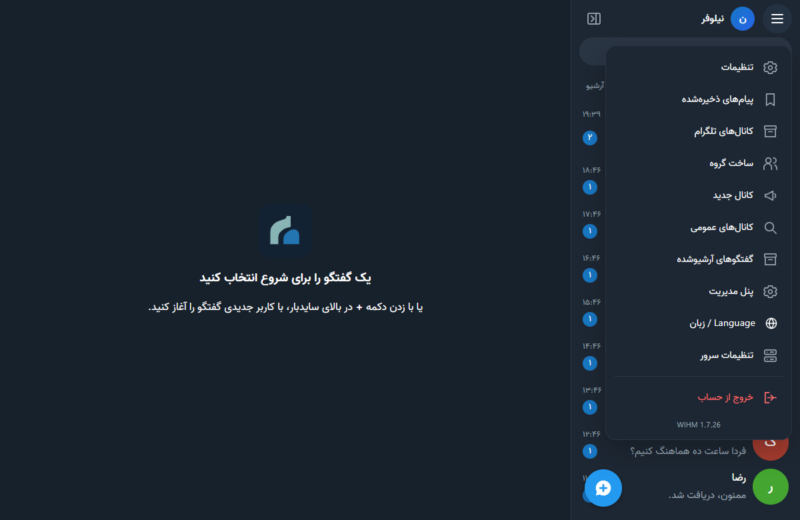
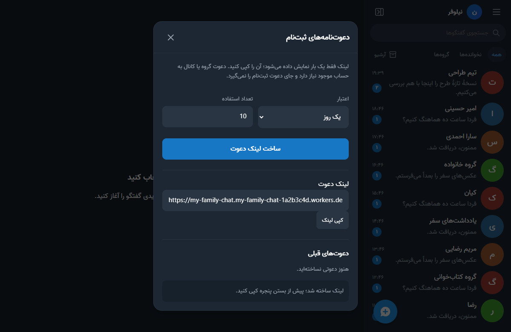

<div dir="rtl">

# راهنمای صاحب سرور: ساختن پیام‌رسان ابرانه از صفر

این راهنما برای کسی است که می‌خواهد برای خودش، خانواده، دوستان یا گروهش یک پیام‌رسان شخصی بسازد. **هیچ دانش فنی لازم نیست.** همهٔ کارها را قدم‌به‌قدم و به ترتیب می‌گوییم، از ساخت حساب کلادفلر تا فرستادن لینک برای دوستانتان و به‌روز نگه‌داشتن سرور.

اگر کسی برایتان سرور ساخته و فقط لینک گرفته‌اید، این راهنما مال شما نیست. به [راهنمای کاربران](GUIDE-USER.fa.md) بروید.

*[English version](GUIDE-ADMIN.en.md)*

## در پایان این راهنما چه دارید؟

- یک پیام‌رسان شخصی که روی حساب **کلادفلر خودتان** کار می‌کند، با لینکی مثل `https://my-family-chat.my-family-chat-1a2b3c4d.workers.dev`
- یک حساب مدیر داخل پیام‌رسان، که با آن ثبت‌نام را کنترل می‌کنید، دعوت‌نامه می‌سازید و سرور را به‌روز می‌کنید
- برنامهٔ ابرانه روی گوشی یا رایانهٔ خودتان
- یک لینک دعوت برای اینکه دوستانتان عضو شوند

| | |
| --- | --- |
| **زمان لازم** | حدود ۳۰ تا ۴۵ دقیقه برای بار اول |
| **هزینه** | رایگان. حساب رایگان کلادفلر برای یک خانواده یا گروه کوچک کافی است. نصب‌کننده هیچ پلن پولی فعال نمی‌کند |
| **دستگاه لازم** | یک رایانهٔ ویندوز، مک یا لینوکس، **یا** فقط یک گوشی اندروید. آیفون برای ساختن سرور مناسب نیست، ولی برای استفاده عالی است |
| **چیزهایی که لازم نیست** | خرید سرور یا هاست، خرید دامنه، برنامه‌نویسی، کارت بانکی |
| **چیزهایی که لازم است** | یک ایمیل که به آن دسترسی دارید، و اینترنتی که سایت کلادفلر و گیت‌هاب را باز کند |

بعد از نصب، **روشن ماندن رایانه یا گوشی شما لازم نیست.** پیام‌رسان روی کلادفلر اجرا می‌شود، نه روی دستگاه شما.

## فهرست

۱. [چند کلمه که باید بشناسید](#words)
۲. [اگر در ایران هستید، اول این را بخوانید](#iran)
۳. [قدم ۱: ساخت حساب کلادفلر](#step-1)
۴. [قدم ۲: دریافت و باز کردن نصب‌کننده](#step-2)
۵. [قدم ۳: ساخت «کد دسترسی» در کلادفلر](#step-3)
۶. [قدم ۴: انتخاب نام و نصب](#step-4)
۷. [قدم ۵: نگه‌داشتن لینک و کد مدیریت](#step-5)
۸. [قدم ۶: ساخت حساب خودتان و مدیر شدن](#step-6)
۹. [قدم ۷: نصب برنامه روی دستگاه خودتان](#step-7)
۱۰. [قدم ۸: دعوت دوستان](#step-8)
۱۱. [کارهای روزانهٔ مدیر](#manage)
۱۲. [به‌روزرسانی سرور و برنامه‌ها](#update)
۱۳. [پشتیبان‌گیری](#backup)
۱۴. [دامنهٔ شخصی (اختیاری)](#domain)
۱۵. [سقف پلن رایگان کلادفلر](#limits)
۱۶. [فهرست امنیتی](#security)
۱۷. [اگر مشکلی پیش آمد](#problems)
۱۸. [پرسش‌های رایج](#faq)

<a id="words"></a>

## ۱. چند کلمه که باید بشناسید

این چند چیز را با هم اشتباه نگیرید. بیشتر گیر کردن‌ها از همین‌جاست.

| نام | چیست؟ | چه کسی لازم دارد؟ |
| --- | --- | --- |
| **کلادفلر (Cloudflare)** | شرکتی که پیام‌رسان شما روی رایانه‌های آن اجرا می‌شود | — |
| **حساب کلادفلر** | ایمیل و رمزی که با آن وارد سایت کلادفلر می‌شوید | فقط شما |
| **نصب‌کننده** | برنامهٔ کوچکی که پیام‌رسان را روی حساب کلادفلر شما می‌سازد. فقط یک بار لازم است | فقط شما |
| **کد دسترسی (API Token)** | یک کد طولانی که به نصب‌کننده اجازه می‌دهد روی حساب کلادفلر شما کار کند | فقط شما. **به هیچ‌کس ندهید** |
| **لینک پیام‌رسان** | نشانی‌ای که با `https://` شروع می‌شود و به `workers.dev` ختم می‌شود. همهٔ کاربران با همین وارد می‌شوند | همه |
| **حساب پیام‌رسان** | نام کاربری و رمزی که داخل خود ابرانه می‌سازید. با حساب کلادفلر فرق دارد | شما و همهٔ کاربران |
| **کد مدیریت** | کدی که در پایان نصب می‌گیرید و حساب پیام‌رسان شما را مدیر می‌کند | فقط شما. **به هیچ‌کس ندهید** |
| **لینک دعوت** | لینکی که می‌سازید تا یک نفر بتواند حساب بسازد | کسی که دعوتش می‌کنید |

> **مهم دربارهٔ حریم خصوصی:** شما به عنوان صاحب سرور، از نظر فنی به پایگاه دادهٔ پیام‌رسان دسترسی دارید. گفتگوهای معمولی و گروه‌ها رمزگذاری سرتاسری ندارند. فقط «گفتگوی امن» رمزگذاری سرتاسری دارد. این را صادقانه به کاربرانتان بگویید.

<a id="iran"></a>

## ۲. اگر در ایران هستید، اول این را بخوانید

بعضی از سایت‌هایی که در این راهنما لازم دارید، در اینترنت ایران گاهی باز نمی‌شوند. وضعیت فیلترینگ مدام عوض می‌شود، پس این‌ها را فقط به عنوان راهنمای کلی بخوانید.

**هنگام ساختن سرور (فقط یک بار):**

- **ثبت‌نام و ورود به کلادفلر:** اگر صفحهٔ `dash.cloudflare.com` باز نشد یا وسط کار خطا داد، برای همین مرحله یک فیلترشکن (VPN) روشن کنید.
- **دانلود از گیت‌هاب:** اگر دانلود نصب‌کننده از `github.com` شروع نشد یا نصفه ماند، با فیلترشکن یا اینترنت دیگری دوباره امتحان کنید.
- **ترموکس روی اندروید:** دانلود از F-Droid هم ممکن است فیلترشکن بخواهد.
- **هنگام نصب** فیلترشکن مشکلی ایجاد نمی‌کند. اگر نصب وسط کار با خطای اتصال قطع شد، با همان نام دوباره بزنید. چیزی خراب نمی‌شود.

**هنگام استفادهٔ روزانه:**

- نشانی‌های `workers.dev` روی بعضی اینترنت‌های ایران بسته‌اند و روی بعضی باز. **قبل از دعوت دیگران، لینک را با اینترنت همراه و خانگی، بدون فیلترشکن، امتحان کنید.**
- اگر لینک بدون فیلترشکن باز نشد، دو راه دارید:
  1. **دامنهٔ شخصی:** یک دامنه بخرید و به پیام‌رسان وصل کنید. این پایدارترین راه است. [بخش دامنهٔ شخصی](#domain) را ببینید.
  2. **پروکسی در برنامه‌ها:** برنامه‌های اندروید و ویندوز تنظیم پروکسی دارند، پس کاربران می‌توانند فقط برای ابرانه پروکسی بگذارند. توضیحش در [راهنمای کاربران](GUIDE-USER.fa.md#proxy) آمده است.
- پیام‌رسان برای کار کردن به اینترنت بین‌المللی نیاز دارد. روی اینترنت کاملاً داخلی (اینترنت ملی) کار نمی‌کند.

<a id="step-1"></a>

## ۳. قدم ۱: ساخت حساب کلادفلر

اگر حساب کلادفلر دارید، این قدم را رد کنید و به [قدم ۲](#step-2) بروید.

۱. در مرورگر، [صفحهٔ ثبت‌نام کلادفلر](https://dash.cloudflare.com/sign-up) را باز کنید.

۲. در کادر **Email** ایمیلتان را بنویسید. ایمیلی باشد که واقعاً به آن دسترسی دارید، چون کلادفلر برایش نامه می‌فرستد.

۳. در کادر **Password** یک رمز قوی بنویسید: حداقل ۱۲ حرف، با حروف بزرگ و کوچک انگلیسی، عدد و علامت. این رمز را جایی امن یادداشت کنید.

۴. اگر کادری با عنوان «Verify you are human» یا تیک «I'm not a robot» دیدید، خودتان آن را بزنید.

۵. دکمهٔ **Sign up** را بزنید.

۶. ایمیلتان را باز کنید. نامه‌ای از Cloudflare با عنوانی شبیه «Verify your email address» آمده است. اگر در Inbox نبود، پوشهٔ **Spam** یا **Promotions** را هم ببینید. روی لینک یا دکمهٔ تأیید داخل نامه بزنید.

۷. به سایت کلادفلر برمی‌گردید. کلادفلر ممکن است چیزهایی پیشنهاد کند، مثل «Add a domain»، «Add a site»، خرید دامنه یا انتخاب پلن. **هیچ‌کدام لازم نیست.** پلن رایگان (Free) کافی است. اگر پرسید چه کاری می‌خواهید بکنید، هر گزینه‌ای را بزنید یا صفحه را رد کنید تا به صفحهٔ اصلی (Dashboard) برسید.

۸. **(پیشنهادی)** ورود دومرحله‌ای را برای حساب کلادفلر روشن کنید: بالای صفحه روی آیکون حساب بزنید، **Profile** و بعد بخش **Authentication** را باز کنید و **Two-Factor Authentication** را فعال کنید. همهٔ داده‌های پیام‌رسان روی همین حساب است، پس محکم بودنش مهم است.

**نتیجه:** با ایمیل و رمزتان وارد داشبورد کلادفلر می‌شوید. ظاهر سایت کلادفلر گاهی عوض می‌شود. اگر دکمه‌ای کمی فرق داشت، نگران نباشید.

> حساب کلادفلر را همین‌جا رها کنید. داخل سایت کلادفلر هیچ کار دیگری لازم نیست. بقیه را نصب‌کننده انجام می‌دهد.

<a id="step-2"></a>

## ۴. قدم ۲: دریافت و باز کردن نصب‌کننده

فقط بخش دستگاه خودتان را بخوانید: [ویندوز](#windows) · [اندروید](#android) · [مک و لینوکس](#mac-linux)

<a id="windows"></a>

### ویندوز ۱۰ و ۱۱

۱. روی این لینک بزنید تا فایل دانلود شود: **[wihm-installer.zip](https://github.com/DarkPoesidon/Abraneh/releases/latest/download/wihm-installer.zip)**

> اگر خودتان به [صفحهٔ آخرین نسخه](https://github.com/DarkPoesidon/Abraneh/releases/latest) رفتید، فقط فایل `wihm-installer.zip` را بگیرید. فایل‌های **Source code** و **APK** و **setup.exe** برای این کار نیستند.

۲. پوشهٔ **Downloads** را باز کنید. برای این کار کلید ویندوز و حرف `E` را با هم بزنید تا File Explorer باز شود، و از ستون کنار **Downloads** را انتخاب کنید.

۳. روی `wihm-installer.zip` **راست‌کلیک** کنید و **Extract All…** را بزنید. در پنجرهٔ بازشده دکمهٔ **Extract** را بزنید.

> فایل را از داخل خود ZIP اجرا نکنید. حتماً اول Extract کنید.

۴. پوشهٔ تازه‌ای باز می‌شود. وارد پوشهٔ **WIHM-Installer** شوید.

۵. روی فایل **Start-Windows** (یا `Start-Windows.cmd`) **دوبار کلیک** کنید.

۶. ویندوز ممکن است پنجرهٔ آبی «Windows protected your PC» نشان دهد. روی **More info** بزنید و بعد **Run anyway**. این هشدار برای این است که فایل امضای تجاری ندارد. فایل را فقط از لینک بالا بگیرید.

۷. یک **پنجرهٔ سیاه** باز می‌شود. اگر بار اول است، نصب‌کننده Node.js را خودش از سایت رسمی آن دانلود می‌کند. این ممکن است یکی دو دقیقه طول بکشد. به نصب دستی چیزی یا دسترسی Administrator نیازی نیست.

۸. کمی بعد، **صفحهٔ فارسی نصب در مرورگر** باز می‌شود. به [قدم ۳](#step-3) بروید.

> **پنجرهٔ سیاه را تا پایان کار نبندید.** با بستنش نصب‌کننده خاموش می‌شود.

<details>
<summary>اگر Start-Windows کار نکرد</summary>

برنامهٔ **PowerShell** را از منوی استارت باز کنید، این خط را کامل کپی کنید، در PowerShell راست‌کلیک کنید تا چسبانده شود، و Enter بزنید:

<div dir="ltr">

```powershell
$setup = Join-Path $env:TEMP 'wihm-install.ps1'; Invoke-WebRequest 'https://raw.githubusercontent.com/DarkPoesidon/Abraneh/main/installer/install.ps1' -OutFile $setup; powershell -NoProfile -ExecutionPolicy Bypass -File $setup
```

</div>

</details>

<a id="android"></a>

### اندروید (فقط با گوشی، بدون رایانه)

روت لازم نیست. این روش برای اندروید ۷ و بالاتر است.

۱. برنامهٔ **Termux** را از [صفحهٔ ترموکس در F-Droid](https://f-droid.org/packages/com.termux/) دانلود کنید. در آن صفحه پایین بیایید و زیر **Packages** روی **Download APK** اولین نسخه بزنید.

> ترموکسِ Google Play قدیمی است و کار نمی‌کند. فقط از F-Droid بگیرید.

۲. فایل دانلودشده را باز کنید. اگر گوشی گفت نصب از این منبع مجاز نیست، روی **تنظیمات** بزنید، **اجازه از این منبع** (Allow from this source) را روشن کنید، برگردید و **نصب** را بزنید.

۳. ترموکس را باز کنید و صبر کنید تا آماده شود و علامت `$` را ببینید.

۴. این دستور را **کامل** کپی کنید:

<div dir="ltr">

```bash
apt-get update && apt-get -y -o Dpkg::Options::=--force-confold dist-upgrade && apt-get install -y curl && curl -fsSL https://raw.githubusercontent.com/DarkPoesidon/Abraneh/main/installer/install.sh -o "$HOME/wihm-install.sh" && bash "$HOME/wihm-install.sh"
```

</div>

۵. در ترموکس انگشت را روی صفحه نگه دارید، **Paste** را بزنید و بعد دکمهٔ Enter صفحه‌کلید را بزنید.

۶. چند دقیقه صبر کنید. اگر ترموکس سؤالی با `[Y/n]` پرسید، `y` بنویسید و Enter بزنید.

۷. صفحهٔ فارسی نصب در مرورگر گوشی باز می‌شود. اگر باز نشد، لینکی را که با `http://127.0.0.1:` شروع می‌شود در ترموکس پیدا کنید، آن را **کامل** کپی کنید و در مرورگر بچسبانید. به [قدم ۳](#step-3) بروید.

> ترموکس را تا پایان نصب نبندید. اگر گوشی آن را بست، همان دستور را دوباره بزنید و در نصب‌کننده **همان نام قبلی** را وارد کنید. چیزی از دست نمی‌رود.

<a id="mac-linux"></a>

### مک و لینوکس

۱. برنامهٔ **Terminal** را باز کنید. در مک: کلید `Command` و `Space` را با هم بزنید، `Terminal` بنویسید و Enter بزنید.

۲. این دستور را کپی کنید، در Terminal بچسبانید و Enter بزنید:

<div dir="ltr">

```bash
curl -fsSL https://raw.githubusercontent.com/DarkPoesidon/Abraneh/main/installer/install.sh -o /tmp/wihm-install.sh && bash /tmp/wihm-install.sh
```

</div>

۳. صفحهٔ فارسی نصب در مرورگر باز می‌شود. پنجرهٔ Terminal را تا پایان کار نبندید.

<a id="step-3"></a>

## ۵. قدم ۳: ساخت «کد دسترسی» در کلادفلر

نصب‌کننده برای اینکه بتواند روی حساب کلادفلر شما پیام‌رسان بسازد، یک اجازه لازم دارد. اسم این اجازه **کد دسترسی** یا **API Token** است. رمز حساب کلادفلر را هرگز به نصب‌کننده نمی‌دهید.


۱. در صفحهٔ نصب، دکمهٔ **ساخت کد دسترسی ↗** را بزنید. یک برگهٔ تازهٔ مرورگر با سایت کلادفلر باز می‌شود.

۲. اگر کلادفلر خواست، با ایمیل و رمز کلادفلر وارد شوید. اگر بعد از ورود به صفحهٔ دیگری رفتید، به صفحهٔ نصب برگردید و دوباره **ساخت کد دسترسی** را بزنید.

۳. صفحه‌ای با عنوان ساخت توکن می‌بینید که سه مجوز در آن آماده است. لازم نیست چیزی از آن‌ها را عوض کنید.

۴. پایین‌تر، بخش **Account Resources** را پیدا کنید. در کادر اول **Include** را بگذارید، در کادر دوم **Specific account** را، و در کادر سوم حساب خودتان را (معمولاً ایمیل شما با عبارت «'s Account»).

۵. پایین صفحه **Continue to summary** را بزنید. در صفحهٔ بعد **Create Token** را بزنید.

۶. کلادفلر یک کد طولانی نشان می‌دهد. دکمهٔ **Copy** کنار آن را بزنید.

> کلادفلر این کد را **فقط یک بار** نشان می‌دهد. اگر صفحه را بستید و کد را کپی نکرده بودید، اشکالی ندارد: از اول یک کد تازه بسازید.

۷. به برگهٔ نصب‌کننده برگردید. کد را در کادر **کد دسترسی کلادفلر** بچسبانید و دکمهٔ **اتصال حساب** را بزنید.

> این کد را برای هیچ‌کس نفرستید، در هیچ گروهی نگذارید و از صفحه‌اش عکس نگیرید. هرکس آن را داشته باشد می‌تواند روی حساب کلادفلر شما کار کند.

<details>
<summary>اگر فرم آماده باز نشد و سه مجوز را ندیدید</summary>

۱. [صفحهٔ API Tokens کلادفلر](https://dash.cloudflare.com/profile/api-tokens) را باز کنید.

۲. **Create Token** را بزنید. در پایین صفحه، کنار **Create Custom Token**، دکمهٔ **Get started** را بزنید.

۳. در **Token name** بنویسید `WIHM Installer`.

۴. در بخش **Permissions** این سه ردیف را بسازید. برای ردیف دوم و سوم، **+ Add more** را بزنید:

| کادر اول | کادر دوم | کادر سوم |
| --- | --- | --- |
| Account | Account Settings | Read |
| Account | Workers Scripts | Edit |
| Account | D1 | Edit |

۵. از شمارهٔ ۴ بالا (Account Resources) ادامه دهید.

</details>

<a id="step-4"></a>

## ۶. قدم ۴: انتخاب نام و نصب


۱. در **حساب کلادفلر**، حساب خودتان را انتخاب کنید. اگر فقط یک حساب دارید، از قبل انتخاب شده است.

۲. در **نام آدرس پیام‌رسان** یک نام کوتاه انگلیسی بنویسید، مثل `my-family-chat` یا `ali-friends`.
   - فقط حروف **کوچک** انگلیسی، عدد و خط تیره (`-`)
   - بین ۳ تا ۴۰ حرف، و با یک حرف شروع شود
   - این نام بخشی از لینک پیام‌رسان می‌شود. نام شخصی، شمارهٔ تلفن یا اطلاعات حساس ننویسید
   - **این نام را یادداشت کنید.** برای به‌روزرسانی یا تعمیر، همین نام را دوباره لازم دارید

۳. **دامنهٔ شخصی (اختیاری)** را **خالی** بگذارید. بعداً هم می‌توانید دامنه اضافه کنید.

۴. دکمهٔ **بررسی نام و حساب** را بزنید.


۵. خلاصهٔ نصب را می‌بینید. تیک **فعال‌کردن به‌روزرسانی سرور از داخل پیام‌رسان** را **بزنید.** با این گزینه، نسخه‌های بعدی را با یک دکمه از داخل خود پیام‌رسان نصب می‌کنید و دیگر لازم نیست نصب‌کننده را اجرا کنید.

> با روشن کردن این گزینه، کد دسترسی به شکل رمزشده روی حساب کلادفلر خودتان نگه داشته می‌شود. **بعداً آن کد را از سایت کلادفلر حذف نکنید**، وگرنه به‌روزرسانی از داخل پیام‌رسان متوقف می‌شود.

۶. بخش **بازیابی پشتیبان روی نصب تازه** را باز نکنید. این فقط برای انتقال یک پیام‌رسان قدیمی است.

۷. دکمهٔ **نصب پیام‌رسان** را بزنید.


۸. نصب‌کننده هفت مرحله را یکی‌یکی انجام می‌دهد و کنار هرکدام تیک می‌زند. معمولاً یکی دو دقیقه طول می‌کشد. **این صفحه و پنجرهٔ سیاه (یا ترموکس) را نبندید.**

اگر مرحله‌ای قرمز شد، پیامش را بخوانید. بیشتر وقت‌ها کافی است مشکل گفته‌شده را حل کنید و **تلاش دوباره** را بزنید. چیزهایی که ساخته شده‌اند حفظ می‌شوند. جدول [اگر مشکلی پیش آمد](#problems) را هم ببینید.

<a id="step-5"></a>

## ۷. قدم ۵: نگه‌داشتن لینک و کد مدیریت


نصب تمام شد. در تصویر، لینک و کد فقط نمونه‌اند. در صفحهٔ پایان دو چیز مهم هست:

**الف) لینک پیام‌رسان**، مثل `https://my-family-chat.my-family-chat-1a2b3c4d.workers.dev`

۱. **کپی لینک** را بزنید و لینک را جایی نگه دارید که گم نشود، مثلاً در «پیام‌های ذخیره‌شده» تلگرام یا یک یادداشت.

۲. **ذخیرهٔ مشخصات** را بزنید. یک فایل متنی کوچک با لینک، نام و حساب دانلود می‌شود. آن را نگه دارید.

**ب) کد مدیریت**، یک کد طولانی در کادر **فعال‌سازی مدیر سرویس**

۳. **کپی کد مدیریت** را بزنید. این کد را تا پایان قدم بعد لازم دارید. در فایل مشخصات ذخیره **نمی‌شود.**

۴. **باز کردن پیام‌رسان ↗** را بزنید. پیام‌رسان در برگهٔ تازه باز می‌شود. **نصب‌کننده را هنوز نبندید.**

> **دو لینک را با هم اشتباه نگیرید:** لینکی که با `http://127.0.0.1:` شروع می‌شود فقط صفحهٔ نصب روی دستگاه خودتان است و برای هیچ‌کس دیگر کار نمی‌کند. لینک درست با `https://` شروع می‌شود و به `workers.dev` ختم می‌شود.

<a id="step-6"></a>

## ۸. قدم ۶: ساخت حساب خودتان و مدیر شدن

پیام‌رسان تازه هیچ کاربری ندارد، حتی شما. اول خودتان ثبت‌نام می‌کنید و بعد با کد مدیریت، حسابتان را مدیر می‌کنید.

**ساخت حساب:**

۱. در صفحهٔ پیام‌رسان که باز شد، اگر متن انگلیسی بود، روی **فارسی** بزنید.

۲. زبانهٔ **ثبت‌نام** را بزنید.

۳. سه کادر را پر کنید:
   - **نام نمایشی:** نامی که دیگران می‌بینند، مثلاً «مریم»
   - **نام کاربری:** فقط حروف انگلیسی، عدد و `_`، بین ۳ تا ۲۰ حرف، مثل `maryam`. دیگران شما را با این پیدا می‌کنند
   - **رمز عبور:** حداقل ۸ حرف. **این رمز را گم نکنید.** رمز مدیر از داخل برنامه بازیابی نمی‌شود

۴. **ایجاد حساب کاربری** را بزنید. وارد پیام‌رسان می‌شوید.

> این حساب با حساب کلادفلر فرق دارد. ایمیل و رمز کلادفلر را اینجا وارد نکنید.

**مدیر شدن:**


۵. منوی اصلی را باز کنید: روی گوشی، سه‌نقطهٔ بالای صفحه، و روی رایانه، سه خط بالای فهرست گفتگوها. **تنظیمات** را بزنید و پایین بیایید تا **مدیریت سرویس**.

۶. کد مدیریت را در کادر **کد مدیریت** بچسبانید و **فعال‌سازی مدیریت این حساب** را بزنید.

۷. حالا در منوی اصلی گزینهٔ **پنل مدیریت** را می‌بینید. یعنی مدیر شده‌اید.



> اولین کسی که ثبت‌نام می‌کند خودبه‌خود مدیر **نمی‌شود.** اگر این قدم را انجام ندهید، پیام‌رسان مدیر ندارد.

۸. به برگهٔ نصب‌کننده برگردید و **پایان و بستن نصب‌کننده** را بزنید. حالا پنجرهٔ سیاه یا ترموکس را هم ببندید. **می‌توانید رایانه را خاموش کنید.** پیام‌رسان روی کلادفلر روشن می‌ماند.

<a id="step-7"></a>

## ۹. قدم ۷: نصب برنامه روی دستگاه خودتان

پیام‌رسان در مرورگر کار می‌کند، ولی برنامه راحت‌تر است و اعلان بهتری دارد. همهٔ برنامه‌ها در [صفحهٔ آخرین نسخه](https://github.com/DarkPoesidon/Abraneh/releases/latest) هستند:

| دستگاه | چه کنم؟ |
| --- | --- |
| اندروید ۵ به بالا | [فایل اندروید](https://github.com/DarkPoesidon/Abraneh/releases/latest/download/wihm-messenger-android-universal.apk) را نصب کنید و لینک پیام‌رسان را در آن وارد کنید |
| ویندوز ۱۰ و ۱۱ | [نصب‌کنندهٔ ویندوز](https://github.com/DarkPoesidon/Abraneh/releases/latest/download/wihm-messenger-windows-setup.exe) را اجرا کنید و لینک پیام‌رسان را وارد کنید |
| آیفون و آیپد | لینک را در Safari باز کنید و **Add to Home Screen** را بزنید |
| مک و مرورگر رایانه | لینک را در Chrome یا Edge باز کنید و از نوار آدرس برنامه را نصب کنید |

جزئیات قدم‌به‌قدم هر دستگاه در [راهنمای کاربران، بخش نصب برنامه](GUIDE-USER.fa.md#install) آمده است. با همان نام کاربری و رمزی که در قدم ۶ ساختید وارد شوید.

<a id="step-8"></a>

## ۱۰. قدم ۸: دعوت دوستان

### اول تصمیم بگیرید چه کسی می‌تواند عضو شود

پیام‌رسان تازه **ثبت‌نام آزاد** دارد، یعنی هرکس لینک را داشته باشد می‌تواند حساب بسازد. برای یک گروه خصوصی، بهتر است ثبت‌نام را **فقط با دعوت‌نامه** کنید.


۱. **منوی اصلی ← تنظیمات ← مدیریت سرویس** را باز کنید.

۲. در کادر **ثبت‌نام** یکی را انتخاب کنید:

| گزینه | معنی |
| --- | --- |
| **آزاد؛ همه می‌توانند حساب بسازند** | هرکس لینک پیام‌رسان را داشته باشد حساب می‌سازد |
| **فقط با دعوت‌نامهٔ ثبت‌نام** | فقط کسی که از شما لینک دعوت گرفته حساب می‌سازد. **پیشنهاد ما** |
| **بسته؛ فقط ورود حساب‌های موجود** | هیچ حساب تازه‌ای ساخته نمی‌شود |

۳. **ذخیرهٔ وضعیت ثبت‌نام** را بزنید.

### ساخت لینک دعوت



۴. در همان صفحه **دعوت‌نامه‌های ثبت‌نام** را بزنید.

۵. در **اعتبار** مدت را انتخاب کنید: یک ساعت، یک روز یا یک هفته. در **تعداد استفاده** بنویسید چند نفر می‌توانند با این لینک حساب بسازند. مثلاً برای یک نفر بنویسید `1` و برای کل خانواده `10`.

۶. **ساخت لینک دعوت** را بزنید و بلافاصله **کپی لینک** را بزنید.

> لینک دعوت **فقط یک بار** نشان داده می‌شود. اگر پنجره را بستید و کپی نکرده بودید، یک لینک تازه بسازید.

لینک دعوت شبیه این است: `https://my-family-chat....workers.dev/#register=...` بخش بعد از `#register=` کلید دعوت است. لینک را کامل بفرستید.

### فرستادن لینک برای دوستتان

۷. لینک را از راهی که به آن اعتماد دارید، مثل تلگرام یا پیامک، بفرستید. می‌توانید این متن را کپی کنید و لینک‌ها را جایگزین کنید:

> سلام! برای پیام‌رسان خانوادگی‌مان این کارها را انجام بده:
>
> ۱. این لینک را در مرورگر گوشی باز کن و حساب بساز: **[لینک دعوت]**
>
> ۲. بعد برنامه را نصب کن. اندروید: https://github.com/DarkPoesidon/Abraneh/releases/latest/download/wihm-messenger-android-universal.apk
>
> ۳. وقتی برنامه نشانی سرور را خواست، این را بنویس: **[لینک پیام‌رسان، بدون بخش #register]**
>
> راهنما: https://github.com/DarkPoesidon/Abraneh/blob/main/docs/GUIDE-USER.fa.md

> **چرا اول مرورگر؟** برنامه‌ها فقط نشانی سرور را می‌گیرند و کلید دعوت را نگه نمی‌دارند. پس حساب را با لینک دعوت در مرورگر بسازند، و بعد در برنامه با همان نام کاربری و رمز وارد شوند.

۸. وقتی دوستتان حساب ساخت، نام کاربری‌اش را از او بپرسید. در پیام‌رسان دکمهٔ آبی **گفتگوی جدید** را بزنید، نام کاربری‌اش را جستجو کنید و پیام بفرستید.

### دعوت به گروه یا کانال

لینک دعوت ثبت‌نام با لینک دعوت گروه فرق دارد. برای گروه یا کانال، روی نام آن در بالای گفتگو بزنید و **لینک‌های دعوت** را بزنید. لینک گروه با `#join=` تمام می‌شود و فقط برای کسی کار می‌کند که حساب دارد. کاربران این لینک را هم یک بار در مرورگر باز می‌کنند، و گروه بعد از آن در برنامه‌شان هم دیده می‌شود.

<a id="manage"></a>

## ۱۱. کارهای روزانهٔ مدیر

### پنل مدیریت

از **منوی اصلی ← پنل مدیریت** باز می‌شود.


| بخش | چه کاری می‌کند؟ |
| --- | --- |
| **گزارش‌های تخلف** | گزارش‌هایی که کاربران از پیام یا شخصی داده‌اند. می‌توانید پیام را برای همه حذف، حساب را غیرفعال یا گفتگو را تعلیق کنید |
| **کاربران** | جستجوی کاربران، غیرفعال یا فعال‌کردن حساب‌ها |
| **گروه‌ها** و **کانال‌ها** | جستجو، تعلیق یا حذف گروه و کانال |
| **رویدادهای مدیریت** | فهرست کارهایی که مدیران اخیراً انجام داده‌اند |
| **وضعیت سرویس** | نسخه، سلامت پایگاه داده و آمار |
| **ثبت‌نام، تماس و تنظیمات** | همان صفحهٔ مدیریت سرویس: وضعیت ثبت‌نام، دعوت‌نامه‌ها و تنظیم تماس |

### کاربری رمزش را فراموش کرده است

۱. **منوی اصلی ← تنظیمات ← مدیریت سرویس ← وضعیت و مدیریت کاربران** را باز کنید.

۲. کاربر را با نام کاربری‌اش پیدا کنید و **ساخت لینک بازیابی رمز** را بزنید.

۳. لینک را **فقط به خود او** و از راهی امن بدهید. او لینک را باز می‌کند و رمز تازه می‌گذارد.

- لینک یک ساعت و فقط یک بار کار می‌کند.
- همهٔ دستگاه‌های آن کاربر از حساب خارج می‌شوند.
- اگر کاربر ورود دومرحله‌ای داشته باشد، خاموش نمی‌شود.
- هرکس این لینک را داشته باشد می‌تواند رمز آن کاربر را عوض کند، پس در گروه نفرستید.

> **رمز خود مدیر از این راه بازیابی نمی‌شود، و کد مدیریت تازه هم مدیر دیگری نمی‌سازد.** رمزتان را جای امنی نگه دارید و از **تنظیمات ← کلید عبور و ورود دومرحله‌ای** یک کلید عبور هم بسازید.

### کاربر مزاحم

- از **پنل مدیریت ← کاربران** حساب او را **غیرفعال** کنید. همهٔ دستگاه‌هایش فوراً خارج می‌شوند و دیگر نمی‌تواند وارد شود. بعداً می‌توانید دوباره فعالش کنید.
- اگر ثبت‌نام آزاد است، آن را **فقط با دعوت‌نامه** کنید.

### تماس روی بعضی اینترنت‌ها وصل نمی‌شود

تماس صوتی و تصویری روی بیشتر اینترنت‌ها بدون تنظیم کار می‌کند. اگر روی شبکه‌ای وصل نشد، از **مدیریت سرویس ← تنظیم اتصال تماس (TURN)** کمک بگیرید. جزئیات در [امکانات پیشرفته](ADVANCED.fa.md#تماس-و-مصرف-سرویس) آمده است.

### گفتگوی امن

متن گفتگوهای امن روی سرور نیست. شما نمی‌توانید آن را بخوانید، بازیابی کنید یا در پشتیبان داشته باشید. برای گزارش تخلف در این گفتگوها، گیرنده باید خودش متن را برایتان بفرستد.

<a id="update"></a>

## ۱۲. به‌روزرسانی سرور و برنامه‌ها

ابرانه سه قسمت دارد که هرکدام جدا به‌روز می‌شوند:

| قسمت | چه کسی به‌روز می‌کند؟ | از کجا؟ |
| --- | --- | --- |
| **سرور** (روی کلادفلر) | فقط شما، یک بار برای همه | داخل پیام‌رسان: **تنظیمات ← به‌روزرسانی** |
| **صفحهٔ پیام‌رسان روی هر دستگاه** | هر کاربر، روی دستگاه خودش | همان صفحه، بخش **پیام‌رسان روی این دستگاه** |
| **برنامهٔ اندروید یا ویندوز** | هر کاربر | خود برنامه نسخهٔ تازه را پیشنهاد می‌کند |

همهٔ نسخه‌ها در یک صفحه منتشر می‌شوند: [صفحهٔ آخرین نسخه](https://github.com/DarkPoesidon/Abraneh/releases/latest). نصب‌کنندهٔ سرور، برنامهٔ اندروید و برنامهٔ ویندوز همه آنجا هستند.

### به‌روزرسانی سرور


۱. **منوی اصلی ← تنظیمات ← به‌روزرسانی** را باز کنید و پایین بیایید تا بخش **سرور پیام‌رسان · مدیر سرویس**.

۲. **بررسی آپدیت سرور** را بزنید. اگر نسخهٔ تازه باشد، کنار **آخرین نسخه** نوشته می‌شود.

۳. برای دیدن تغییرات، **تغییرات نسخهٔ جدید** را باز کنید.

۴. **بله، به‌روزرسانی سرور** را بزنید و تأیید کنید. پیام‌ها و حساب‌ها حفظ می‌شوند. چند دقیقه طول می‌کشد، و بستن صفحه کار را متوقف نمی‌کند.

**روش به‌روزرسانی سرور** سه حالت دارد:

| حالت | معنی |
| --- | --- |
| **با تأیید من** | سرور نسخهٔ تازه را پیدا می‌کند و به شما خبر می‌دهد. نصب فقط با دکمهٔ شما انجام می‌شود |
| **خودکار** | سرور نسخهٔ تازه را خودش نصب می‌کند |
| **فقط بررسی دستی** | فقط وقتی خودتان «بررسی آپدیت سرور» را بزنید نگاه می‌کند |

<details>
<summary>اگر نوشته است «به‌روزرسانی سرور هنوز فعال نیست»</summary>

یعنی هنگام نصب تیک «به‌روزرسانی سرور از داخل پیام‌رسان» را نزده‌اید، یا کد دسترسی را از کلادفلر حذف کرده‌اید.

۱. نصب‌کننده را مثل [قدم ۲](#step-2) دوباره دانلود و باز کنید. حتماً **نسخهٔ تازه** را دانلود کنید.

۲. یک کد دسترسی تازه بسازید ([قدم ۳](#step-3)).

۳. **همان حساب و دقیقاً همان نام قبلی** را وارد کنید. نصب‌کننده نصب قبلی را پیدا می‌کند و می‌نویسد «به‌روزرسانی از … به …».

۴. تیک **فعال‌کردن به‌روزرسانی سرور از داخل پیام‌رسان** را بزنید و **به‌روزرسانی پیام‌رسان** را بزنید.

> نام تازه یک پیام‌رسان **جدا و خالی** می‌سازد و پیام‌ها به آن منتقل نمی‌شوند. حتماً همان نام قبلی را بزنید.

</details>

### به‌روزرسانی برنامه‌ها

بعد از به‌روزرسانی سرور، هر کاربر صفحهٔ پیام‌رسان را روی دستگاه خودش به‌روز می‌کند: **تنظیمات ← به‌روزرسانی ← بررسی آپدیت**. برنامهٔ اندروید هر بار که باز می‌شود نسخهٔ تازه را بررسی می‌کند. برنامهٔ ویندوز هم هر چند ساعت بررسی می‌کند. هر دو با پنجره‌ای خبر می‌دهند. [جزئیات برای کاربران](GUIDE-USER.fa.md#updates).

<a id="backup"></a>

## ۱۳. پشتیبان‌گیری

پشتیبان یعنی یک فایل رمزشده از همهٔ حساب‌ها، گروه‌ها و پیام‌های معمولی. اگر روزی حساب کلادفلر را از دست بدهید یا بخواهید پیام‌رسان را به حساب دیگری ببرید، با این فایل همه‌چیز برمی‌گردد.

۱. **منوی اصلی ← تنظیمات ← پشتیبان سرویس** را باز کنید.

۲. در **رمز فعلی حساب مدیر** رمز حساب پیام‌رسانتان را بنویسید. اگر ورود دومرحله‌ای دارید، کدش را هم بنویسید.

۳. در **رمز تازه برای فایل** یک رمز جدا، حداقل ۱۲ حرف، بنویسید و در **تکرار رمز فایل** دوباره بنویسید.

۴. **شروع و دریافت پشتیبان** را بزنید و صبر کنید تا فایل دانلود شود. در این مدت ارسال پیام برای همه موقتاً متوقف می‌شود، و حداکثر پس از ۱۵ دقیقه خودبه‌خود باز می‌شود. پس پشتیبان را وقتی بگیرید که کسی کار مهمی ندارد.

۵. فایل را جای امنی نگه دارید، مثلاً روی فلش یا فضای ابری شخصی. **رمز فایل را جدا و جای امن یادداشت کنید.** بدون رمز، فایل هیچ راه بازیابی ندارد.

- گفتگوهای امن در پشتیبان نیستند، چون متنشان روی سرور نیست.
- ماهی یک بار، یا قبل از کارهای مهم، پشتیبان بگیرید.
- بازیابی با نصب‌کننده و روی یک نام تازه انجام می‌شود. [جزئیات پشتیبان و بازیابی](ADVANCED.fa.md#پشتیبان-کامل-سرور-و-بازیابی).

<a id="domain"></a>

## ۱۴. دامنهٔ شخصی (اختیاری)

با دامنهٔ شخصی، لینک پیام‌رسان کوتاه‌تر و آشناتر می‌شود، مثل `https://chat.example.com`. در ایران هم معمولاً پایدارتر از `workers.dev` است.

**چه لازم دارید:** یک دامنه، مثل `example.com`، که در همین حساب کلادفلر فعال شده باشد، یعنی در داشبورد کلادفلر وضعیتش **Active** باشد.

**به طور خلاصه:**

۱. دامنه را در کلادفلر اضافه کنید (**Add a domain**) و تا فعال شدنش صبر کنید.

۲. هنگام ساخت کد دسترسی، دو مجوز دیگر هم اضافه کنید: **Zone → Zone → Read** و **Zone → DNS → Read**.

۳. نصب‌کننده را با **همان حساب و همان نام** اجرا کنید و در **دامنهٔ شخصی** یک زیردامنهٔ خالی بنویسید، مثل `chat.example.com`.

لینک `workers.dev` هم کار می‌کند. حساب‌ها مشترک‌اند، ولی کاربران روی نشانی تازه باید یک بار دیگر وارد شوند. [راهنمای کامل دامنهٔ شخصی](ADVANCED.fa.md#دامنه-شخصی).

<a id="limits"></a>

## ۱۵. سقف پلن رایگان کلادفلر

پلن رایگان برای یک خانواده یا گروه دوستان کافی است. محدودیت اصلی پایگاه داده (D1) است: **روزی ۱۰۰٬۰۰۰ ردیف نوشتن**. این سهمیه هر روز ساعت ۰۰:۰۰ به وقت جهانی (UTC) تازه می‌شود، یعنی ساعت ۳:۳۰ بامداد به وقت ایران.

- اگر سهمیه پر شود، **پیام‌ها و داده‌ها از بین نمی‌روند**، ولی تا تازه شدن سهمیه، برنامه با پیام «عملیات سرویس کامل نشد» کار نمی‌کند.
- مصرف را در داشبورد کلادفلر، بخش **Storage & Databases ← D1** ببینید.
- سرور را به‌روز نگه دارید. نسخه‌های تازه‌تر نوشتن کمتری دارند.
- یک گفتگوی امنِ باز هر ۵ ثانیه پیام تازه را بررسی می‌کند. اگر تمام روز باز بماند، حدود ۱۷ هزار ردیف مصرف می‌کند.
- اگر کاربران زیادی دارید، پلن پولی **Workers Paid** سقف بسیار بالاتری دارد.

<a id="security"></a>

## ۱۶. فهرست امنیتی

- [ ] ورود دومرحله‌ای حساب کلادفلر روشن است
- [ ] رمز حساب مدیر در پیام‌رسان جای امنی یادداشت شده است، و یک کلید عبور یا ورود دومرحله‌ای هم دارد (**تنظیمات ← کلید عبور و ورود دومرحله‌ای**)
- [ ] کد دسترسی و کد مدیریت را برای هیچ‌کس نفرستاده‌اید، حتی برای عکس از صفحهٔ خطا
- [ ] ثبت‌نام روی **فقط با دعوت‌نامه** است، مگر اینکه واقعاً ثبت‌نام آزاد بخواهید
- [ ] یک پشتیبان تازه دارید و رمزش جدا نگه داشته شده است
- [ ] به کاربران گفته‌اید که گفتگوهای معمولی رمزگذاری سرتاسری ندارند و برای حرف‌های محرمانه از **گفتگوی امن** استفاده کنند

<a id="problems"></a>

## ۱۷. اگر مشکلی پیش آمد

| مشکل | چه کنم؟ |
| --- | --- |
| سایت کلادفلر یا گیت‌هاب باز نمی‌شود | فیلترشکن را روشن کنید یا اینترنت دیگری را امتحان کنید. [بخش ایران](#iran) |
| ایمیل تأیید کلادفلر نیامد | پوشهٔ Spam و Promotions را ببینید. چند دقیقه صبر کنید. در کلادفلر گزینهٔ ارسال دوباره (Resend) را بزنید |
| ویندوز می‌گوید «Windows protected your PC» | **More info** و بعد **Run anyway** را بزنید |
| پنجرهٔ سیاه باز و بسته شد و صفحه‌ای نیامد | مطمئن شوید ZIP را Extract کرده‌اید. اگر نشد، روش PowerShell را در [بخش ویندوز](#windows) امتحان کنید |
| صفحهٔ نصب باز نمی‌شود یا می‌گوید «نشانی نصب‌کننده کامل نیست» | لینک `http://127.0.0.1:...` را که پنجرهٔ نصب نشان می‌دهد **کامل** کپی کنید و در مرورگر باز کنید. اگر نصب‌کننده را دوباره اجرا کرده‌اید، لینک قبلی دیگر کار نمی‌کند |
| «دسترسی کافی نیست» یا خطای Token | کد تازه بسازید. در Account Resources حساب درست را انتخاب کنید و سه مجوز را بررسی کنید |
| «آدرس Workers فعال نشد» یا کلادفلر تأیید ایمیل می‌خواهد | وارد داشبورد کلادفلر شوید، ایمیل را تأیید کنید و یک بار بخش **Workers & Pages** را باز کنید. بعد **تلاش دوباره** را بزنید |
| «دیتابیسی با این نام از قبل وجود دارد» | نام دیگری انتخاب کنید. نصب‌کننده دیتابیسی را که مال پیام‌رسان نیست دست نمی‌زند |
| نصب وسط کار قطع شد | نصب‌کننده را دوباره باز کنید و **همان حساب و همان نام** را بزنید. چیزهای ساخته‌شده حفظ می‌شوند |
| «منتشر شد؛ بررسی اتصال باقی ماند» | پیام‌رسان ساخته شده، ولی دستگاه شما هنوز به آن نرسیده است. چند دقیقه صبر کنید و لینک را با اینترنت دیگری یا فیلترشکن امتحان کنید |
| لینک برای دیگران باز نمی‌شود | لینک `https://...workers.dev` را فرستاده باشید، نه `127.0.0.1`. اگر `workers.dev` روی اینترنتشان بسته است، [پروکسی](GUIDE-USER.fa.md#proxy) یا [دامنهٔ شخصی](#domain) کمک می‌کند |
| کد مدیریت را قبل از مدیر شدن گم کردم | نصب‌کننده را با همان حساب و همان نام دوباره اجرا کنید. کد مدیریت تازه می‌دهد و اطلاعات حفظ می‌شوند. وقتی یک حساب مدیر شد، کد تازه دیگر کسی را مدیر نمی‌کند |
| رمز حساب مدیر را فراموش کردم | اگر کلید عبور دارید، همیشه می‌توانید با **ورود با کلید عبور** وارد شوید. تغییر رمز به رمز فعلی نیاز دارد، پس رمز قبلی را با کلید عبور جایگزین می‌کنید. اگر هنوز روی دستگاهی وارد هستید، از آن خارج نشوید و همان‌جا یک کلید عبور بسازید. وگرنه رمز مدیر از داخل برنامه بازیابی نمی‌شود و مدیر تازه هم نمی‌شود ساخت. در [Issues](https://github.com/DarkPoesidon/Abraneh/issues) کمک بخواهید |
| دوستم با لینک دعوت ثبت‌نام نمی‌تواند | لینک دعوت ممکن است منقضی یا تمام شده باشد. لینک تازه بسازید. لینک را **کامل**، با بخش `#register=`، و در **مرورگر** باز کند |
| کاربری رمزش را فراموش کرده است | [لینک بازیابی رمز](#manage) برایش بسازید |
| همهٔ کاربران «عملیات سرویس کامل نشد» می‌بینند | احتمالاً [سقف روزانهٔ رایگان](#limits) پر شده است. داده‌ها سالم‌اند. تا ۳:۳۰ بامداد به وقت ایران صبر کنید، یا پلن پولی بگیرید |
| «به‌روزرسانی سرور هنوز فعال نیست» | [توضیح بخش به‌روزرسانی](#update) را ببینید |

اگر گزارش خطا می‌فرستید، **کد دسترسی، رمزها، کد مدیریت و لینک `127.0.0.1` را نفرستید.** برای گزارش مشکل از [Issues گیت‌هاب](https://github.com/DarkPoesidon/Abraneh/issues) استفاده کنید.

<a id="faq"></a>

## ۱۸. پرسش‌های رایج

**آیا باید رایانه‌ام روشن بماند؟**
نه. بعد از پایان نصب، پیام‌رسان روی کلادفلر کار می‌کند. نصب‌کننده را فقط برای نصب، تعمیر یا بازیابی لازم دارید.

**هزینه دارد؟**
برای استفادهٔ معمولی یک خانواده یا گروه کوچک، نه. فقط اگر کاربران خیلی زیادی داشته باشید و از [سقف رایگان](#limits) رد شوید، پلن پولی لازم می‌شود. نصب‌کننده هیچ پلن پولی فعال نمی‌کند.

**چند نفر می‌توانند عضو شوند؟**
محدودیت تعداد کاربر نیست. هر گروه تا ۱۰۰ عضو و هر کانال تا ۱۰٬۰۰۰ مشترک دارد. محدودیت واقعی، سقف روزانهٔ کلادفلر است.

**می‌توانم پیام‌های کاربران را بخوانم؟**
از نظر فنی، گفتگوهای معمولی و گروه‌ها در پایگاه دادهٔ حساب شما هستند. گفتگوهای امن را نه شما و نه هیچ‌کس دیگر جز دو طرف نمی‌تواند بخواند.

**اگر بخواهم پیام‌رسان را کاملاً پاک کنم؟**
در داشبورد کلادفلر، در بخش **Workers & Pages** ورکری را که نام پیام‌رسان شماست پاک کنید (و اگر به‌روزرسان دارید، ورکر `نام-updates` را هم)، و در **Storage & Databases ← D1** دیتابیس همان نام را پاک کنید. این کار برگشت‌پذیر نیست، پس اول پشتیبان بگیرید.

**آیا می‌توانم یک نفر دیگر را هم مدیر کنم؟**
هر پیام‌رسان یک مدیر سرویس دارد. ولی در هر گروه و کانال، صاحب آن می‌تواند دیگران را مدیر همان گروه کند.

**کاربران سرور من می‌توانند با کاربران سرور دیگری حرف بزنند؟**
بله، در گفتگوی امن و برای دنبال کردن کانال‌های عمومی. [امکانات پیشرفته](ADVANCED.fa.md#پیدا-کردن-مخاطب-سرور-دیگر-و-شروع-گفتگو) را ببینید.

</div>
