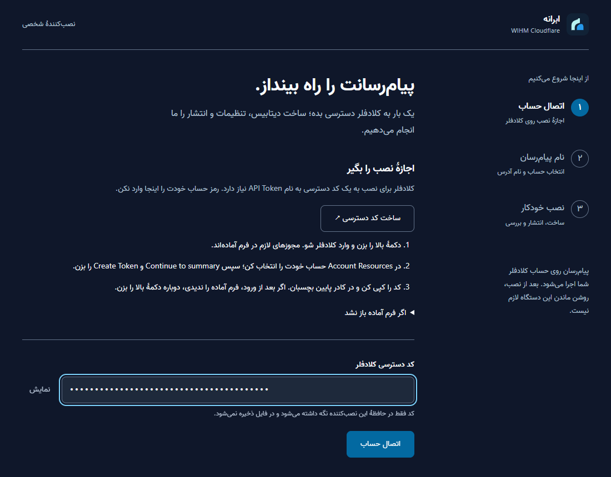
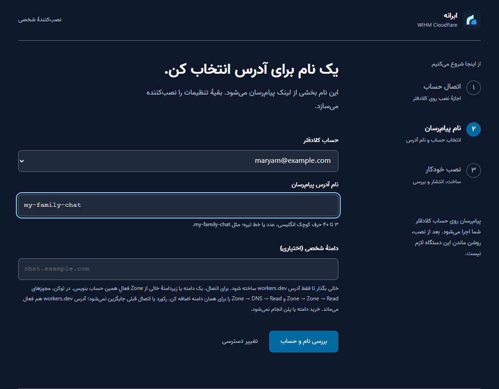
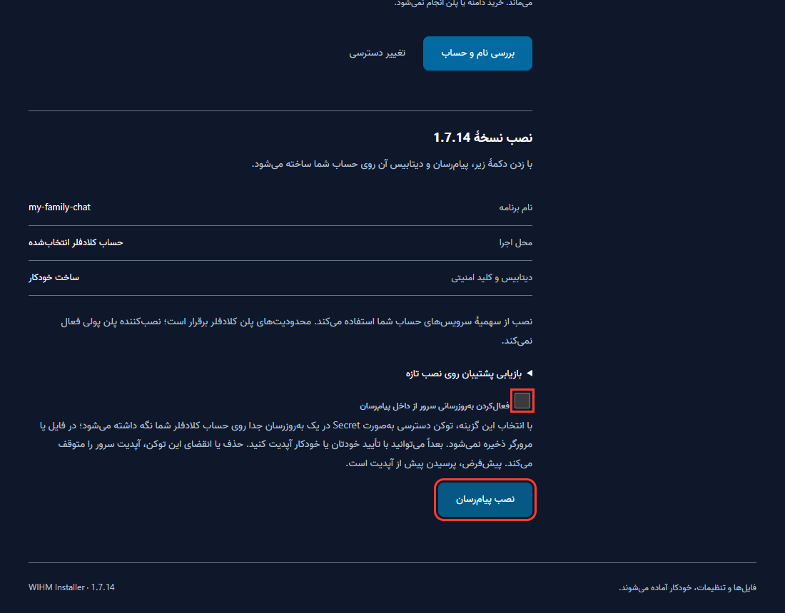
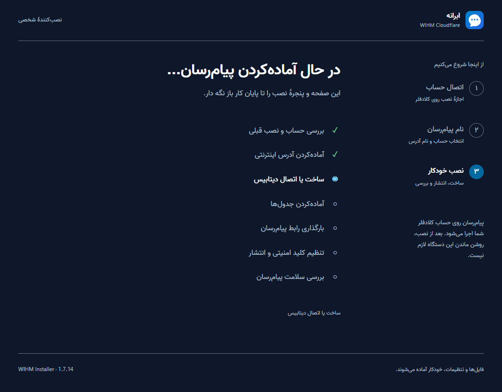
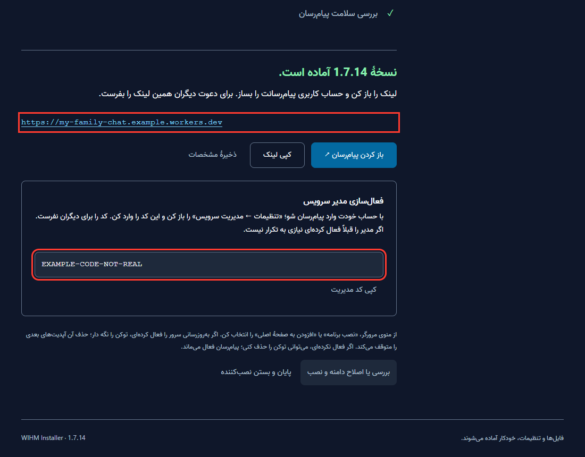
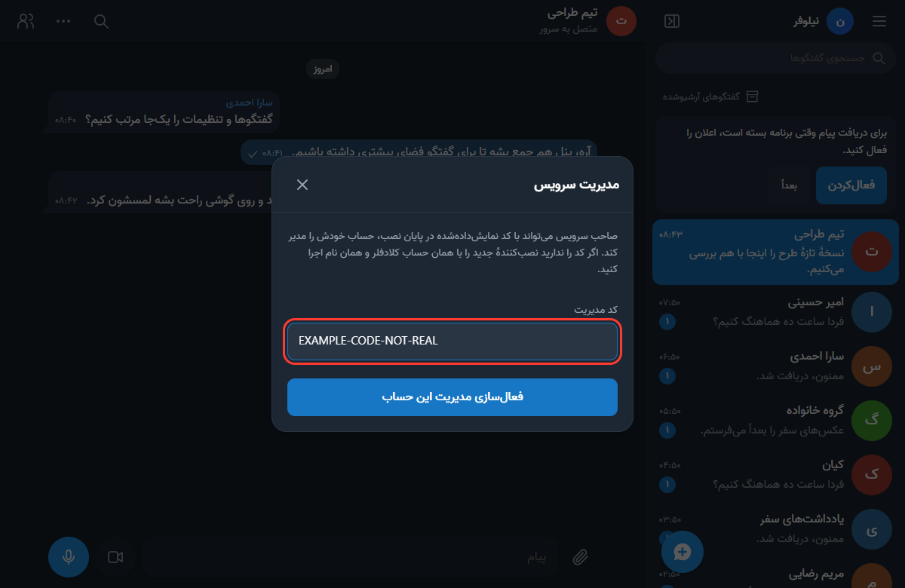
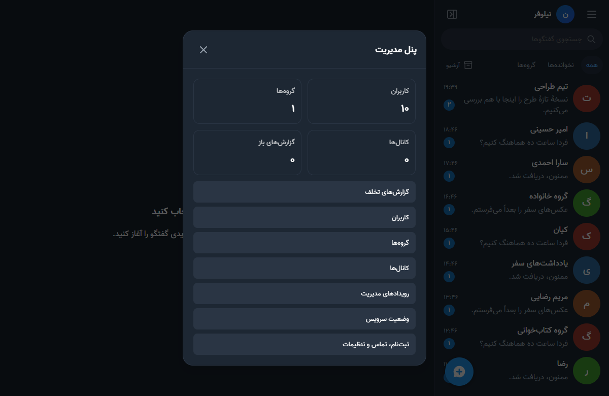
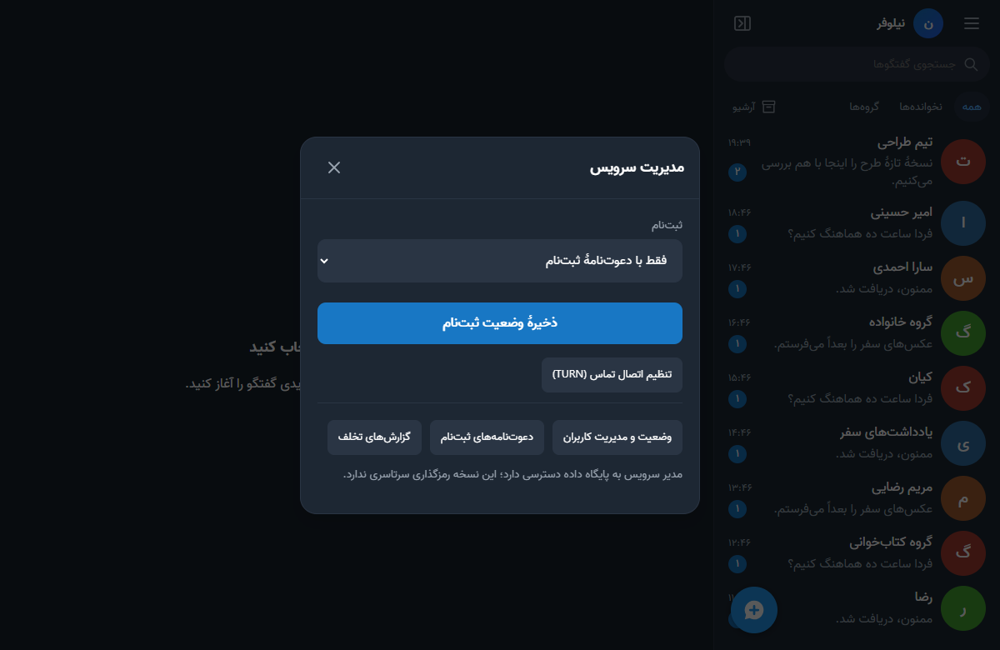
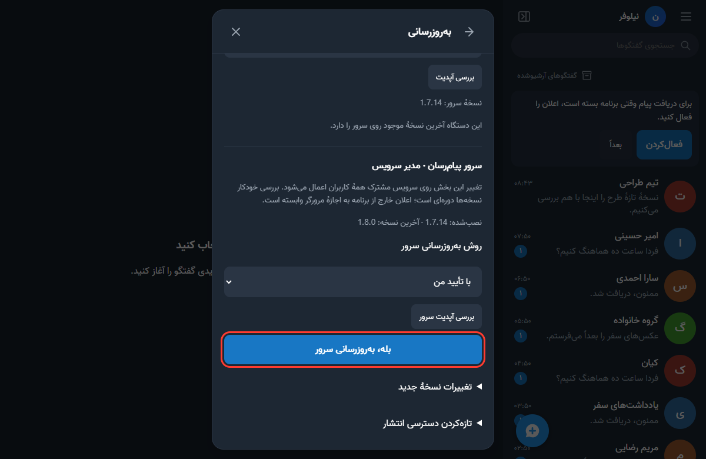

<div dir="rtl">

# راهنمای صاحب سرور: ساخت پیام‌رسان از صفر

این راهنما برای کسی است که می‌خواهد برای خودش، خانواده یا گروهش پیام‌رسان بسازد. دانش فنی لازم ندارید. اگر فقط لینک پیام‌رسان را از کسی گرفته‌اید، به [راهنمای کاربران](GUIDE-USER.fa.md) بروید.

**زمان لازم:** معمولاً کمتر از نیم ساعت. **هزینه:** حساب رایگان کلادفلر برای شروع کافی است و نصب‌کننده هیچ پلن پولی فعال نمی‌کند. محدودیت‌های مصرف پلن حساب شما برقرار است.

## فهرست

۱. [قبل از شروع](#before)
۲. [ساخت حساب کلادفلر](#step-1)
۳. [باز کردن نصب‌کننده](#step-2)
۴. [ساخت کد دسترسی](#step-3)
۵. [انتخاب نام و نصب](#step-4)
۶. [نگه‌داشتن لینک و کد مدیریت](#step-5)
۷. [ساخت حساب و فعال‌کردن مدیریت](#step-6)
۸. [دعوت دوستان](#step-7)
۹. [پنل مدیریت](#panel)
۱۰. [به‌روزرسانی سرور](#server-update)
۱۱. [کمک به کاربران](#users)
۱۲. [سقف پلن رایگان کلادفلر](#limits)
۱۳. [پشتیبان و امنیت](#backup)
۱۴. [اگر مشکلی پیش آمد](#problems)

<a id="before"></a>

## قبل از شروع

یک رایانهٔ ویندوز، مک یا لینوکس لازم دارید، یا فقط یک گوشی اندروید. آیفون برای نصب سرور مناسب نیست، ولی برای استفاده از پیام‌رسان مشکلی ندارد. خرید سرور، دامنه یا برنامه‌نویسی لازم نیست.

**این چهار چیز را با هم اشتباه نگیرید:**

| نام | چیست؟ | چه کسی لازم دارد؟ |
| --- | --- | --- |
| حساب کلادفلر | جایی که پیام‌رسان شما روی آن اجرا می‌شود | فقط شما |
| کد دسترسی (API Token) | اجازهٔ نصب روی حساب کلادفلر شما | فقط شما. به کسی ندهید |
| حساب پیام‌رسان | نام کاربری و رمز داخل خود برنامه | شما و همهٔ کاربران |
| کد مدیریت | کدی که حساب پیام‌رسان شما را مدیر می‌کند | فقط شما. به کسی ندهید |

> **مهم:** مدیر سرور به پایگاه داده دسترسی دارد و گفتگوهای عادی و گروه‌ها رمزگذاری سرتاسری ندارند. این را به کاربرانتان بگویید.

<a id="step-1"></a>

## مرحله ۱: ساخت حساب کلادفلر

۱. [صفحهٔ ثبت‌نام کلادفلر](https://dash.cloudflare.com/sign-up) را باز کنید. اگر حساب دارید، **Log in** را بزنید و به مرحلهٔ بعد بروید.

۲. ایمیل و یک رمز قوی وارد کنید و ثبت‌نام را تمام کنید.

۳. ایمیل تأیید را در Inbox یا Spam پیدا کنید و روی لینک آن بزنید.

۴. اگر کلادفلر پیشنهاد افزودن سایت یا خرید دامنه داد، لازم نیست قبول کنید. به داشبورد اصلی برگردید.

**نتیجه:** می‌توانید وارد داشبورد کلادفلر شوید. صفحه‌های کلادفلر گاهی تغییر می‌کنند، پس اگر ظاهر کمی فرق داشت نگران نباشید.

<a id="step-2"></a>

## مرحله ۲: باز کردن نصب‌کننده

بخش مربوط به دستگاه خودتان را انجام دهید.

### ویندوز

۱. [`wihm-installer.zip`](https://github.com/DarkPoesidon/WIHM-Cloudflare/releases/latest/download/wihm-installer.zip) را دانلود کنید. **Source code** را نگیرید.

۲. روی فایل راست‌کلیک کنید و **Extract All** را بزنید. از داخل ZIP اجرا نکنید.

۳. پوشهٔ `WIHM-Installer` را باز کنید و روی **Start-Windows.cmd** (یا فقط `Start-Windows`) دوبار کلیک کنید.

۴. اگر ویندوز هشدار داد، **More info** و بعد **Run anyway** را بزنید. این بسته امضای تجاری ندارد.

۵. پنجرهٔ سیاه را تا پایان نصب **نبندید**. صفحهٔ فارسی نصب در مرورگر باز می‌شود.

### اندروید (فقط با گوشی)

۱. **Termux** را از [F-Droid](https://f-droid.org/packages/com.termux/) نصب کنید. روت لازم نیست.

۲. ترموکس را باز کنید، این دستور را کامل کپی کنید، روی صفحه نگه دارید، **Paste** و بعد Enter را بزنید:

<div dir="ltr">

```bash
apt-get update && apt-get -y -o Dpkg::Options::=--force-confold dist-upgrade && apt-get install -y curl && curl -fsSL https://raw.githubusercontent.com/DarkPoesidon/WIHM-Cloudflare/main/installer/install.sh -o "$HOME/wihm-install.sh" && bash "$HOME/wihm-install.sh"
```

</div>

۳. صبر کنید تا صفحهٔ فارسی در مرورگر باز شود. اگر باز نشد، لینک `http://127.0.0.1:...` را که ترموکس نشان می‌دهد **کامل** کپی کنید و در مرورگر باز کنید.

۴. ترموکس را نبندید. اگر گوشی آن را بست، همان دستور را دوباره اجرا کنید و همان نام قبلی را وارد کنید.

### مک و لینوکس

برنامهٔ Terminal را باز کنید و این دستور را بزنید:

<div dir="ltr">

```bash
curl -fsSL https://raw.githubusercontent.com/DarkPoesidon/WIHM-Cloudflare/main/installer/install.sh -o /tmp/wihm-install.sh && bash /tmp/wihm-install.sh
```

</div>

<a id="step-3"></a>

## مرحله ۳: ساخت کد دسترسی



۱. در صفحهٔ نصب، **ساخت کد دسترسی** را بزنید. صفحهٔ کلادفلر با مجوزهای آماده باز می‌شود.

۲. اگر خواست، وارد حساب کلادفلر شوید.

۳. در بخش **Account Resources** گزینهٔ **Include** و بعد **Specific account** را بگذارید و حساب خودتان را انتخاب کنید.

۴. **Continue to summary** و بعد **Create Token** را بزنید.

۵. کد نمایش‌داده‌شده را کپی کنید. کلادفلر این کد را فقط یک بار نشان می‌دهد.

۶. به صفحهٔ نصب برگردید، کد را در **کد دسترسی کلادفلر** بچسبانید و **اتصال حساب** را بزنید.

> رمز حساب کلادفلر را اینجا وارد نکنید. این کد را برای کسی نفرستید و در هیچ گروهی نگذارید.

<details>
<summary>اگر فرم آماده باز نشد</summary>

۱. [صفحهٔ API Tokens](https://dash.cloudflare.com/profile/api-tokens) را باز کنید و **Create Token** و بعد **Create Custom Token** را بزنید.

۲. نام را `WIHM Installer` بگذارید و این سه مجوز را اضافه کنید:

| دسته | نام مجوز | دسترسی |
| --- | --- | --- |
| Account | Account Settings | Read |
| Account | Workers Scripts | Edit |
| Account | D1 | Edit |

۳. از شمارهٔ ۳ مرحلهٔ بالا ادامه دهید.

</details>

<a id="step-4"></a>

## مرحله ۴: انتخاب نام و نصب



۱. حساب کلادفلر را از فهرست انتخاب کنید.

۲. یک نام انگلیسی کوتاه بنویسید، مثل `my-family-chat`. فقط حروف کوچک انگلیسی، عدد و خط تیره مجاز است و باید با حرف شروع شود. این نام بخشی از لینک پیام‌رسان می‌شود.

۳. **دامنهٔ شخصی** را خالی بگذارید و **بررسی نام و حساب** را بزنید.



۴. **به‌روزرسانی سرور از داخل پیام‌رسان** را روشن کنید. پیشنهاد می‌کنیم روشن باشد، چون بعداً سرور را با یک دکمه به‌روز می‌کنید. در این حالت کد دسترسی به‌صورت رمزشده روی حساب کلادفلر خودتان نگه داشته می‌شود، پس آن را از کلادفلر حذف نکنید.

۵. **نصب پیام‌رسان** را بزنید و صبر کنید. این صفحه و پنجرهٔ نصب را نبندید.



<a id="step-5"></a>

## مرحله ۵: نگه‌داشتن لینک و کد مدیریت



در تصویر، لینک و کد فقط نمونه‌اند. در صفحهٔ پایان:

۱. **کپی لینک** را بزنید و لینک را جایی نگه دارید. این همان لینکی است که برای دوستانتان می‌فرستید.

۲. **کپی کد مدیریت** را بزنید و تا پایان مرحلهٔ بعد نگه دارید. این کد در فایل مشخصات ذخیره نمی‌شود.

۳. **ذخیرهٔ مشخصات** را بزنید تا نام و لینک نصب را داشته باشید.

۴. **باز کردن پیام‌رسان** را بزنید. نصب‌کننده را هنوز نبندید.

> لینک `127.0.0.1` فقط صفحهٔ نصب روی دستگاه شماست. برای کسی نفرستید. لینک درست با `https://` شروع می‌شود و به `workers.dev` ختم می‌شود.

<a id="step-6"></a>

## مرحله ۶: ساخت حساب و فعال‌کردن مدیریت

۱. در پیام‌رسان **ثبت‌نام** کنید. این حساب با حساب کلادفلر فرق دارد و نصب‌کننده حساب آماده نمی‌سازد.

۲. **منوی اصلی ← تنظیمات ← مدیریت سرویس** را باز کنید.



۳. کد مدیریت را بچسبانید و دکمهٔ فعال‌سازی را بزنید. اولین کسی که ثبت‌نام می‌کند خودکار مدیر نمی‌شود، پس این مرحله را رد نکنید.

۴. به نصب‌کننده برگردید و **پایان و بستن نصب‌کننده** را بزنید. حالا می‌توانید رایانه را خاموش کنید، چون پیام‌رسان روی کلادفلر اجرا می‌شود.

<a id="step-7"></a>

## مرحله ۷: دعوت دوستان

۱. لینک پیام‌رسان و [راهنمای کاربران](GUIDE-USER.fa.md) را برای دوستتان بفرستید. او به کلادفلر نیازی ندارد.

۲. برای آزمایش، از او بخواهید ثبت‌نام کند و نام کاربری‌اش را به شما بگوید. دکمهٔ گفتگوی جدید را بزنید، نام او را جستجو کنید و یک پیام بفرستید.

۳. اگر نمی‌خواهید هر کسی بتواند ثبت‌نام کند، وضعیت ثبت‌نام را عوض کنید. این کار را در بخش بعدی توضیح داده‌ایم.

<a id="panel"></a>

## پنل مدیریت

از **منوی اصلی ← پنل مدیریت** باز می‌شود.



| بخش | چه کاری می‌کند؟ |
| --- | --- |
| گزارش‌های تخلف | گزارش‌های کاربران را می‌بینید و بررسی می‌کنید |
| کاربران | جستجو، و غیرفعال یا فعال‌کردن حساب‌ها |
| گروه‌ها و کانال‌ها | جستجو، تعلیق یا حذف گروه و کانال |
| رویدادهای مدیریت | تغییرهای اخیر مدیران |
| وضعیت سرویس | نسخه، سلامت پایگاه داده و آمار |
| ثبت‌نام، تماس و تنظیمات | وضعیت ثبت‌نام، تماس و دعوت‌نامه‌ها |



**وضعیت ثبت‌نام** سه حالت دارد:

- **آزاد:** هر کسی با لینک می‌تواند حساب بسازد.
- **فقط با دعوت‌نامهٔ ثبت‌نام:** باید از **دعوت‌نامه‌های ثبت‌نام** برای هر نفر دعوت‌نامه بسازید.
- **بسته:** فقط حساب‌های موجود می‌توانند وارد شوند.

**تماس روی بعضی اینترنت‌ها:** اگر تماس روی شبکه‌ای وصل نشد، از **تنظیم اتصال تماس (TURN)** کمک بگیرید. جزئیات در [امکانات پیشرفته](ADVANCED.fa.md#تماس-و-مصرف-سرویس) آمده است.

<a id="server-update"></a>

## به‌روزرسانی سرور



۱. **منوی اصلی ← تنظیمات ← به‌روزرسانی** را باز کنید و پایین بیایید تا **سرور پیام‌رسان · مدیر سرویس**.

۲. **بررسی آپدیت سرور** را بزنید. اگر نسخهٔ تازه بود، **بله، به‌روزرسانی سرور** را بزنید. پیام‌ها و حساب‌ها حفظ می‌شوند، و بستن صفحه کار را متوقف نمی‌کند.

۳. بعد از آن، هر کاربر نسخهٔ تازهٔ برنامه را روی دستگاه خودش می‌گیرد. در بالای همان صفحه، بخش **پیام‌رسان روی این دستگاه** مخصوص همین کار است.

اگر هنگام نصب گزینهٔ به‌روزرسانی از داخل پیام‌رسان را روشن نکردید، نصب‌کننده را با **همان حساب و همان نام** دوباره اجرا کنید. نام تازه یک پیام‌رسان جدا می‌سازد و پیام‌ها منتقل نمی‌شوند. جزئیات در [راهنمای به‌روزرسانی](AUTO-UPDATE.fa.md) آمده است.

<a id="users"></a>

## کمک به کاربران

**رمز فراموش‌شده:** از **تنظیمات ← مدیریت سرویس ← وضعیت سرویس ← مدیریت کاربران** کاربر را پیدا کنید و **ساخت لینک بازیابی رمز** را بزنید. لینک را از راهی امن به خود او بدهید. لینک یک ساعت و فقط یک بار کار می‌کند، همهٔ نشست‌های کاربر را می‌بندد و ورود دومرحله‌ای را خاموش نمی‌کند. هرکس این لینک را داشته باشد می‌تواند رمز آن کاربر را عوض کند.

رمز خود صاحب سرور از این راه بازیابی نمی‌شود، پس آن را جای امن نگه دارید و برایش کلید عبور بسازید.

**گفتگوی امن:** متن این گفتگوها روی سرور نیست، پس نمی‌توانید آن را بخوانید، بازیابی کنید یا در پشتیبان داشته باشید. برای گزارش تخلف در این گفتگوها، گیرنده باید خودش متن را بفرستد.

<a id="limits"></a>

## سقف پلن رایگان کلادفلر

پلن رایگان D1 روزی ۱۰۰٬۰۰۰ ردیف نوشتن اجازه می‌دهد و این سهمیه ساعت ۰۰:۰۰ UTC تازه می‌شود. اگر از آن رد شوید، پیام‌ها و داده‌ها از بین نمی‌روند، ولی تا تازه‌شدن سهمیه برنامه کار نمی‌کند و خطای «عملیات سرویس کامل نشد» می‌آید.

- مصرف را در داشبورد کلادفلر، بخش **D1** ببینید.
- سرور را به 1.7.16 یا جدیدتر به‌روز کنید، چون نسخه‌های قبلی برای هر درخواست ردیف می‌نوشتند.
- یک گفتگوی امنِ باز هر ۵ ثانیه پیام تازه را بررسی می‌کند و هر بررسی یک ردیف می‌نویسد. اگر تمام روز باز بماند، حدود ۱۷ هزار ردیف مصرف می‌کند.
- اگر کاربران زیادی دارید، پلن پولی Workers سقف نوشتن بسیار بالاتری دارد.

<a id="backup"></a>

## پشتیبان و امنیت

- **پشتیبان بگیرید:** از **تنظیمات ← پشتیبان سرویس** یک فایل رمزشده بسازید و جای امن نگه دارید. رمز فایل را گم نکنید، چون هیچ راه بازیابی ندارد. [جزئیات پشتیبان و بازیابی](ADVANCED.fa.md#پشتیبان-کامل-سرور-و-بازیابی).
- **حساب مدیر را محکم کنید:** از **تنظیمات ← رمز عبور و امنیت** و **کلید عبور و ورود دومرحله‌ای** استفاده کنید.
- **کد دسترسی و کد مدیریت را نفرستید،** حتی برای عکس از صفحهٔ خطا.
- **حساب کلادفلر را با تأیید دومرحله‌ای ببندید،** چون همهٔ داده‌ها روی آن است.

<a id="problems"></a>

## اگر مشکلی پیش آمد

| مشکل | چه کنم؟ |
| --- | --- |
| صفحهٔ نصب باز نمی‌شود | راه‌انداز یا ترموکس را دوباره اجرا کنید و لینک تازه را کامل باز کنید. لینک قبلی دیگر کار نمی‌کند |
| «دسترسی کافی نیست» | مجوزها و حساب انتخاب‌شده را هنگام ساخت کد بررسی کنید و کد تازه بسازید |
| کلادفلر تأیید ایمیل یا شرایط Workers را می‌خواهد | آن را در داشبورد همان حساب انجام دهید و دوباره تلاش کنید |
| نصب وسط کار قطع شد | نصب‌کننده را دوباره باز کنید و **همان حساب و همان نام** را بزنید. اطلاعات حفظ می‌شوند |
| «منتشر شد؛ بررسی اتصال باقی ماند» | چند دقیقه صبر کنید و لینک را با اینترنت دیگری امتحان کنید. بعضی شبکه‌ها `workers.dev` را می‌بندند |
| کاربران لینک را باز نمی‌توانند | لینک `https://` را فرستاده باشید، نه `127.0.0.1`. اگر `workers.dev` روی شبکه‌شان بسته است، پروکسی یا [دامنهٔ شخصی](ADVANCED.fa.md#دامنهٔ-شخصی) کمک می‌کند |
| کد مدیریت را گم کردم | نصب‌کننده را با همان حساب و نام دوباره اجرا کنید. کد تازه‌ای می‌دهد و اطلاعات حفظ می‌شوند |
| کاربری رمزش را فراموش کرده است | در **تنظیمات ← مدیریت سرویس ← وضعیت سرویس ← مدیریت کاربران** برای او «لینک بازیابی رمز» بسازید و از راهی امن به خودش بدهید. لینک یک ساعت و یک بار کار می‌کند. رمز خود صاحب سرور از این راه بازیابی نمی‌شود، پس آن را جای امن نگه دارید |
| همهٔ کاربران خطای «عملیات سرویس کامل نشد» می‌بینند | احتمالاً [سقف روزانهٔ D1](#limits) پر شده است. داده‌ها سالم‌اند. تا ۰۰:۰۰ UTC صبر کنید یا پلن پولی بگیرید، و بعد سرور را به‌روز کنید |
| به‌روزرسانی سرور فعال نیست | نصب‌کننده را یک بار با همان نام اجرا کنید و گزینهٔ به‌روزرسانی از داخل پیام‌رسان را روشن کنید |

اگر گزارش خطا می‌فرستید، **کد دسترسی، رمز، کد مدیریت و لینک `127.0.0.1` را نفرستید**. برای گزارش مشکل از [Issues](https://github.com/DarkPoesidon/WIHM-Cloudflare/issues) استفاده کنید.

</div>
