# User guide: using Abraneh

This guide is for someone who got a **link** to an Abraneh messenger from a friend, a family member or the owner of a group. **No technical knowledge is needed.** You don't need a Cloudflare account, the installer or anything technical.

If you want to build your own server, read the [owner's guide](GUIDE-ADMIN.en.md).

*[نسخهٔ فارسی](GUIDE-USER.fa.md)*

## Three steps in short

1. **Create an account:** open the link you received in your phone's browser and register.

2. **Install the app:** install the Android or Windows app, or add the page to your iPhone's home screen.

3. **Sign in and chat:** sign in with the same username and password, and find your friend by their username.

The rest of this guide explains these three steps in detail, then every feature of the app.

## Contents

1. [Two kinds of link](#link)
2. [If you are in Iran](#iran)
3. [Create an account](#account)
4. [Install the app](#install)
5. [Your first message](#first-message)
6. [Messages, files, voice and calls](#messages)
7. [Chat menu and profiles](#chat-menu)
8. [Groups and channels](#groups)
9. [Secure chats](#secure-chat)
10. [Notifications](#notifications)
11. [Settings, language and proxy](#settings)
12. [Updates](#updates)
13. [Security and privacy](#security)
14. [If something goes wrong](#problems)

## 1. Two kinds of link

The server owner sends you one of these:

| The link looks like | It means |
| --- | --- |
| `https://my-family-chat.my-family-chat-1a2b3c4d.workers.dev` | **The messenger link.** Registration is open, and you register with this link |
| `https://my-family-chat....workers.dev/#register=a1b2c3...` | **An invitation link.** Registration is by invitation only and this link is yours. The part after `#register=` is the invitation key |

The **server address** is the first part of the link, up to `workers.dev` (or up to the owner's own domain), without `#register=...`. The apps ask you for this address.

- Each server has its own accounts. An account made on one server doesn't work on another.
- Don't forward an invitation link. It may be meant for one person only and expire soon.

## 2. If you are in Iran

- `workers.dev` addresses don't open on some Iranian connections. If the link doesn't open, first try another connection (for example mobile data instead of Wi-Fi).
- If it still doesn't open, turn on a VPN, or set a [proxy](#proxy) **for Abraneh only** in the Android or Windows app.
- Downloading the apps from GitHub may also need a VPN. You can ask the server owner to send you the app file directly.
- If this affects every member, tell the server owner. They can connect [their own domain](GUIDE-ADMIN.en.md#domain), which is usually more stable.

## 3. Create an account

We recommend **creating the account in a browser first** and installing the app afterwards. The apps only take the server address and don't keep the invitation key.

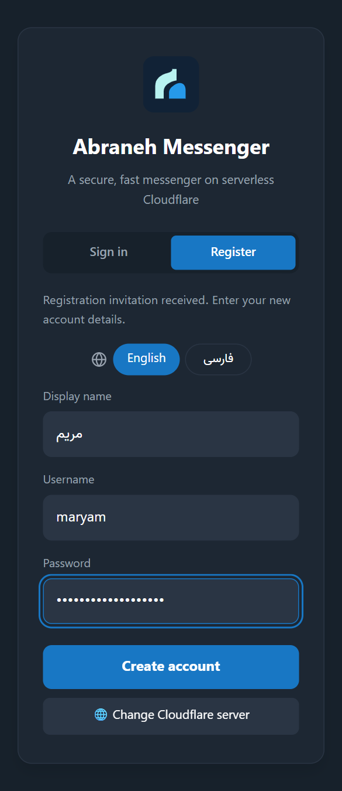

1. Open the link you received, **completely**, in your phone's or computer's browser (Chrome, Safari, Edge or any other).

2. If the page is in Persian, tap **English**.

3. With an invitation link, the **Register** tab opens by itself and says "Registration invitation received" above the form. With a normal link, tap the **Register** tab yourself.

4. Fill in three boxes:
   - **Display name:** the name others see, like "Maryam Ahmadi"
   - **Username:** English letters, numbers and `_` only, 3 to 20 characters, like `maryam` or `ali_1990`. Others find you by it. You can change it later
   - **Password:** at least 8 characters. One you don't use anywhere else

5. Tap **Create account**. You are signed in.

**Write down your username and password.** You use them to sign in to the app.

| If you see | It means |
| --- | --- |
| "Registration here needs an invitation link from the admin" | Ask the server owner for an invitation link |
| A message that the invitation expired or was used up (it may appear in Persian) | The invitation link is spent. Ask for a new one |
| "Registration is closed" | The owner closed registration. Talk to them |
| "This username is already taken" | Choose another username |

## 4. Install the app

Read only the part for your device: [Android](#android) · [Windows](#windows) · [iPhone and iPad](#iphone) · [Mac and computers](#desktop)

Every app is on the [latest release page](https://github.com/DarkPoesidon/Abraneh/releases/latest). The `wihm-installer.zip` file on that page is for building a server, not for you.

### Android (Android 5 and later)

1. Tap this link to download the file: **[wihm-messenger-android-universal.apk](https://github.com/DarkPoesidon/Abraneh/releases/latest/download/wihm-messenger-android-universal.apk)**

2. When the download finishes, tap the download notification or the file in **Downloads**.

3. If the phone says installing unknown apps from this source isn't allowed, tap **Settings**, turn on **Allow from this source**, go back and tap **Install**.

4. If **Google Play Protect** warns that it doesn't recognise the app, tap **More details**, then **Install anyway**. The warning appears because the app doesn't come from Google Play.

5. Open **Abraneh**.

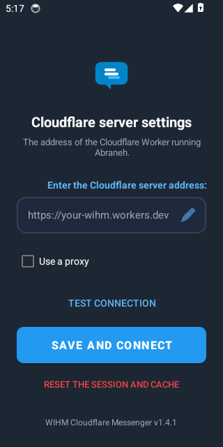

6. In the address box, type or paste the **server address**: the messenger link **without** `#register=...`. For example `https://my-family-chat.my-family-chat-1a2b3c4d.workers.dev`

7. If you like, tap **Test connection**. A green message means everything is fine. Then tap **Save and connect**.

8. The sign-in page opens. Tap **Sign in**, enter your username and password and tap **Sign in** again.

9. If the app asks for **notification** permission, allow it. If it offers to remove the **battery restriction**, accept. Without these, messages arrive late when the app is closed. See [notifications](#notifications) too.

> **App lock:** to open Abraneh only with your fingerprint, face or phone PIN, go to **Settings → Notifications** and turn on **Open Abraneh with the phone's lock**. The phone must already have a screen lock. You are asked again after more than a minute outside the app.

### Windows (Windows 10 and 11, 64-bit)

1. Click this link to download the file: **[wihm-messenger-windows-setup.exe](https://github.com/DarkPoesidon/Abraneh/releases/latest/download/wihm-messenger-windows-setup.exe)** (about 120 MB)

2. Run it from **Downloads**.

3. If Windows shows a blue "Windows protected your PC" window, click **More info**, then **Run anyway**. The warning appears because the app has no commercial signature.

4. It installs by itself and opens.

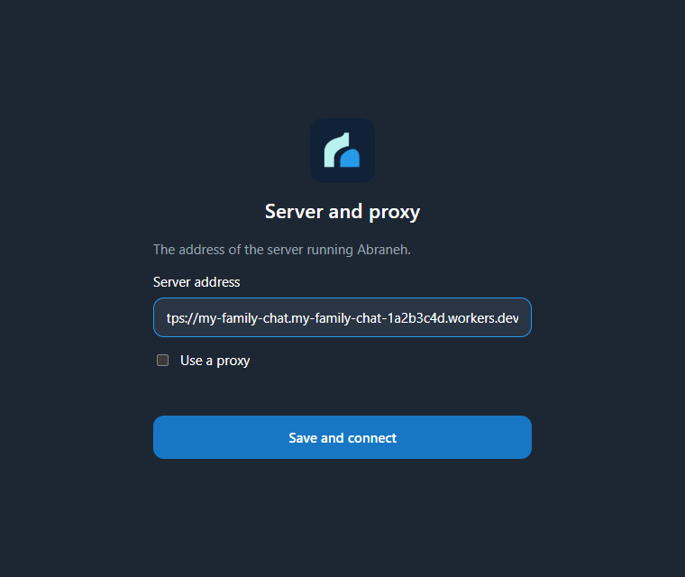

5. In **Server address**, paste the server address without `#register=...` and click **Save and connect**.

6. Sign in with your username and password.

- Closing the window doesn't quit the app. It stays next to the Windows clock so notifications arrive. To quit completely, right-click the Abraneh icon next to the clock and choose **Quit**.
- When you have unread messages, the app's taskbar button shows a red dot.
- Press `Ctrl+K` to find a chat quickly.

### iPhone and iPad

No separate app is needed. You put the page on the home screen like an app.

1. Open the link in **Safari**. Chrome on iPhone is not suitable for notifications.

2. If you don't have an account yet, [register](#account). Otherwise sign in.

3. Tap the **Share** button (a square with an arrow pointing up).

4. Scroll down, tap **Add to Home Screen**, then **Add**.

5. From now on, open Abraneh from its home screen icon. Notifications on iPhone only work this way, and need iOS 16.4 or later.

### Mac, Linux and computer browsers

1. Open the link in **Chrome** or **Edge** and sign in.

2. At the end of the address bar, click the install icon (a screen with an arrow) and click **Install**. Abraneh opens like a separate app.

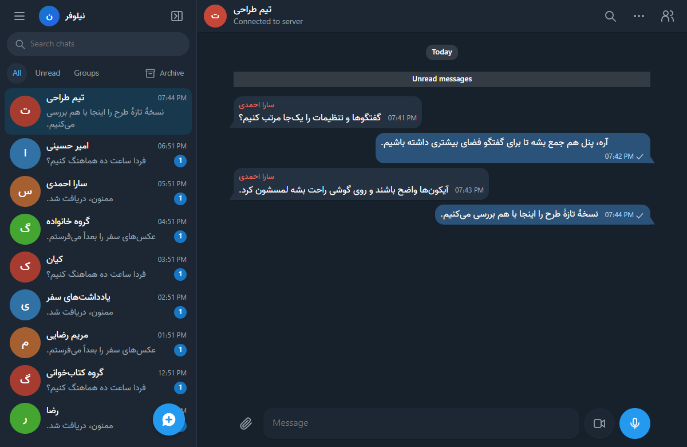

## 5. Your first message

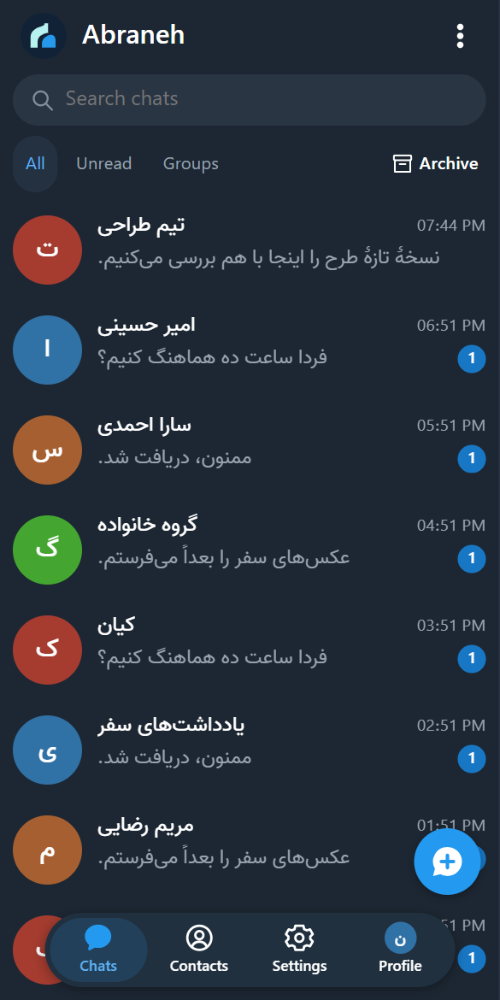

1. Tap the round blue **New chat** button at the bottom of the list.

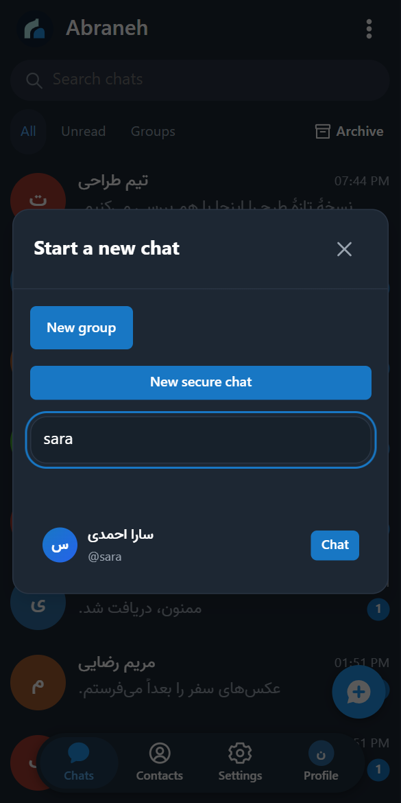

2. Type your friend's username, like `sara`. Find them in the list and tap **Chat**.

3. Type your message in the box at the bottom and tap send.

**Finding chats:** at the top of the list, tap **All**, **Unread** or **Groups**. The **Search chats** box is at the top too. Text you typed but didn't send stays under that chat's name, labelled "Draft".

**What the marks next to your messages mean:**

| Mark | Meaning |
| --- | --- |
| Clock | Not sent yet, waiting for the internet. It is sent by itself when the connection returns |
| One tick | The message reached the server |
| Two ticks | Your contact read it |

## 6. Messages, files, voice and calls

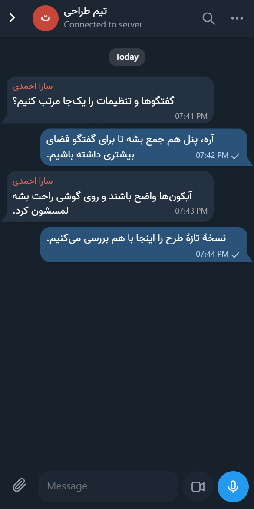

- **Photos and files:** tap the paperclip and choose a file. Check the preview and tap **Send**. Photos up to 16 MB, files up to 32 MB.
- **Voice and video messages:** when the message box is empty, tap the microphone or camera. Voice messages up to 5 minutes, video messages up to 1 minute.
- **Voice and video calls:** in a one-to-one chat, tap the contact's name and tap **Call** or **Video**. The first time, allow microphone and camera access.
- **Back to the list:** on a phone, press back or swipe the chat to the side.

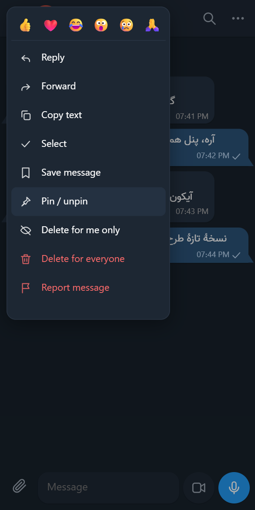

- **Message menu:** on a phone, hold your finger on a message. On a computer, right-click it. Reactions, reply, edit, forward, copy, save, pin, delete and report are here.
- **Quick reply:** on a phone, swipe a message sideways.
- **Edit and delete:** you can edit your own messages. **Delete for me only** hides a message just for you. **Delete for everyone** removes it for everyone.
- **Selecting several messages:** tap **Select** in the menu to copy, forward or delete up to 50 messages at once.
- **Saved messages:** messages you saved are in **Main menu → Saved messages**.
- **Search in a chat:** the magnifier at the top of the chat.
- **Mentions in groups:** type `@` and choose a member.

## 7. Chat menu and profiles

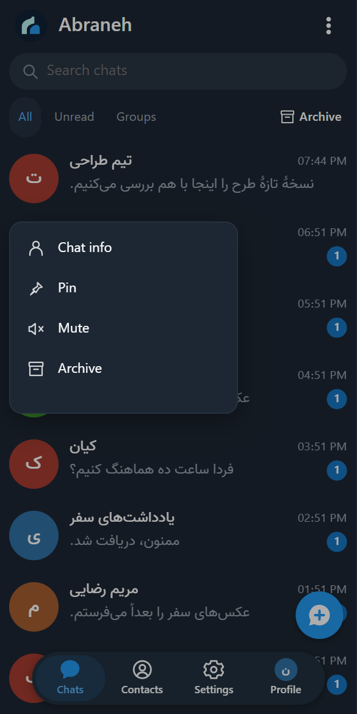

- **Chat menu:** in the chat list, hold your finger on a chat, or right-click on a computer. **Chat info**, **Pin**, **Mute** and **Archive** are here.
- **Archive:** archived chats are under **Archive** at the top of the list.

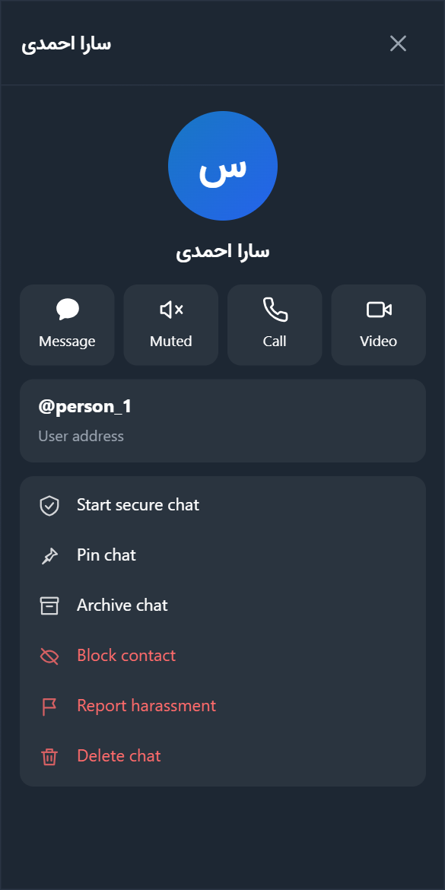

- **Profile:** inside a chat, tap the contact's name or picture. **Message**, **Mute**, **Call** and **Video** are at the top. Further down are **Start secure chat**, pin, archive, **Block contact**, **Report harassment** and **Delete chat**.
- **The phone's back button:** each press closes one layer: a menu, a window, a settings page or a chat. In the chat list it moves the app aside, and messages keep arriving.

## 8. Groups and channels

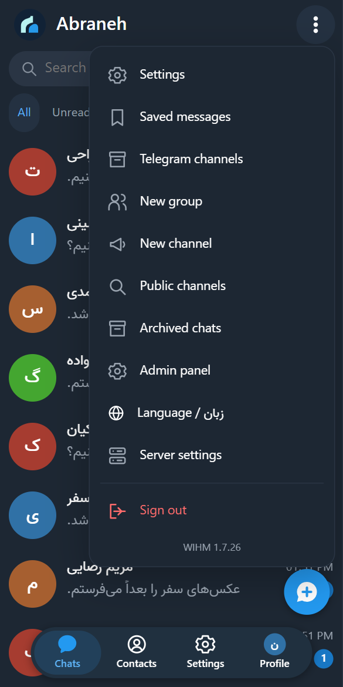

The main menu opens with the three dots at the top.

**Creating a group:**

1. Choose **Main menu → New group**.

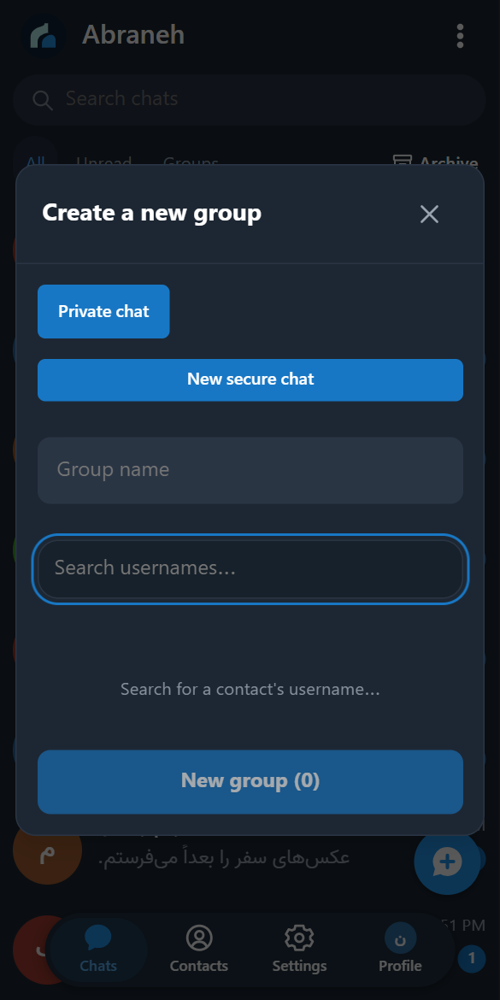

2. Type the group's name.

3. Search for members' usernames one at a time and tap each one to add them.

4. Tap the create button. Each group holds up to 100 members.

**Creating a channel:** **Main menu → New channel**. In a channel only admins post and everyone else reads. A **private** channel takes members only through invitation links. A **public** channel can be found in search and anyone can join.

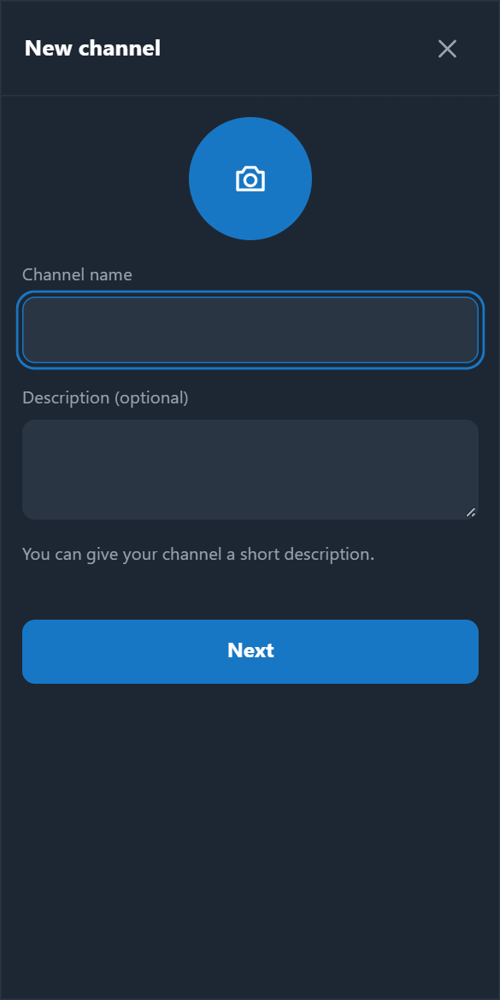

**Finding channels:** **Main menu → Public channels**. Channels on other servers are found here too.

**Joining with a group invitation link:** group and channel invitation links end with `#join=`. Open the link once in a **browser** while signed in to your account. The group is added to your list and appears in the app too. The apps don't open these links themselves.

**Group or channel settings:** tap its name at the top of the chat. Adding members, invitation links, mute, report and leave are there.

## 9. Secure chats

In a secure chat, each message is encrypted on your device and only your contact's device can open it. **Even the server owner can't see the text.** It is similar to Telegram's secret chats.

> Normal chats and groups are not like this. The server owner technically has access to them. Use secure chats for anything private.

### Starting a secure chat

1. Tap the blue **New chat** button and choose **New secure chat**.

2. Search for the contact, choose them and confirm. For a contact on another server, type their full address, like `sara@chat.example.org`.

3. Type and send a message. The first message sends a chat request to your contact.

You can also tap **Start secure chat** in a one-to-one chat's profile.

### Accepting a request

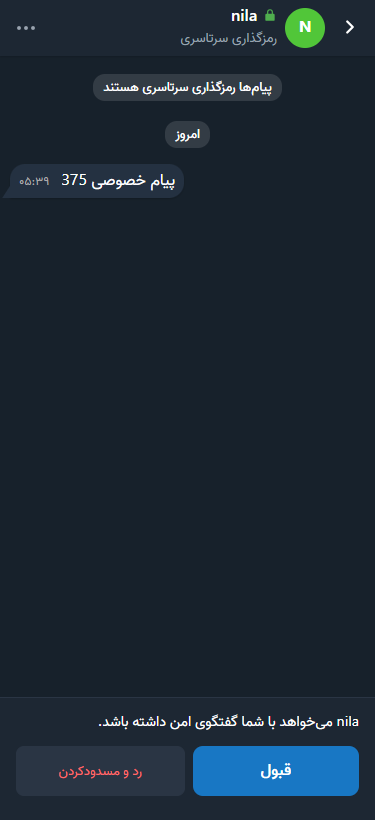

When someone sends you a secure chat request, their chat appears in your list. Open it and read their message, then tap **Accept** or **Decline and block**. Until you accept, they don't know you read it, and you can't reply.

### Inside the chat

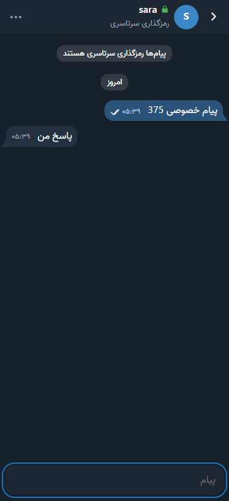

- A **green lock** next to the name and the words **End-to-end encrypted** mean you are in a secure chat. It is separate from your normal chat with the same person.
- Reply, edit, delete, reactions, copy and read ticks work like a normal chat.
- Pin and archive apply only on that device. **Delete chat** also deletes only that device's copy.
- Files, voice, calls, search and mute are not available in secure chats yet.

### Security code (optional)

For full certainty, tap the contact's name and open the **security code**. Compare it with the code on your contact's device, in person or during a call. If they match, tap **They match**. If they don't, don't write anything private in that chat.

If your contact reinstalls the app or changes device, a warning appears above the message box. If you aren't sure, ask them another way before continuing.

### Several devices

Until approved, each device has its own separate secure chats. To join them:

1. On the new device, open **Settings → Secure chat devices**. You see that device's code.

2. On your old device, open the same page and tap **Approve this device** next to the new device. If the codes match, tap **They match**.

3. On the new device, compare the old device's code and tap **They match**.

Earlier messages don't move to the new device. New messages open on both. Use the same page to remove a lost device.

### Keeping your history

Secure chat history lives only on the device, and the server has no copy. Before clearing browser data, uninstalling the app or changing phones, create a file under **Settings → Secure chat devices → Recovery file**. Keep the file and its password separately. Without that file, the history can't come back.

## 10. Notifications

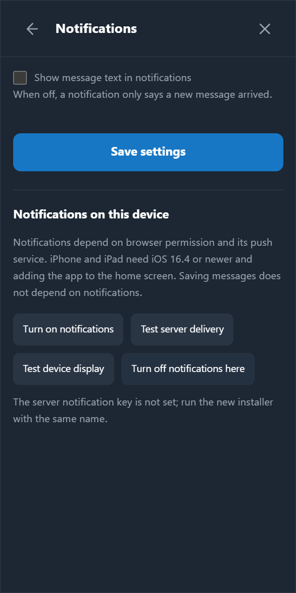

**Android app:** the app delivers notifications itself and doesn't depend on Google services. If messages arrive late:

1. Open **Settings → Notifications** in Abraneh.

2. Tap **⚡ Remove battery restriction** and allow it.

3. On Xiaomi, Huawei, Samsung and Oppo phones, tap **🚀 Autostart settings** and turn Abraneh on, so messages arrive after the phone restarts.

4. Use **🔔 Test device notification** to make sure notifications appear.

On Android 7 and later you can reply or mark as read straight from the notification.

**Windows app:** it notifies you while it is running next to the Windows clock. If notifications don't appear, turn off Windows **Focus Assist** or **Do not disturb**. After restarting the computer, open the app once.

**Browser and iPhone:** tap **Settings → Notifications → Turn on notifications** and choose **Allow** in the browser's prompt. Try it with **Test server delivery**.

- **Show message text in notifications:** when on, notifications show the message text. When off, they only say a new message arrived.
- **Muting one chat:** hold your finger on the chat and tap **Mute**.

## 11. Settings, language and proxy

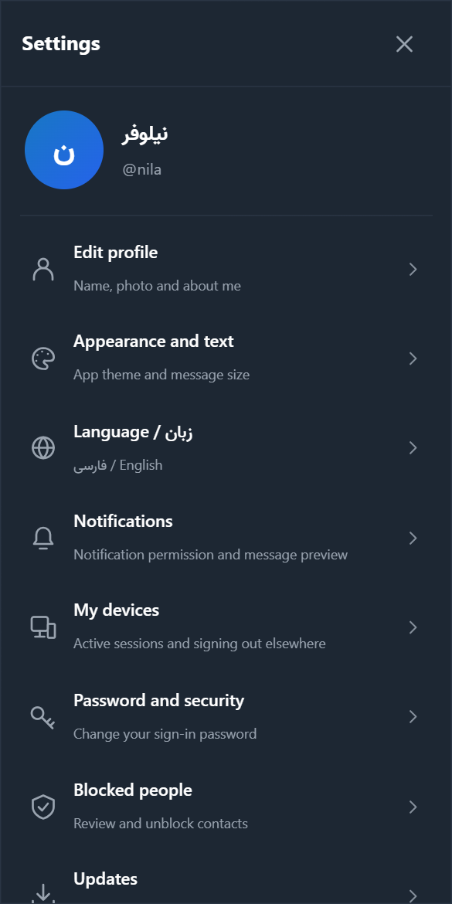

From **Main menu → Settings**, or the **Settings** button in the bottom bar:

| Section | Use |
| --- | --- |
| **Edit profile** | Name, picture, username and "about me" |
| **Appearance and text** | Dark or light theme, and message text size |
| **Language / زبان** | Persian or English |
| **Notifications** | Notification permission, message text in notifications, and on Android the app lock and battery |
| **My devices** | Devices you are signed in on, and signing out of other devices |
| **Password and security** | Change your password |
| **Blocked people** | People you blocked, and unblocking |
| **Updates** | Checking for new versions |
| **Passkeys and two-step sign-in** | Stronger sign-in security |
| **Secure chat devices** | Approving a new device and the recovery file |

### Proxy (Android and Windows only)

If the messenger link doesn't open on your connection, you can set a proxy for Abraneh only:

1. Tap **Main menu → Server settings**. The server address screen opens. If you aren't signed in yet, the **Change Cloudflare server** button on the sign-in page does the same.

2. Turn on **Use a proxy**.

3. Enter the proxy type (**SOCKS5** or **HTTP**), the **proxy address** and the **port**. If a VPN app runs on the same device, the address is usually `127.0.0.1` and the port is in that app's settings.

4. Tap **Save and connect**.

- Only proxies **without a username and password** work.
- **MTProto** proxies are for Telegram only and don't work here.
- In a browser or on iPhone, use a VPN or the device's own proxy setting.

## 12. Updates

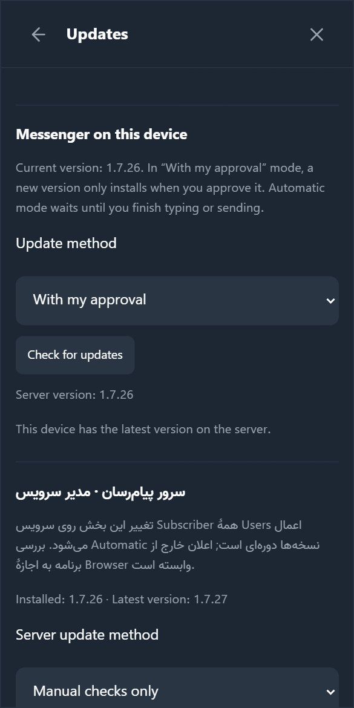

You update two things separately:

**1. The messenger page (on every device):**

1. Open **Settings → Updates**.

2. Tap **Check for updates**. If the server owner installed a new version, an update button appears. Tap it. Text you were typing stays as a draft.

Under **Update method** you can choose **Automatic**. The app then waits until you finish your message and updates itself.

**2. The app itself (Android and Windows):**

- **Android:** every time it opens, the app checks for a new version. If there is one, it shows "A new version is ready". Tap **Download and install**. The first time, you must allow Abraneh to install apps. Your messages and account are kept.
- **Windows:** it checks by itself every few hours. To check now, tap **Check for Windows app updates** under **Settings → Updates**, or right-click the icon next to the clock and choose **Check for updates**.

Version numbers are shown at the bottom of the main menu. If you reinstall an app by hand, install it over the old one. Uninstalling deletes that device's secure chat history.

## 13. Security and privacy

- **Normal chats and groups are not end-to-end encrypted.** The server owner technically has access to them. Only use a server whose owner you trust.
- Use [secure chats](#secure-chat) for private matters. This feature is experimental and has not had an independent security review yet. [Full explanation](ADVANCED.fa.md#معنای-رمزگذاری-آزمایشی) (Persian).
- Never send your password to anyone, including the server owner. The server owner never needs your password.
- For stronger security, create a passkey or two-step sign-in under **Settings → Passkeys and two-step sign-in**.
- **Forgot your password?** Ask the server owner for a "password reset link". It works once, for one hour. Don't forward it.
- **Lost your phone?** Sign in on another device and tap **Sign out of other devices** under **Settings → My devices**. If you used secure chats, also remove the lost device under **Secure chat devices**.
- **Harassment:** in their profile, tap **Block contact** or **Report harassment**.

## 14. If something goes wrong

| Problem | What to do |
| --- | --- |
| The link doesn't open | Try another connection. A VPN or [proxy](#proxy) helps. See [Iran](#iran) |
| The Android app won't install | Allow installing unknown apps for your browser or file manager. If an older version is installed and there is a conflict error, uninstall the old version first |
| The app says the address is invalid | The address must start with `https://`. Remove the `#register=...` part |
| Wrong username or password | Each server's accounts are separate. Make sure you're on the server where you registered. For a forgotten password, ask the server owner for a reset link |
| Registration is closed or the invitation link doesn't work | Ask the server owner for a new invitation link, and open it **completely** in a **browser** |
| I can't find my friend | Type the exact username. They must be registered on the same server. If one of you blocked the other, they won't show up |
| No notifications | Go through [notifications](#notifications) in order. Make sure the chat isn't muted |
| Calls don't connect | Check microphone and camera permissions. On some networks, the server owner has to set up call connections |
| A message stays on the clock | You're offline or the server isn't reachable. The message waits in the queue and is sent when the connection returns |
| Secure chat: "this contact hasn't opened a secure chat yet" | Ask your contact to open the app once, then send again |
| Secure chat: messages are missing on my other device | [Approve the new device](#secure-chat). Messages from before approval don't move |
| Everything fails with "The service action failed" | Tell the server owner. No messages are lost. It usually fixes itself within a few hours |
| The app looks old | **Settings → Updates → Check for updates** |
| A blank white page on an old Android | Update **Android System WebView** from Google Play or the phone's app store |

If nothing helps, tell the server owner. **Never send your password to anyone.**
