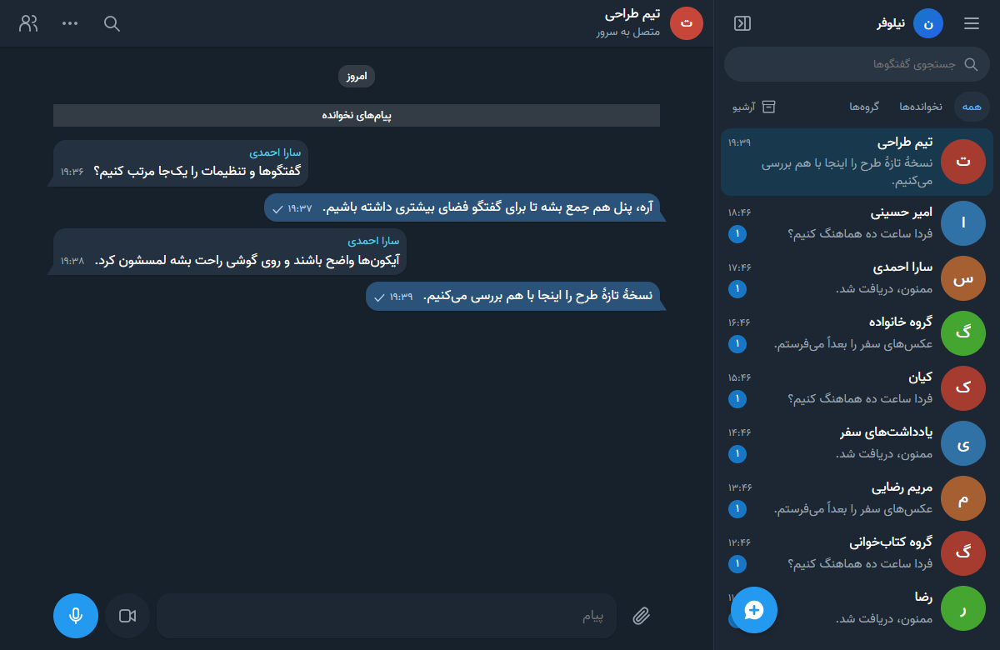
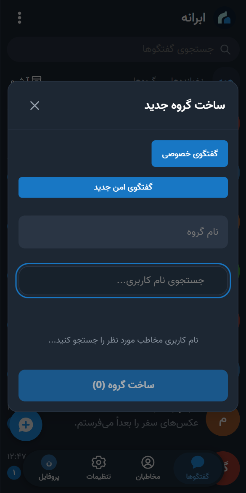
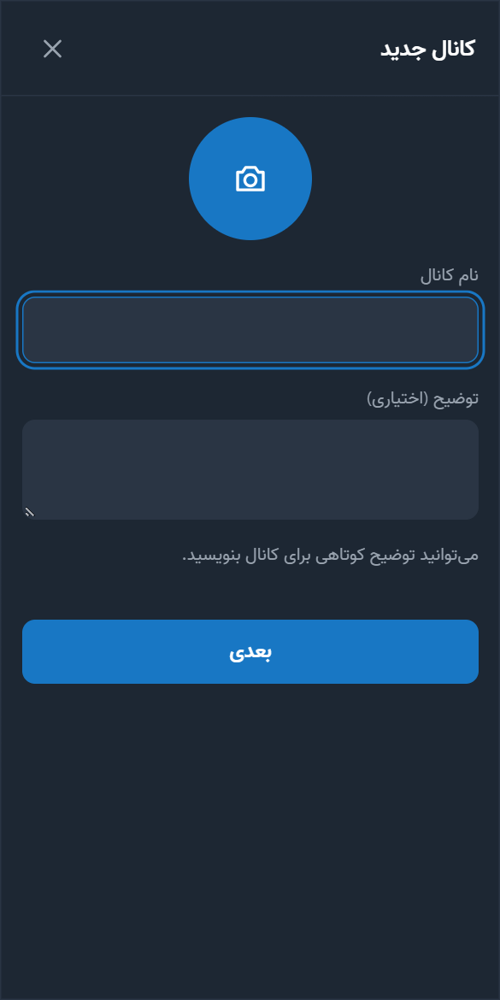

# راهنمای کاربران: استفاده از ابرانه

این راهنما برای کسی است که از یک دوست، عضو خانواده یا صاحب یک گروه، **لینک** پیام‌رسان ابرانه را گرفته است. **هیچ دانش فنی لازم نیست.** به حساب کلادفلر، نصب‌کننده یا کار فنی دیگری هم نیازی ندارید.

اگر می‌خواهید سرور خودتان را بسازید، [راهنمای صاحب سرور](GUIDE-ADMIN.fa.md) را ببینید.

*[English version](GUIDE-USER.en.md)*

## خلاصه در سه قدم

۱. **حساب بسازید:** لینکی را که گرفته‌اید در مرورگر گوشی باز کنید و ثبت‌نام کنید.

۲. **برنامه را نصب کنید:** برنامهٔ اندروید یا ویندوز را نصب کنید، یا روی آیفون صفحه را به صفحهٔ اصلی اضافه کنید.

۳. **وارد شوید و پیام بدهید:** با همان نام کاربری و رمز وارد شوید و دوستتان را با نام کاربری‌اش پیدا کنید.

بقیهٔ راهنما همین سه قدم را با جزئیات توضیح می‌دهد، و بعد همهٔ امکانات برنامه را.

## فهرست

۱. [دو نوع لینک](#link)
۲. [اگر در ایران هستید](#iran)
۳. [ساخت حساب](#account)
۴. [نصب برنامه](#install)
۵. [اولین پیام](#first-message)
۶. [پیام، فایل، صدا و تماس](#messages)
۷. [منوی گفتگو و پروفایل](#chat-menu)
۸. [گروه و کانال](#groups)
۹. [گفتگوی امن](#secure-chat)
۱۰. [اعلان‌ها](#notifications)
۱۱. [تنظیمات، زبان و پروکسی](#settings)
۱۲. [به‌روزرسانی](#updates)
۱۳. [امنیت و حریم خصوصی](#security)
۱۴. [اگر مشکلی پیش آمد](#problems)

## ۱. دو نوع لینک

صاحب سرور یکی از این دو لینک را برایتان می‌فرستد:

| لینک شبیه این است | یعنی |
| --- | --- |
| `https://my-family-chat.my-family-chat-1a2b3c4d.workers.dev` | **لینک پیام‌رسان.** ثبت‌نام آزاد است و با همین لینک حساب می‌سازید |
| `https://my-family-chat....workers.dev/#register=a1b2c3...` | **لینک دعوت.** ثبت‌نام فقط با دعوت است و این لینک مخصوص شماست. بخش بعد از `#register=` کلید دعوت است |

**نشانی سرور** همان بخش اول لینک است، تا `workers.dev` (یا تا دامنه‌ای که صاحب سرور گذاشته)، بدون `#register=...`. برنامه‌ها این نشانی را از شما می‌خواهند.

- هر سرور حساب‌های خودش را دارد. حسابی که روی یک سرور می‌سازید، روی سرور دیگر کار نمی‌کند.
- لینک دعوت را برای کس دیگری نفرستید. ممکن است فقط برای یک نفر ساخته شده باشد و زود منقضی شود.

## ۲. اگر در ایران هستید

- نشانی‌های `workers.dev` روی بعضی اینترنت‌های ایران باز نمی‌شوند. اگر لینک باز نشد، اول اینترنت دیگری را امتحان کنید (مثلاً اینترنت همراه به جای وای‌فای).
- اگر باز هم نشد، می‌توانید فیلترشکن روشن کنید. یا در برنامه‌های اندروید و ویندوز، **فقط برای ابرانه** [پروکسی](#proxy) بگذارید.
- دانلود برنامه‌ها از گیت‌هاب هم ممکن است فیلترشکن بخواهد. می‌توانید از صاحب سرور بخواهید فایل برنامه را مستقیم برایتان بفرستد.
- اگر این مشکل برای همهٔ اعضا هست، به صاحب سرور بگویید. او می‌تواند [دامنهٔ شخصی](GUIDE-ADMIN.fa.md#domain) وصل کند که معمولاً پایدارتر است.

## ۳. ساخت حساب

پیشنهاد ما این است که **اول حساب را در مرورگر بسازید** و بعد برنامه را نصب کنید. برنامه‌ها فقط نشانی سرور را می‌گیرند و کلید دعوت را نگه نمی‌دارند.

۱. لینکی را که گرفته‌اید، **کامل**، در مرورگر گوشی یا رایانه باز کنید (Chrome، Safari، Edge یا هر مرورگر دیگری).

۲. اگر صفحه انگلیسی بود، روی **فارسی** بزنید.

۳. اگر لینک دعوت گرفته‌اید، صفحهٔ **ثبت‌نام** خودش باز می‌شود و بالای فرم می‌نویسد «دعوت‌نامهٔ ثبت‌نام دریافت شد». اگر لینک معمولی گرفته‌اید، خودتان زبانهٔ **ثبت‌نام** را بزنید.

۴. سه کادر را پر کنید:
   - **نام نمایشی:** نامی که دیگران می‌بینند، مثلاً «مریم احمدی». فارسی هم می‌شود
   - **نام کاربری:** فقط حروف انگلیسی، عدد و `_`، بین ۳ تا ۲۰ حرف، مثل `maryam` یا `ali_1370`. دیگران شما را با این پیدا می‌کنند. بعداً هم می‌شود عوضش کرد
   - **رمز عبور:** حداقل ۸ حرف. رمزی که جای دیگری استفاده نکرده‌اید

۵. **ایجاد حساب کاربری** را بزنید. وارد پیام‌رسان می‌شوید.

**نام کاربری و رمزتان را یادداشت کنید.** در برنامه با همین‌ها وارد می‌شوید.

| اگر این را دیدید | یعنی |
| --- | --- |
| «ثبت‌نام در این سرویس فقط با لینک دعوت مدیر ممکن است» | از صاحب سرور لینک دعوت بخواهید |
| «دعوت ثبت‌نام منقضی یا مصرف شده است» | لینک دعوت تمام شده است. لینک تازه بخواهید |
| «ثبت‌نام فعلاً بسته است» | صاحب سرور ثبت‌نام را بسته است. با او صحبت کنید |
| «این نام کاربری قبلاً انتخاب شده است» | نام کاربری دیگری بنویسید |

## ۴. نصب برنامه

فقط بخش دستگاه خودتان را بخوانید: [اندروید](#android) · [ویندوز](#windows) · [آیفون و آیپد](#iphone) · [مک و رایانه](#desktop)

همهٔ برنامه‌ها در [صفحهٔ آخرین نسخه](https://github.com/DarkPoesidon/Abraneh/releases/latest) هستند. فایل `wihm-installer.zip` در آن صفحه برای ساختن سرور است، نه برای شما.

### اندروید (اندروید ۵ به بالا)

۱. روی این لینک بزنید تا فایل دانلود شود: **[wihm-messenger-android-universal.apk](https://github.com/DarkPoesidon/Abraneh/releases/latest/download/wihm-messenger-android-universal.apk)**

۲. وقتی دانلود تمام شد، روی اعلان دانلود یا روی فایل در پوشهٔ **Downloads** بزنید.

۳. اگر گوشی گفت «برای امنیت، نصب برنامه‌های ناشناس از این منبع مجاز نیست»، روی **تنظیمات** بزنید، **اجازه از این منبع** را روشن کنید، با دکمهٔ برگشت برگردید و **نصب** را بزنید.

۴. اگر **Google Play Protect** هشدار داد که برنامه را نمی‌شناسد، روی **جزئیات بیشتر** (More details) و بعد **در هر صورت نصب شود** (Install anyway) بزنید. این هشدار برای این است که برنامه از Google Play نیامده است.

۵. برنامهٔ **ابرانه** را باز کنید.

۶. در کادر نشانی، **نشانی سرور** را بنویسید یا بچسبانید، یعنی لینک پیام‌رسان **بدون** `#register=...`. مثلاً `https://my-family-chat.my-family-chat-1a2b3c4d.workers.dev`

۷. اگر خواستید، **آزمایش اتصال** را بزنید. پیام سبز یعنی همه‌چیز درست است. بعد **ذخیره و اتصال** را بزنید.

۸. صفحهٔ ورود باز می‌شود. زبانهٔ **ورود** را بزنید، نام کاربری و رمز را وارد کنید و **ورود به حساب** را بزنید.

۹. اگر برنامه اجازهٔ **اعلان** خواست، **اجازه دادن** را بزنید. اگر پیشنهاد برداشتن **محدودیت باتری** داد، قبول کنید. بدون این‌ها، وقتی برنامه بسته است پیام‌ها دیر می‌رسند. بخش [اعلان‌ها](#notifications) را هم ببینید.

> **قفل برنامه:** اگر می‌خواهید ابرانه فقط با اثرانگشت، چهره یا رمز گوشی باز شود، در **تنظیمات ← اعلان‌ها**، **باز کردن ابرانه با قفل گوشی** را روشن کنید. گوشی باید از قبل قفل صفحه داشته باشد. وقتی بیش از یک دقیقه از برنامه بیرون باشید، دوباره پرسیده می‌شود.

### ویندوز (ویندوز ۱۰ و ۱۱، ۶۴ بیتی)

۱. روی این لینک بزنید تا فایل دانلود شود: **[wihm-messenger-windows-setup.exe](https://github.com/DarkPoesidon/Abraneh/releases/latest/download/wihm-messenger-windows-setup.exe)** (حدود ۱۲۰ مگابایت)

۲. فایل را از پوشهٔ **Downloads** اجرا کنید.

۳. اگر ویندوز پنجرهٔ آبی «Windows protected your PC» نشان داد، روی **More info** و بعد **Run anyway** بزنید. این هشدار برای این است که برنامه امضای تجاری ندارد.

۴. نصب خودکار انجام می‌شود و برنامه باز می‌شود.

۵. در **نشانی سرور**، نشانی سرور را بدون `#register=...` بچسبانید و **ذخیره و اتصال** را بزنید.

۶. با نام کاربری و رمز وارد شوید.

- با بستن پنجره، برنامه بسته نمی‌شود و کنار ساعت ویندوز می‌ماند تا اعلان‌ها برسند. برای خروج کامل، روی آیکون ابرانه کنار ساعت راست‌کلیک کنید و **خروج** را بزنید.
- وقتی پیام نخوانده دارید، روی دکمهٔ برنامه در نوار وظیفه یک نقطهٔ قرمز دیده می‌شود.
- با `Ctrl+K` سریع گفتگو پیدا کنید.

### آیفون و آیپد

برنامهٔ جدا لازم نیست. صفحه را مثل یک برنامه روی صفحهٔ اصلی می‌گذارید.

۱. لینک را در **Safari** باز کنید. Chrome روی آیفون برای اعلان مناسب نیست.

۲. اگر هنوز حساب ندارید، [ثبت‌نام](#account) کنید. وگرنه وارد شوید.

۳. پایین صفحه دکمهٔ **Share** (مربع با فلش رو به بالا) را بزنید.

۴. پایین بیایید و **Add to Home Screen** را بزنید، و بعد **Add**.

۵. از این به بعد ابرانه را با آیکونش در صفحهٔ اصلی باز کنید. اعلان روی آیفون فقط به این شکل کار می‌کند، و به iOS 16.4 یا جدیدتر نیاز دارد.

### مک، لینوکس و مرورگر رایانه

۱. لینک را در **Chrome** یا **Edge** باز کنید و وارد شوید.

۲. در انتهای نوار آدرس، روی آیکون نصب (یک صفحه با فلش) بزنید و **Install** را بزنید. ابرانه مثل یک برنامهٔ جدا باز می‌شود.

## ۵. اولین پیام

۱. دکمهٔ آبی گرد **گفتگوی جدید** را در پایین فهرست بزنید.

۲. نام کاربری دوستتان را بنویسید، مثل `sara`. او را در فهرست پیدا کنید و **گفتگو** را بزنید.

۳. پیام را در کادر پایین بنویسید و دکمهٔ ارسال را بزنید.

**پیدا کردن گفتگو:** بالای فهرست، **همه**، **نخوانده‌ها** یا **گروه‌ها** را بزنید. کادر **جستجوی گفتگوها** هم بالای فهرست است. اگر متنی نوشته‌اید و نفرستاده‌اید، زیر نام آن گفتگو با برچسب «پیش‌نویس» می‌ماند.

**معنی علامت‌ها کنار پیام شما:**

| علامت | معنی |
| --- | --- |
| ساعت | پیام هنوز فرستاده نشده و منتظر اینترنت است. وقتی اینترنت برگردد، خودش فرستاده می‌شود |
| یک تیک | پیام به سرور رسیده است |
| دو تیک | مخاطب پیام را خوانده است |

## ۶. پیام، فایل، صدا و تماس

- **عکس و فایل:** دکمهٔ گیره را بزنید و فایل را انتخاب کنید. پیش‌نمایش را ببینید و **ارسال** را بزنید. عکس تا ۱۶ و فایل تا ۳۲ مگابایت.
- **پیام صوتی و تصویری:** وقتی کادر پیام خالی است، دکمهٔ میکروفون یا دوربین را بزنید. پیام صوتی تا ۵ دقیقه و تصویری تا ۱ دقیقه.
- **تماس صوتی و تصویری:** در گفتگوی دونفره، روی نام مخاطب بزنید و **تماس** یا **تصویری** را بزنید. بار اول، اجازهٔ میکروفون و دوربین را بدهید.
- **برگشت به فهرست:** روی گوشی، دکمهٔ برگشت را بزنید یا صفحهٔ گفتگو را به راست بکشید.

- **منوی پیام:** روی گوشی، انگشت را روی پیام نگه دارید. روی رایانه، راست‌کلیک کنید. واکنش (ایموجی)، پاسخ، ویرایش، هدایت، کپی، ذخیره، سنجاق، حذف و گزارش اینجاست.
- **پاسخ سریع:** روی گوشی، پیام را به کنار بکشید.
- **ویرایش و حذف:** پیام خودتان را می‌توانید ویرایش کنید. **حذف فقط برای من** پیام را فقط از دید شما برمی‌دارد. **حذف برای همه** برای همه پاک می‌کند.
- **انتخاب چند پیام:** در منو **انتخاب** را بزنید و تا ۵۰ پیام را با هم کپی، هدایت یا حذف کنید.
- **پیام‌های ذخیره‌شده:** پیام‌هایی که ذخیره کرده‌اید در **منوی اصلی ← پیام‌های ذخیره‌شده** هستند.
- **جستجو در گفتگو:** ذره‌بین بالای گفتگو.
- **اشاره در گروه:** `@` بنویسید و عضو را انتخاب کنید.

## ۷. منوی گفتگو و پروفایل

- **منوی گفتگو:** در فهرست گفتگوها، انگشت را روی یک گفتگو نگه دارید، یا روی رایانه راست‌کلیک کنید. **اطلاعات گفتگو**، **سنجاق**، **بی‌صدا کردن** و **آرشیو** اینجاست.
- **آرشیو:** گفتگوهای آرشیوشده زیر دکمهٔ **آرشیو** در بالای فهرست هستند.

- **پروفایل:** داخل گفتگو، روی نام یا عکس مخاطب بزنید. دکمه‌های **پیام**، **بی‌صدا**، **تماس** و **تصویری** بالا هستند. پایین‌تر **شروع گفتگوی امن**، **سنجاق**، **آرشیو**، **مسدودکردن مخاطب**، **گزارش مزاحمت** و **حذف گفتگو** را می‌بینید.
- **دکمهٔ برگشت گوشی:** هر بار یک لایه را می‌بندد: منو، پنجره، صفحهٔ تنظیمات یا گفتگو. در فهرست گفتگوها، برنامه کنار می‌رود و پیام‌ها همچنان می‌رسند.

## ۸. گروه و کانال

منوی اصلی با سه‌نقطهٔ بالای صفحه باز می‌شود.

**ساختن گروه:**

۱. **منوی اصلی ← ساخت گروه** را بزنید.

۲. نام گروه را بنویسید.

۳. نام کاربری اعضا را یکی‌یکی جستجو کنید و روی هرکدام بزنید تا اضافه شوند.

۴. **ساخت گروه** را بزنید. هر گروه تا ۱۰۰ عضو دارد.

**ساختن کانال:** **منوی اصلی ← کانال جدید**. در کانال فقط مدیران پست می‌گذارند و بقیه می‌خوانند. کانال **خصوصی** فقط با لینک دعوت عضو می‌گیرد. کانال **عمومی** در جستجو پیدا می‌شود و همه می‌توانند عضو شوند.

**پیدا کردن کانال:** **منوی اصلی ← کانال‌های عمومی**. کانال‌های سرورهای دیگر هم از همین‌جا پیدا می‌شوند.

**پیوستن با لینک دعوت گروه:** لینک دعوت گروه یا کانال با `#join=` تمام می‌شود. آن را یک بار در **مرورگر** باز کنید، در حالی که با حسابتان وارد شده‌اید. گروه به فهرستتان اضافه می‌شود و در برنامه هم دیده می‌شود. برنامه‌ها خودشان این لینک‌ها را باز نمی‌کنند.

**تنظیمات گروه یا کانال:** روی نام آن در بالای گفتگو بزنید. افزودن عضو، لینک‌های دعوت، بی‌صدا کردن، گزارش و خروج آنجاست.

## ۹. گفتگوی امن

در گفتگوی امن، پیام روی دستگاه شما رمز می‌شود و فقط دستگاه مخاطب آن را باز می‌کند. **صاحب سرور هم متن را نمی‌بیند.** این شبیه «گفتگوی محرمانه» تلگرام است.

> گفتگوهای معمولی و گروه‌ها این‌طور نیستند. صاحب سرور از نظر فنی به آن‌ها دسترسی دارد. برای حرف‌های محرمانه از گفتگوی امن استفاده کنید.

### شروع گفتگو

۱. دکمهٔ آبی **گفتگوی جدید** را بزنید و **گفتگوی امن جدید** را انتخاب کنید.

۲. مخاطب را جستجو کنید، او را انتخاب کنید و شروع گفتگو را تأیید کنید. برای مخاطبی در سرور دیگر، نشانی کامل مثل `sara@chat.example.org` را بنویسید.

۳. پیام بنویسید و بفرستید. اولین پیام، درخواست گفتگو را برای مخاطب می‌فرستد.

از پروفایل یک گفتگوی دونفره هم می‌توانید **شروع گفتگوی امن** را بزنید.

### قبول درخواست

وقتی کسی برایتان درخواست گفتگوی امن بفرستد، گفتگویش در فهرست می‌آید. آن را باز کنید و پیامش را بخوانید. بعد **قبول** یا **رد و مسدودکردن** را بزنید. تا قبول نکنید، او نمی‌فهمد که پیام را خوانده‌اید و شما هم نمی‌توانید پاسخ بدهید.

### داخل گفتگو

- **قفل سبز** کنار نام و عبارت **رمزگذاری سرتاسری** یعنی در گفتگوی امن هستید. این گفتگو از گفتگوی معمولی شما با همان شخص جداست.
- پاسخ، ویرایش، حذف، واکنش، کپی و تیک خواندن مثل گفتگوی معمولی کار می‌کنند.
- سنجاق و آرشیو فقط روی همان دستگاه اعمال می‌شوند. **حذف گفتگو** هم فقط نسخهٔ همان دستگاه را پاک می‌کند.
- فعلاً فایل، صدا، تماس، جستجو و بی‌صدا کردن در گفتگوی امن نیست.

### کد امنیتی (اختیاری)

برای اطمینان کامل، روی نام مخاطب بزنید و **کد امنیتی** را باز کنید. کد را حضوری یا در یک تماس، با کد روی دستگاه مخاطب مقایسه کنید. اگر یکسان بود، **یکسان است** را بزنید. اگر یکسان نبود، در آن گفتگو چیز محرمانه‌ای ننویسید.

اگر مخاطب برنامه را دوباره نصب کند یا دستگاهش عوض شود، بالای کادر پیام هشدار می‌آید. اگر مطمئن نیستید، قبل از ادامه از راه دیگری از خودش بپرسید.

### چند دستگاه

هر دستگاه تا وقتی تأیید نشده، گفتگوهای امن جدای خودش را دارد. برای یکی‌کردن آن‌ها:

۱. روی دستگاه تازه، **تنظیمات ← دستگاه‌های گفتگوی امن** را باز کنید. کد آن دستگاه را می‌بینید.

۲. روی دستگاه قبلی، همان صفحه را باز کنید و کنار دستگاه تازه **تأیید این دستگاه** را بزنید. اگر کدها یکی بود، **یکسان است** را بزنید.

۳. روی دستگاه تازه، کد دستگاه قبلی را مقایسه کنید و **یکسان است** را بزنید.

پیام‌های قبلی به دستگاه تازه نمی‌آیند. پیام‌های تازه روی هر دو باز می‌شوند. برای حذف دستگاه گم‌شده هم از همان صفحه استفاده کنید.

### نگه‌داشتن تاریخچه

تاریخچهٔ گفتگوی امن فقط روی دستگاه است و سرور نسخه‌ای از آن ندارد. قبل از پاک کردن حافظهٔ مرورگر، حذف برنامه یا عوض کردن گوشی، از **تنظیمات ← دستگاه‌های گفتگوی امن ← فایل بازیابی** یک فایل بگیرید. فایل و رمزش را جدا نگه دارید. بدون این فایل، تاریخچه برنمی‌گردد.

## ۱۰. اعلان‌ها

**برنامهٔ اندروید:** اعلان را خود برنامه می‌دهد و به سرویس گوگل نیاز ندارد. اگر پیام‌ها دیر می‌رسند:

۱. **تنظیمات ← اعلان‌ها** را در ابرانه باز کنید.

۲. **⚡ غیرفعال‌سازی محدودیت باتری** را بزنید و اجازه بدهید.

۳. روی گوشی‌های شیائومی، هواوی، سامسونگ و اوپو، **🚀 تنظیمات شروع خودکار (Autostart)** را بزنید و ابرانه را روشن کنید تا بعد از روشن شدن دوبارهٔ گوشی، پیام‌ها برسند.

۴. با **🔔 آزمایش اعلان دستگاه** مطمئن شوید که اعلان می‌آید.

در اندروید ۷ و بالاتر، از خود اعلان می‌توانید پاسخ بدهید یا **خوانده شد** را بزنید.

**برنامهٔ ویندوز:** تا وقتی برنامه کنار ساعت ویندوز باز است، اعلان می‌دهد. اگر اعلان نمی‌آید، **Focus Assist** یا **Do not disturb** ویندوز را خاموش کنید. بعد از ری‌استارت رایانه، یک بار برنامه را باز کنید.

**مرورگر و آیفون:** **تنظیمات ← اعلان‌ها ← فعال‌کردن اعلان** را بزنید و در پنجرهٔ مرورگر **Allow** را بزنید. با **آزمایش ارسال سرور** امتحان کنید.

- **نمایش متن پیام در اعلان:** اگر روشن باشد، متن پیام در اعلان دیده می‌شود. اگر خاموش باشد، فقط می‌نویسد پیام تازه آمده است.
- **بی‌صدا کردن یک گفتگو:** انگشت را روی گفتگو نگه دارید و **بی‌صدا کردن** را بزنید.

## ۱۱. تنظیمات، زبان و پروکسی

از **منوی اصلی ← تنظیمات**، یا دکمهٔ **تنظیمات** در نوار پایین:

| بخش | کاربرد |
| --- | --- |
| **ویرایش پروفایل** | نام، عکس، نام کاربری و «دربارهٔ من» |
| **ظاهر و نوشته‌ها** | تم تیره یا روشن، و اندازهٔ متن پیام‌ها |
| **Language / زبان** | فارسی یا انگلیسی |
| **اعلان‌ها** | اجازهٔ اعلان، متن پیام در اعلان، و در اندروید قفل برنامه و باتری |
| **دستگاه‌های من** | دستگاه‌هایی که با آن‌ها وارد شده‌اید. خروج از دستگاه‌های دیگر |
| **رمز عبور و امنیت** | تغییر رمز |
| **افراد مسدودشده** | فهرست کسانی که مسدود کرده‌اید، و برداشتن مسدودیت |
| **به‌روزرسانی** | بررسی نسخهٔ تازه |
| **کلید عبور و ورود دومرحله‌ای** | امنیت بیشتر برای ورود |
| **دستگاه‌های گفتگوی امن** | تأیید دستگاه تازه و فایل بازیابی |

### پروکسی (فقط اندروید و ویندوز)

اگر لینک پیام‌رسان روی اینترنت شما باز نمی‌شود، می‌توانید فقط برای ابرانه پروکسی بگذارید:

۱. **منوی اصلی ← تنظیمات سرور** را بزنید. همان صفحهٔ نشانی سرور باز می‌شود. اگر هنوز وارد نشده‌اید، در صفحهٔ ورود دکمهٔ **تغییر سرور کلادفلر** همین کار را می‌کند.

۲. **استفاده از پروکسی** را روشن کنید.

۳. نوع پروکسی (**SOCKS5** یا **HTTP**)، **نشانی پروکسی** و **پورت** را وارد کنید. اگر برنامهٔ فیلترشکنی روی همان دستگاه دارید، معمولاً نشانی `127.0.0.1` است و پورت را در تنظیمات همان برنامه پیدا می‌کنید.

۴. **ذخیره و اتصال** را بزنید.

- فقط پروکسی **بدون نام کاربری و رمز** کار می‌کند.
- پروکسی **MTProto** مخصوص تلگرام است و اینجا کار نمی‌کند.
- در مرورگر و آیفون، از فیلترشکن یا تنظیم پروکسی خود دستگاه استفاده کنید.

## ۱۲. به‌روزرسانی

دو چیز را جدا به‌روز می‌کنید:

**۱. صفحهٔ پیام‌رسان (روی همهٔ دستگاه‌ها):**

۱. **تنظیمات ← به‌روزرسانی** را باز کنید.

۲. **بررسی آپدیت** را بزنید. اگر صاحب سرور نسخهٔ تازه نصب کرده باشد، دکمهٔ به‌روزرسانی ظاهر می‌شود. آن را بزنید. متنی که نوشته‌اید به‌صورت پیش‌نویس می‌ماند.

در **روش به‌روزرسانی** می‌توانید **خودکار** را انتخاب کنید. در این حالت، برنامه صبر می‌کند تا پیامتان را تمام کنید و بعد خودش به‌روز می‌شود.

**۲. خود برنامه (اندروید و ویندوز):**

- **اندروید:** هر بار که برنامه باز می‌شود، نسخهٔ تازه را بررسی می‌کند. اگر نسخهٔ تازه باشد، پنجرهٔ «نسخهٔ جدید آماده دریافت است» را نشان می‌دهد. **دانلود و نصب خودکار** را بزنید. بار اول باید به ابرانه اجازهٔ نصب برنامه بدهید. پیام‌ها و حسابتان حفظ می‌شوند.
- **ویندوز:** چند ساعت یک بار خودش بررسی می‌کند. برای بررسی فوری، در **تنظیمات ← به‌روزرسانی** دکمهٔ **بررسی آپدیت برنامهٔ ویندوز** را بزنید، یا روی آیکون کنار ساعت راست‌کلیک کنید و **بررسی به‌روزرسانی** را بزنید.

شمارهٔ نسخه‌ها پایین منوی اصلی نوشته شده است. اگر برنامه را دستی از نو نصب کنید، فقط آن را روی نسخهٔ قبلی نصب کنید. حذف برنامه، تاریخچهٔ گفتگوهای امن آن دستگاه را پاک می‌کند.

## ۱۳. امنیت و حریم خصوصی

- **گفتگوهای معمولی و گروه‌ها رمزگذاری سرتاسری ندارند.** صاحب سرور از نظر فنی می‌تواند به آن‌ها دسترسی داشته باشد. فقط از سروری استفاده کنید که به صاحبش اعتماد دارید.
- برای حرف‌های محرمانه از [گفتگوی امن](#secure-chat) استفاده کنید. این بخش آزمایشی است و هنوز بررسی امنیتی مستقل نشده است. [توضیح کامل](ADVANCED.fa.md#معنای-رمزگذاری-آزمایشی).
- رمزتان را برای هیچ‌کس، حتی صاحب سرور، نفرستید. صاحب سرور هیچ‌وقت رمز شما را لازم ندارد.
- برای امنیت بیشتر، از **تنظیمات ← کلید عبور و ورود دومرحله‌ای**، کلید عبور یا ورود دومرحله‌ای بسازید.
- **رمز را فراموش کردید؟** از صاحب سرور «لینک بازیابی رمز» بخواهید. لینک یک ساعت و فقط یک بار کار می‌کند. آن را برای کس دیگری نفرستید.
- **گوشی را گم کردید؟** روی دستگاه دیگری وارد شوید و از **تنظیمات ← دستگاه‌های من**، **خروج از سایر دستگاه‌ها** را بزنید. اگر گفتگوی امن داشتید، دستگاه گم‌شده را از **دستگاه‌های گفتگوی امن** هم حذف کنید.
- **مزاحم:** از پروفایل او **مسدودکردن مخاطب** یا **گزارش مزاحمت** را بزنید.

## ۱۴. اگر مشکلی پیش آمد

| مشکل | چه کنم؟ |
| --- | --- |
| لینک باز نمی‌شود | اینترنت دیگری را امتحان کنید. فیلترشکن یا [پروکسی](#proxy) کمک می‌کند. [بخش ایران](#iran) |
| برنامهٔ اندروید نصب نمی‌شود | اجازهٔ نصب از منبع ناشناس را برای مرورگر یا مدیر فایل بدهید. اگر نسخهٔ قدیمی‌تری نصب است و خطای تداخل می‌دهد، اول نسخهٔ قدیمی را حذف کنید |
| برنامه می‌گوید نشانی معتبر نیست | نشانی باید با `https://` شروع شود. بخش `#register=...` را پاک کنید |
| نام کاربری یا رمز درست نیست | حساب هر سرور جداست. مطمئن شوید روی همان سروری هستید که ثبت‌نام کرده‌اید. برای رمز فراموش‌شده از صاحب سرور لینک بازیابی بخواهید |
| ثبت‌نام بسته است یا لینک دعوت کار نمی‌کند | از صاحب سرور لینک دعوت تازه بخواهید و آن را **کامل** و در **مرورگر** باز کنید |
| دوستم پیدا نمی‌شود | نام کاربری را دقیق بنویسید. او باید روی همین سرور ثبت‌نام کرده باشد. اگر یکی از شما دیگری را مسدود کرده باشد، پیدا نمی‌شود |
| اعلان نمی‌آید | بخش [اعلان‌ها](#notifications) را به ترتیب انجام دهید. ببینید گفتگو بی‌صدا نباشد |
| تماس وصل نمی‌شود | اجازهٔ میکروفون و دوربین را بررسی کنید. روی بعضی اینترنت‌ها، صاحب سرور باید اتصال تماس را تنظیم کند |
| پیام با علامت ساعت می‌ماند | اینترنت قطع است یا سرور در دسترس نیست. پیام در صف می‌ماند و وقتی اتصال برگردد، خودش فرستاده می‌شود |
| گفتگوی امن: «این مخاطب هنوز گفتگوی امن را باز نکرده است» | از مخاطب بخواهید برنامه را یک بار باز کند، و بعد دوباره بفرستید |
| گفتگوی امن: پیام‌ها روی دستگاه دیگرم نیست | دستگاه تازه را [تأیید کنید](#secure-chat). پیام‌های قبل از تأیید منتقل نمی‌شوند |
| همه‌چیز خطا می‌دهد: «عملیات سرویس کامل نشد» | به صاحب سرور خبر دهید. پیام‌ها از بین نرفته‌اند. معمولاً تا چند ساعت بعد خودش درست می‌شود |
| ظاهر برنامه قدیمی است | **تنظیمات ← به‌روزرسانی ← بررسی آپدیت** |
| روی اندروید قدیمی صفحه سفید یا خالی است | **Android System WebView** را از Google Play یا فروشگاه گوشی به‌روز کنید |

اگر حل نشد، به صاحب سرور خبر دهید. **رمز خودتان را برای هیچ‌کس نفرستید.**

