

# راهنمای کاربران: استفاده از ابرانه

این راهنما برای کسی است که لینک پیام‌رسان را از صاحب سرور گرفته است. به حساب کلادفلر، نصب‌کننده یا ترموکس نیازی ندارید. اگر می‌خواهید سرور خودتان را بسازید، [راهنمای صاحب سرور](GUIDE-ADMIN.fa.md) را ببینید.

## فهرست

۱. [لینک را بگیرید](#link)
۲. [برنامه را نصب کنید](#install)
۳. [حساب بسازید](#account)
۴. [اولین پیام](#first-message)
۵. [پیام، فایل، صدا و تماس](#messages)
۶. [منوی گفتگو و پروفایل](#chat-menu)
۷. [گفتگوی امن](#secure-chat)
۸. [گروه و کانال](#groups)
۹. [اعلان‌ها](#notifications)
۱۰. [تنظیمات، زبان و پروکسی](#settings)
۱۱. [به‌روزرسانی](#updates)
۱۲. [امنیت و حریم خصوصی](#security)
۱۳. [اگر مشکلی پیش آمد](#problems)

## ۱. لینک را بگیرید

از صاحب سرور لینک پیام‌رسان را بگیرید. لینک شبیه این است: `https://my-family-chat.example.workers.dev`

هر سرور لینک و حساب‌های خودش را دارد. حسابی که روی یک سرور می‌سازید، روی سرور دیگری کار نمی‌کند.

## ۲. برنامه را نصب کنید

یکی را انتخاب کنید. برای استفاده، می‌توانید لینک را فقط در مرورگر هم باز کنید.

### اندروید (اندروید ۵ به بالا)

۱. [فایل اندروید](https://github.com/DarkPoesidon/WIHM-Cloudflare/releases/latest/download/wihm-messenger-android-universal.apk) را دانلود و باز کنید.

۲. اگر گوشی اجازهٔ نصب خواست، برای همان مرورگر **اجازه** بدهید و نصب را بزنید.

۳. برنامه را باز کنید، لینک سرور را وارد کنید و دکمهٔ ذخیره و اتصال را بزنید.

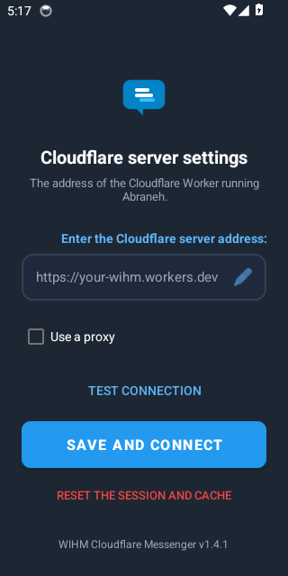

۴. اگر پرسید، اجازهٔ اعلان بدهید و محدودیت باتری را بردارید تا پیام‌ها وقتی برنامه بسته است هم برسند.

### ویندوز (ویندوز ۱۰ و ۱۱)

۱. [نصب‌کنندهٔ ویندوز](https://github.com/DarkPoesidon/WIHM-Cloudflare/releases/latest/download/wihm-messenger-windows-setup.exe) را دانلود و اجرا کنید. حجمش حدود ۱۲۰ مگابایت است.

۲. اگر ویندوز هشدار داد، **More info** و بعد **Run anyway** را بزنید. این برنامه امضای تجاری ندارد.

۳. لینک سرور را وارد کنید و **ذخیره و اتصال** را بزنید.

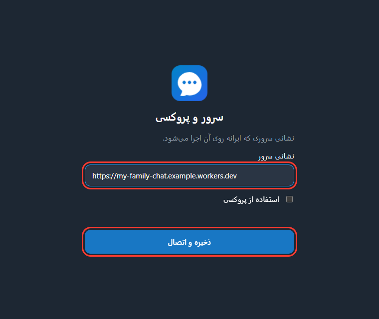

با بستن پنجره، برنامه در نوار وظیفه می‌ماند تا اعلان‌ها برسند. برای خروج کامل، روی آیکونش در نوار وظیفه راست‌کلیک کنید. بعد از ری‌استارت رایانه، برنامه را دوباره باز کنید تا اعلان بگیرید.

### آیفون و آیپد

لینک را در **Safari** باز کنید، دکمهٔ Share را بزنید و **Add to Home Screen** را انتخاب کنید. اعلان در آیفون به iOS 16.4 یا جدیدتر و همین افزودن به صفحهٔ اصلی نیاز دارد.

### مک و مرورگر رایانه

لینک را در Chrome یا Edge باز کنید و از آیکون نصب در نوار آدرس برنامه را نصب کنید.

## ۳. حساب بسازید

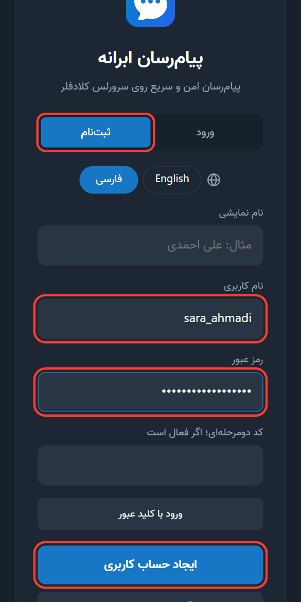

۱. **ثبت‌نام** را بزنید. اگر متن انگلیسی است، در همین صفحه **فارسی** را انتخاب کنید.

۲. نام نمایشی، نام کاربری و رمز عبور را وارد کنید. رمز باید حداقل ۸ حرف باشد.

۳. **ایجاد حساب کاربری** را بزنید. کد دومرحله‌ای و کلید عبور را در ثبت‌نام لازم ندارید.

نام کاربری را نگه دارید، چون دیگران شما را با آن پیدا می‌کنند. اگر ثبت‌نام بسته بود، از صاحب سرور دعوت‌نامه بخواهید.

> رمز را به کسی ندهید و جای امنی نگه دارید. اگر رمز را فراموش کردید، از مدیر سرور لینک بازیابی بخواهید.

## ۴. اولین پیام

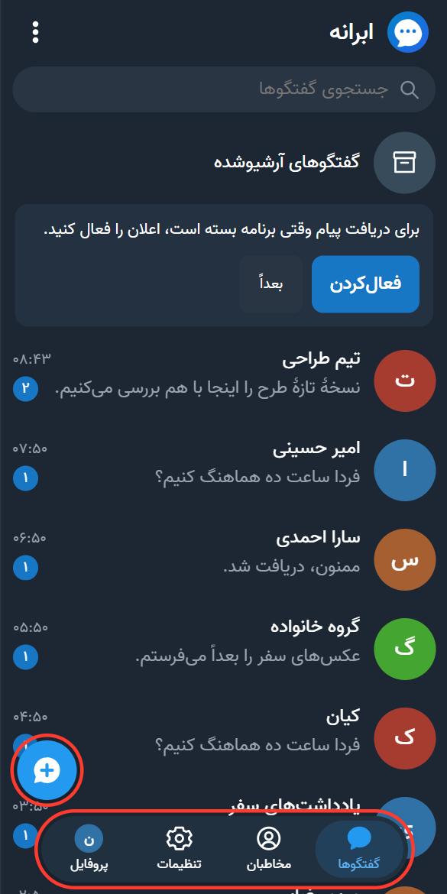

۱. دکمهٔ آبی **گفتگوی جدید** را بزنید.

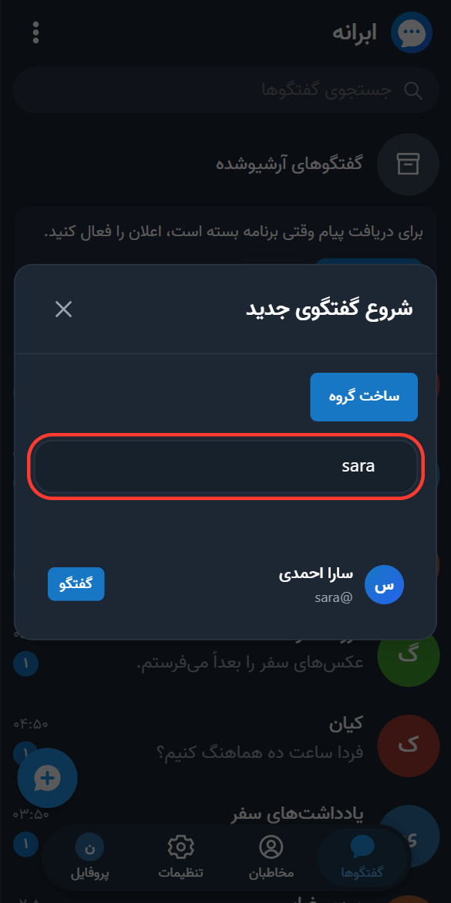

۲. نام کاربری دوستتان را جستجو کنید و او را انتخاب کنید.

۳. پیام را بنویسید و بفرستید.

**پیداکردن گفتگو:** در بالای فهرست، **همه**، **خوانده‌نشده** یا **گروه‌ها** را انتخاب کنید. در برنامهٔ ویندوز، `Ctrl+K` را بزنید، نام گفتگو را جستجو کنید، با کلیدهای جهت‌دار نتیجه را انتخاب کنید و با `Enter` آن را باز کنید.

**معنی تیک‌ها:** یک تیک یعنی پیام فرستاده شده است و دو تیک یعنی خوانده شده است. آیکون ساعت یعنی پیام هنوز منتظر اینترنت است و خودش بعداً ارسال می‌شود.

## ۵. پیام، فایل، صدا و تماس

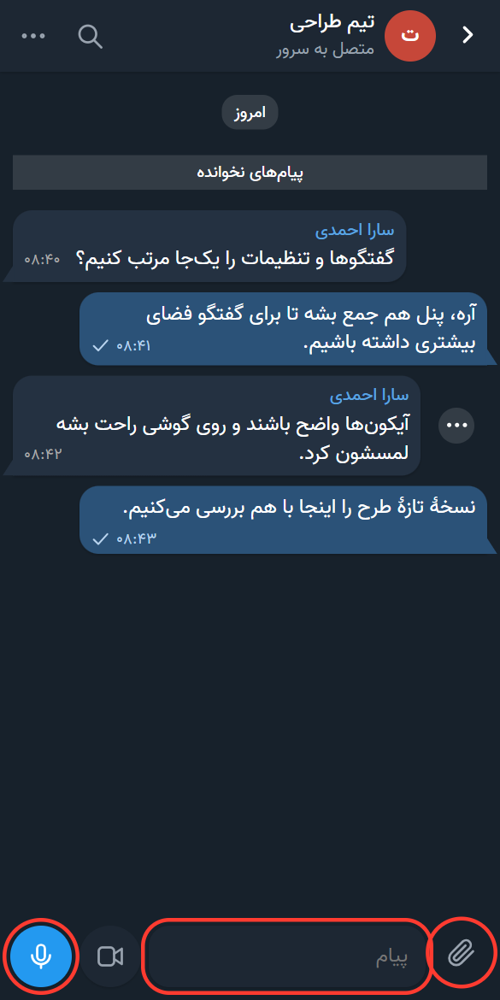

- **فایل و عکس:** دکمهٔ گیره را بزنید و یک فایل یا عکس انتخاب کنید. در پیش‌نمایش آن را بررسی کنید و برای فرستادن **ارسال** را بزنید. عکس تا ۱۶ و فایل تا ۳۲ مگابایت ارسال می‌شود.
- **پیام صوتی و تصویری:** وقتی کادر خالی است، دکمهٔ میکروفون یا دوربین را بزنید.
- **تماس:** در گفتگوی خصوصی، دکمهٔ تماس صوتی یا تصویری بالای صفحه را بزنید. مرورگر یا گوشی اجازهٔ میکروفون و دوربین می‌خواهد.

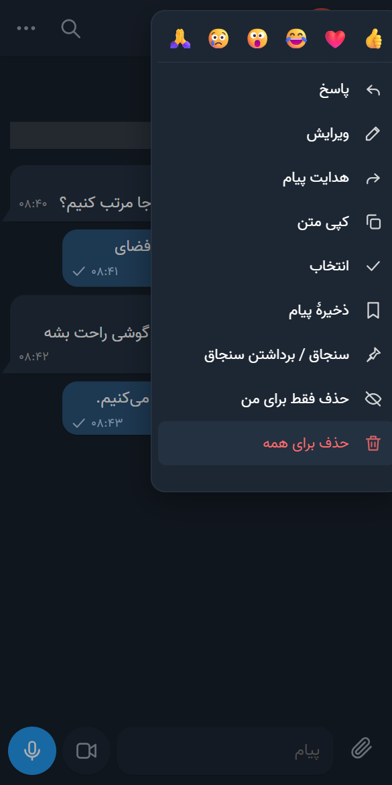

- **منوی پیام:** روی گوشی پیام را نگه دارید و روی رایانه راست‌کلیک کنید. پاسخ، ویرایش، هدایت، کپی، ذخیره، سنجاق و حذف اینجاست.
- **پاسخ سریع:** روی گوشی پیام را به چپ بکشید.
- **انتخاب چند پیام:** در منو **انتخاب** را بزنید و تا ۵۰ پیام را با هم کپی، هدایت یا حذف کنید.
- **پیش‌نویس:** متنی که نوشته‌اید با عوض‌کردن گفتگو یا بستن برنامه پاک نمی‌شود. در فهرست گفتگوها، یک خط از پیش‌نویس را زیر نام گفتگو می‌بینید. با ارسال پیام یا پاک‌کردن متن، پیش‌نمایش هم برداشته می‌شود.
- **اشاره در گروه:** `@` بنویسید و عضو را انتخاب کنید.

## ۶. منوی گفتگو و پروفایل

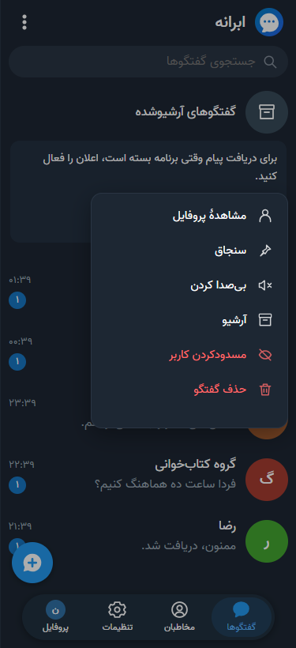

- **منوی گفتگو:** در فهرست گفتگوها انگشت را روی یک گفتگو نگه دارید تا منو از پایین صفحه باز شود. روی رایانه راست‌کلیک کنید. داخل چت هم سه‌نقطهٔ بالای صفحه را بزنید. پروفایل، سنجاق، بی‌صدا، آرشیو، مسدودکردن و حذف اینجاست.
- **آرشیو:** گفتگوهای آرشیوشده زیر **گفتگوهای آرشیوشده** در بالای فهرست هستند.

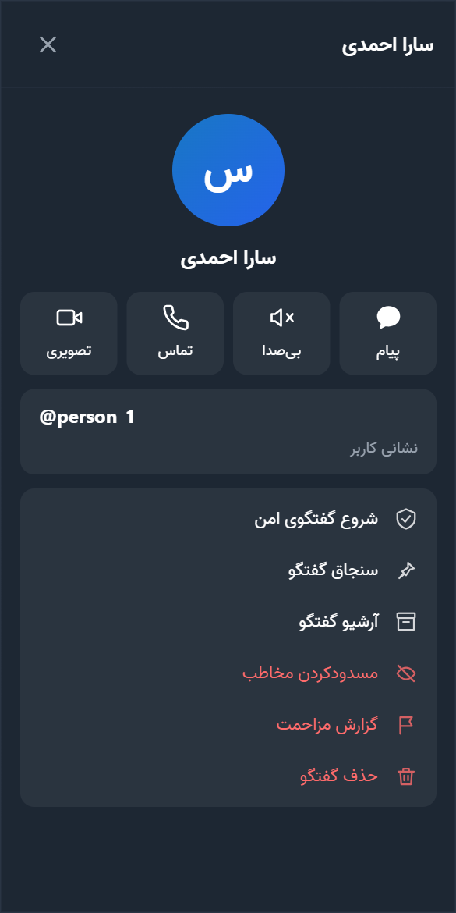

- **پروفایل:** داخل چت روی نام یا عکس مخاطب بزنید. دکمه‌های پیام، بی‌صدا، تماس و تصویری بالای آن هستند.
- **دکمهٔ بک گوشی:** هر بار یک لایه را می‌بندد: منو، پنجره، صفحهٔ تنظیمات یا چت. در فهرست گفتگوها، برنامه کنار می‌رود و پیام‌ها همچنان می‌رسند. برای رفتار کامل، اندروید 1.7.4 یا جدیدتر را نصب کنید.

## ۷. گفتگوی امن

در گفتگوی امن، پیام روی دستگاه شما رمز می‌شود و فقط دستگاه مخاطب آن را باز می‌کند. صاحب سرور متن را ندارد. این شبیه گفتگوی محرمانهٔ تلگرام است.

### شروع گفتگو

۱. دکمهٔ آبی **+** را بزنید و **گفتگوی امن جدید** را انتخاب کنید.

۲. مخاطب را جستجو کنید، او را انتخاب کنید و شروع گفتگو را تأیید کنید. برای مخاطب سرور دیگر، نشانی کامل مثل `sara@chat.example.org` را بنویسید.

۳. مثل چت معمولی پیام بنویسید و بفرستید. اولین پیام، درخواست گفتگو را برای مخاطب می‌فرستد.

می‌توانید از پروفایل یک گفتگوی خصوصی هم **شروع گفتگوی امن** را بزنید.

### قبول درخواست

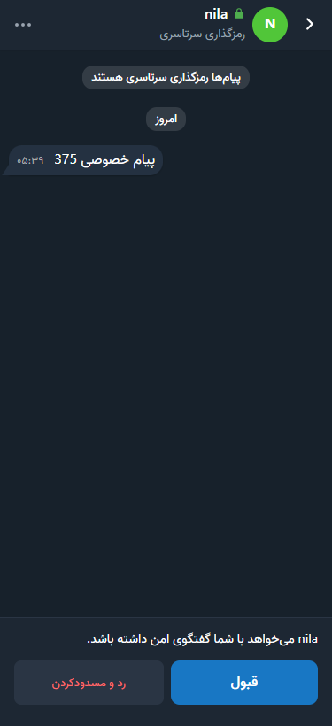

وقتی کسی برایتان درخواست بفرستد، گفتگویش در فهرست می‌آید. آن را باز کنید و پیامش را بخوانید. بعد **قبول** یا **رد و مسدودکردن** را بزنید. تا قبول نکنید، او خبر ندارد که پیام را خوانده‌اید و نمی‌توانید پاسخ بدهید.

### داخل گفتگو

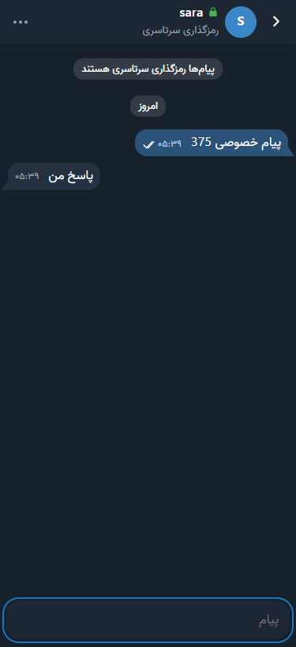

- **قفل سبز** کنار نام و عبارت **رمزگذاری سرتاسری** یعنی در گفتگوی امن هستید. همین گفتگو با همان شخص، جدا از چت معمولی شماست.
- پاسخ، ویرایش، حذف، واکنش، کپی و تیک خواندن مثل چت معمولی کار می‌کنند.
- سنجاق و آرشیو فقط روی همان دستگاه اعمال می‌شوند. **حذف گفتگو** هم فقط نسخهٔ همان دستگاه را پاک می‌کند، و پیام‌های دستگاه مخاطب پاک نمی‌شوند.
- فعلاً فایل، صدا، تماس، جستجو و بی‌صداکردن در گفتگوی امن نیست.

### کد امنیتی (اختیاری)

برای اطمینان کامل، روی نام مخاطب بزنید و **کد امنیتی** را باز کنید. کد را حضوری یا در تماس با کد روی دستگاه مخاطب مقایسه کنید. اگر یکسان بود، **یکسان است** را بزنید. اگر یکسان نبود، در آن گفتگو چیز محرمانه‌ای ننویسید.

اگر مخاطب برنامه را دوباره نصب کند یا دستگاهش عوض شود، بالای کادر پیام هشدار می‌آید. اگر مطمئن نیستید، قبل از پذیرش از راه دیگری از خودش بپرسید.

### چند دستگاه

هر دستگاه تا وقتی تأیید نشده، گفتگوهای امن جدای خودش را دارد. برای یکی‌کردن آن‌ها:

۱. روی دستگاه تازه، **تنظیمات ← دستگاه‌های گفتگوی امن** را باز کنید. کد آن دستگاه نوشته شده است.

۲. روی دستگاه قبلی، همان صفحه را باز کنید و کنار دستگاه تازه **تأیید این دستگاه** را بزنید. اگر کد یکی بود، **یکسان است** را بزنید.

۳. روی دستگاه تازه، کد دستگاه قبلی را مقایسه کنید و **یکسان است** را بزنید.

پیام‌های قبلی به دستگاه تازه نمی‌آیند. پیام‌های تازه روی هر دو باز می‌شوند، ولی مخاطب ممکن است تا چند دقیقه دستگاه تازه را نبیند. برای حذف دستگاه گم‌شده هم از همان صفحه استفاده کنید. حذف، چیزهایی را که قبلاً روی آن دستگاه ذخیره شده پاک نمی‌کند.

### نگه‌داشتن تاریخچه

تاریخچهٔ امن فقط روی دستگاه است و سرور نسخه‌ای از آن ندارد. پیش از پاک‌کردن حافظهٔ مرورگر یا حذف برنامه، از **تنظیمات ← دستگاه‌های گفتگوی امن ← فایل بازیابی** فایل بگیرید. فایل و رمزش را جدا نگه دارید. بدون این فایل تاریخچه برنمی‌گردد.

## ۸. گروه و کانال

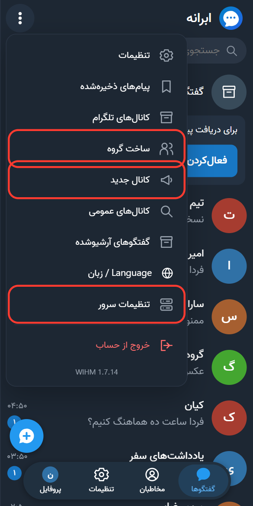

**گروه:** از منوی اصلی **ساخت گروه** را بزنید، نام بگذارید، اعضا را با نام کاربری اضافه کنید و گروه را بسازید. هر گروه تا ۱۰۰ عضو دارد.

**کانال:** از منوی اصلی **کانال جدید** را بزنید. فقط مدیران پست می‌گذارند و دیگران می‌خوانند. کانال می‌تواند عمومی با نشانی کوتاه باشد، یا خصوصی با لینک دعوت.

**پیدا کردن کانال:** از منوی اصلی **کانال‌های عمومی** را بزنید. کانال‌های سرورهای دیگر هم از همان‌جا پیدا می‌شوند.

**تنظیمات گروه و کانال:** روی نام آن در بالای گفتگو بزنید. بی‌صداکردن، سنجاق، آرشیو، لینک دعوت، گزارش و خروج آنجاست.

## ۹. اعلان‌ها

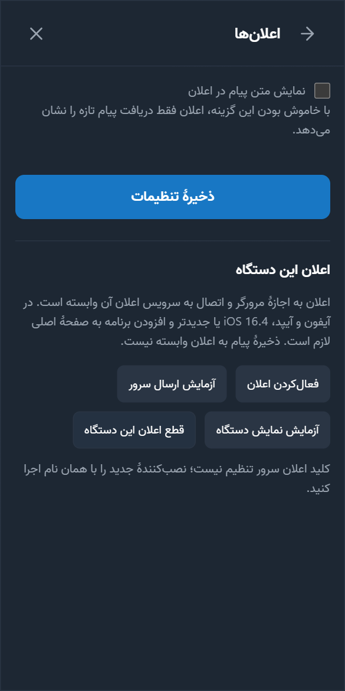

- **برنامهٔ اندروید:** اعلان را خود برنامه می‌دهد. اجازهٔ اعلان بدهید و محدودیت باتری را بردارید.
- **برنامهٔ ویندوز:** تا وقتی برنامه در نوار وظیفه باز است اعلان می‌دهد. Focus Assist یا Do Not Disturb ویندوز را هم بررسی کنید.
- **مرورگر و آیفون:** **تنظیمات ← اعلان‌ها** را باز کنید و اعلان را فعال کنید.

برای نمایش یا پنهان‌کردن متن پیام در اعلان، از همان صفحه استفاده کنید. برای بی‌صداکردن یک گفتگو، انگشت را روی آن نگه دارید و **بی‌صدا کردن** را بزنید.

## ۱۰. تنظیمات، زبان و پروکسی

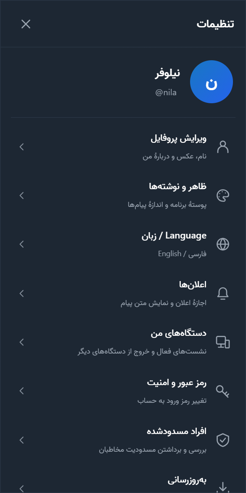

- **ویرایش پروفایل:** نام، عکس، نام کاربری و دربارهٔ من.
- **ظاهر و نوشته‌ها:** تم تیره یا روشن، و اندازهٔ متن.
- **زبان:** ردیف **Language / زبان**.
- **دستگاه‌های من:** می‌بینید با چه دستگاه‌هایی وارد شده‌اید، و می‌توانید از آن‌ها خارج شوید.
- **افراد مسدودشده:** فهرست کسانی که مسدود کرده‌اید.

**پروکسی (اندروید و ویندوز):** در **منوی اصلی ← سرور و پروکسی**، **استفاده از پروکسی** را روشن کنید و نوع، نشانی و پورت را وارد کنید. فقط پروکسی SOCKS5 یا HTTP بدون نام کاربری و رمز کار می‌کند. پروکسی MTProto مخصوص تلگرام است و اینجا کار نمی‌کند. در مرورگر و آیفون از VPN یا تنظیم پروکسی خود دستگاه استفاده کنید.

## ۱۱. به‌روزرسانی

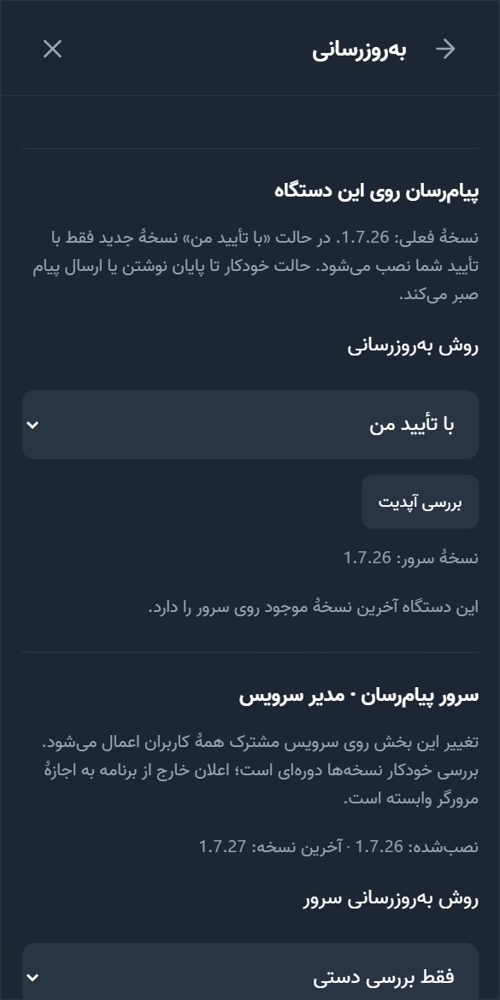

در **تنظیمات ← به‌روزرسانی**، **بررسی آپدیت** را بزنید. اگر نسخهٔ تازه بود، **بله، دریافت نسخهٔ جدید** را بزنید. متن نوشته‌شدهٔ شما به‌صورت پیش‌نویس می‌ماند.

نسخه‌ها پایین منوی اصلی نوشته شده‌اند. برنامهٔ اندروید و ویندوز هر کدام نسخهٔ جدای خودشان را دارند، و خودشان نسخهٔ تازه را پیشنهاد می‌کنند.

## ۱۲. امنیت و حریم خصوصی

- **گفتگوهای عادی و گروه‌ها رمزگذاری سرتاسری ندارند.** صاحب سرور از نظر فنی می‌تواند به آن‌ها دسترسی داشته باشد. فقط از سروری استفاده کنید که به صاحبش اعتماد دارید.
- برای امنیت بیشتر، از **تنظیمات ← رمز عبور و امنیت** و **کلید عبور و ورود دومرحله‌ای** استفاده کنید.
- برای حرف‌های محرمانه از [گفتگوی امن](#secure-chat) استفاده کنید. این بخش آزمایشی است و ممیزی مستقل نشده است. [توضیح کامل](ADVANCED.fa.md#معنای-رمزگذاری-آزمایشی).
- اگر دستگاهی را گم کردید، از **دستگاه‌های من** روی دستگاه دیگر از آن خارج شوید.
- مزاحم را از پروفایل او مسدود یا گزارش کنید.

## ۱۳. اگر مشکلی پیش آمد

| مشکل | چه کنم؟ |
| --- | --- |
| لینک باز نمی‌شود | اینترنت دیگری را امتحان کنید. بعضی شبکه‌ها `workers.dev` را می‌بندند. پروکسی یا VPN کمک می‌کند |
| نام کاربری یا رمز درست نیست | به‌یاد داشته باشید که حساب هر سرور جداست. برای رمز فراموش‌شده از مدیر سرور لینک بازیابی بخواهید |
| ثبت‌نام بسته است | از صاحب سرور دعوت‌نامه بخواهید |
| دوستم پیدا نمی‌شود | نام کاربری را دقیق وارد کنید. او باید روی همین سرور ثبت‌نام کرده باشد |
| اعلان نمی‌آید | اجازهٔ اعلان و محدودیت باتری را بررسی کنید و ببینید گفتگو بی‌صدا نباشد |
| تماس وصل نمی‌شود | اجازهٔ میکروفون و دوربین را بررسی کنید. روی بعضی شبکه‌ها صاحب سرور باید اتصال تماس را تنظیم کند |
| گفتگوی امن: «این مخاطب هنوز گفتگوی امن را باز نکرده است» | از مخاطب بخواهید برنامه را یک بار باز کند و بعد دوباره بفرستید |
| گفتگوی امن: پیام‌ها روی دستگاه دیگرم نیست | دستگاه تازه را [تأیید کنید](#secure-chat). پیام‌های قبل از تأیید منتقل نمی‌شوند |
| همه‌چیز خطا می‌دهد: «عملیات سرویس کامل نشد» | به صاحب سرور خبر دهید. پیام‌ها از بین نرفته‌اند |
| ظاهر برنامه قدیمی است | در **تنظیمات ← به‌روزرسانی**، **بررسی آپدیت** را بزنید |
| روی اندروید قدیمی صفحه خالی است | Android System WebView را از فروشگاه به‌روز کنید |

اگر حل نشد، به صاحب سرور خبر دهید. **رمز خودتان را برای هیچ‌کس نفرستید.**

