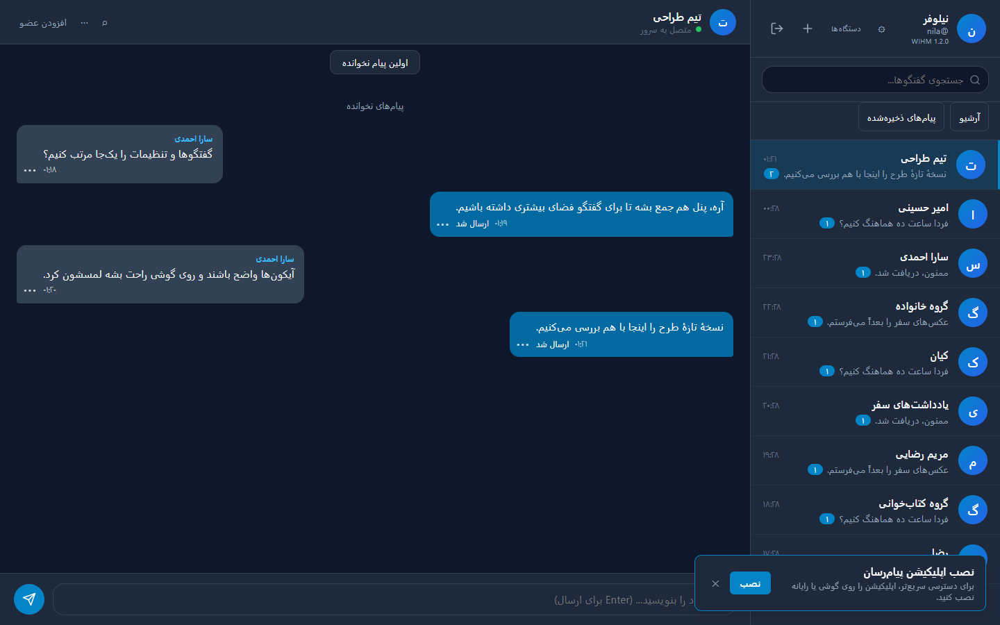
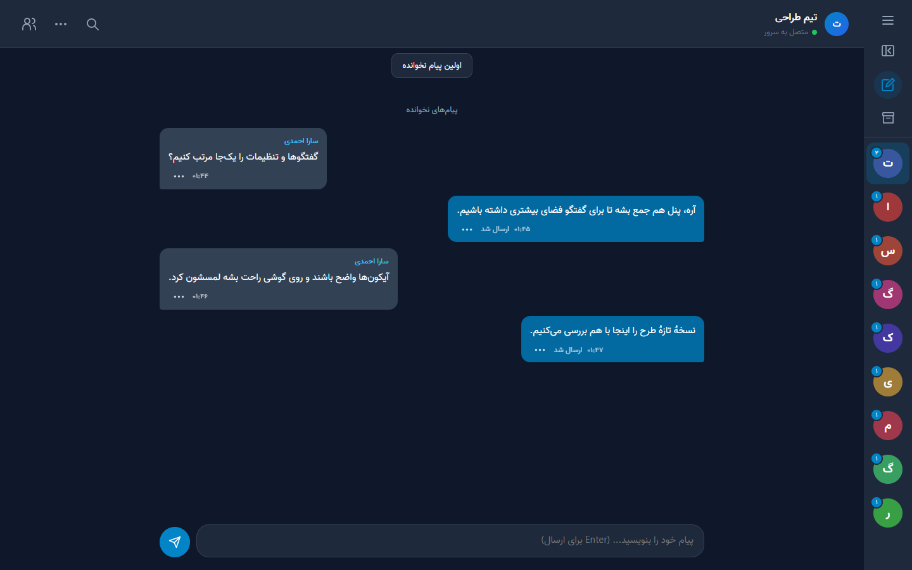
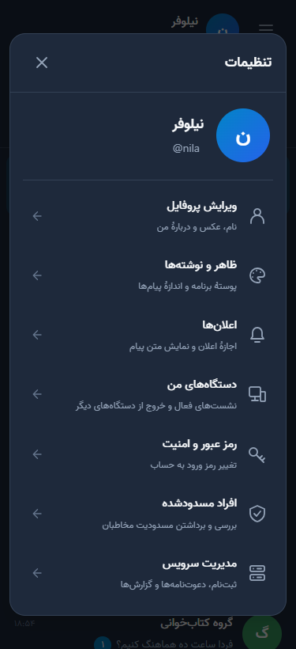

# بازبینی رابط و فونت در ۱.۲.۱

درخواست: آیکون خواناتر، انتقال دستگاه‌ها به تنظیمات، جمع‌شدن پنل گفتگوها و استفاده از فونت وزیر.

## مرجع تلگرام

صفحهٔ رسمی [Telegram Applications](https://telegram.org/apps#source-code)، Web A را به سورس `Ajaxy/telegram-tt` معرفی می‌کند. بررسی ایستای سورس روی کامیت `6002824b6532f3d913997ce496d9ab5f9b86bc22` انجام شد:

- [سربرگ اصلی](https://github.com/Ajaxy/telegram-tt/blob/6002824b6532f3d913997ce496d9ab5f9b86bc22/src/components/left/main/LeftMainHeader.tsx): منوی گرد و جستجوی منعطف، به‌جای تعداد زیاد فرمان کنار حساب.
- [تنظیمات](https://github.com/Ajaxy/telegram-tt/blob/6002824b6532f3d913997ce496d9ab5f9b86bc22/src/components/left/settings/SettingsMain.tsx): دستگاه‌ها یک ردیف کامل در تنظیمات و مسیر `ActiveSessions` هستند.
- [منوی اصلی](https://github.com/Ajaxy/telegram-tt/blob/6002824b6532f3d913997ce496d9ab5f9b86bc22/src/components/common/MainMenuDropdown.tsx): تنظیمات و آرشیو از منوی اصلی در دسترس‌اند.
- [چیدمان](https://github.com/Ajaxy/telegram-tt/blob/6002824b6532f3d913997ce496d9ab5f9b86bc22/src/components/main/Main.scss): ستون‌های کنار هم و تغییر حالت در اندازه‌های کوچک.

این‌ها مشاهدات از سورس‌اند؛ ورود به حساب تلگرام یا مشاهدهٔ گفتگوی واقعی تلگرام انجام نشد. ریل آواتار ۷۶ پیکسلی، آیکون‌های SVG و کد رابط ابرانه در همین پروژه پیاده‌سازی شدند؛ رفتاری به تلگرام نسبت داده نمی‌شود که در مرجع بررسی‌شده دیده نشده است.

## ثبت اجرای واقعی با REA

ابزار `capture_browser_scenario` مهارت [reverse-engineer-anything](https://github.com/morluto/rea/tree/main/.agents/skills/reverse-engineer-anything) روی نمونهٔ محلی ابرانه و حساب‌ها و پیام‌های ساختگی اجرا شد. REA ورود، انتخاب گفتگو، جمع‌کردن پنل و مسیر دستگاه‌ها را با عمل‌های صریح انجام داد؛ مرورگر موقتش در پایان هر سناریو بسته شد.

| ثبت | Evidence ID | مشاهده |
| --- | --- | --- |
| رابط اولیه، ۱۴۴۰×۹۰۰ | `ev_273e151bee1e92e80bfef14aa21c1a4e8657e872e820d12e5656c829bc7083d9` | سربرگ شلوغ و کنترل‌های کوچک |
| پنل جمع‌شده و وزیر، ۱۴۴۰×۹۰۰ | `ev_0bf002508edc917c96273518d3967b82ba838b2baf149d1ed5aa52e611f1fe0c` | گفتگو فعال می‌ماند و ریل آواتارها دیده می‌شود |
| تنظیمات و دستگاه‌ها با وزیر، ۳۷۵×۸۲۰ | `ev_31f86b27f23c988d6a42584f0cc85ce264f20ffe24eafd3f4f3b3dcbd1a31f05` | ورود به دستگاه‌ها و بازگشت به تنظیمات؛ بدون خطای صفحهٔ ثبت‌شده |

REA نسخهٔ Chromium مشاهده‌شده را `156.0.8078.48` و پاک‌سازی را `terminated-owned-process` گزارش کرد. این ثبت‌ها شواهد رابط در نمونهٔ محلی‌اند؛ هویت یک بستهٔ نصب‌شده روی دستگاه کاربر، ترافیک کل شبکه یا همهٔ حالت‌های برنامه را اثبات نمی‌کنند. بدنهٔ درخواست/پاسخ، دادهٔ حساب واقعی یا اجرای تلگرام ثبت نشد. Evidence کامل و PNGهای اصلی در پوشهٔ محلی `.wrangler/design-qa` نگه داشته شدند.

## آزمون و انتخاب طراحی

- پنل کامل ۳۴۴ و پنل جمع‌شده ۷۶ پیکسل؛ انتخاب گفتگو و شمارندهٔ نخوانده در ریل باقی می‌مانند. حالت در همان مرورگر ذخیره می‌شود.
- سربرگ و منوی اصلی کنترل‌های ۴۴ پیکسلی و آیکون‌های SVG دارند؛ دستگاه‌ها در تنظیمات هستند.
- موبایل فهرست و گفتگو را تمام‌صفحه نشان می‌دهد. متن کادر با جمع‌شدن پنل یا انتخاب دوبارهٔ همان گفتگو پاک نمی‌شود.
- پیشنهاد نصب به منو منتقل شد تا روی کادر پیام قرار نگیرد.
- سناریوی مستقل [navigation.mjs](https://github.com/DarkPoesidon/WIHM-Cloudflare/blob/main/tests/browser/navigation.mjs) عرض‌های ۳۲۰، ۳۷۵، ۴۱۴، ۶۰۰، ۷۶۸، ۷۶۹، ۱۰۲۴ و ۱۴۴۰ را بررسی می‌کند؛ منو با صفحه‌کلید، فوکوس پنجره، بازگشت دستگاه‌ها، صفحهٔ کوتاه، پوستهٔ روشن/تیره و عدم سرریز افقی در آزمون حضور دارند.

## فونت وزیر

فایل رسمی و دست‌نخوردهٔ `Vazir-Variable.woff2` از انتشار v30.1.0 با محور وزن ۱۰۰ تا ۹۰۰، داخل خود پیام‌رسان و نصب‌کننده قرار گرفت. [مرجع، مجوز و هش فایل](https://github.com/DarkPoesidon/WIHM-Cloudflare/blob/main/public/fonts/README.md) در پروژه ثبت شده‌اند.

مرورگر بارگذاری واقعی وزن‌های ۴۰۰ و ۷۰۰، خانوادهٔ اصلی `Vazir`، پاسخ `200` و نوع `font/woff2` را تأیید کرد. فایل ۴۱٬۶۹۶ بایتی با SHA-256 زیر تطبیق داشت:

```text
3d7c6820aa45e4f1c569561a7dabc6472153e14ea883b5b6ef41aa764c66def0
```

پس از فعال‌شدن Service Worker و غیرفعال‌کردن کش HTTP، نوسازی آفلاین هم فونت را از Service Worker با همان هش بارگذاری کرد. این نتیجه مربوط به Chrome واقعی روی نمونهٔ محلی است؛ آزمون گوشی فیزیکی محسوب نمی‌شود.

## تصاویر نمونهٔ محلی

پیش از اصلاح:



پنل جمع‌شده با فونت وزیر:



تنظیمات موبایل:


