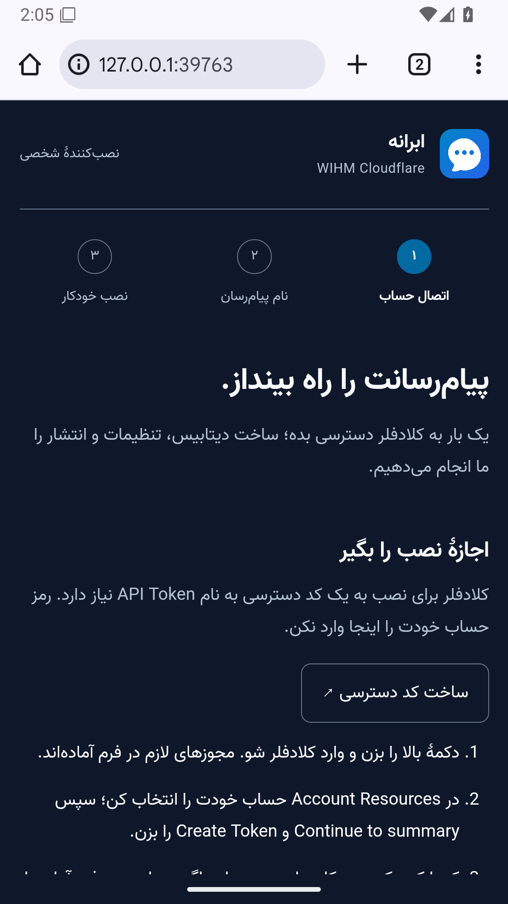

# بررسی اجرای نصب‌کننده در ترموکس

محیط آزمون: شبیه‌ساز تازهٔ Android 16، API 36، ABI برابر x86_64؛ برنامهٔ رسمی Termux 0.118.3 از ریلیز رسمی گیت‌هاب، با تطبیق SHA-256 فایل APK. این آزمون اجرای واقعی اندروید و Node مخصوص اندروید است؛ گوشی فیزیکی یا ARM64 را شامل نمی‌شود.

## خطاهای بازتولیدشده

۱. دستور قدیمی روی ترموکس تازه فقط curl را ارتقا داد؛ دریافت نصب‌کننده با خطای زیر متوقف شد:

```text
CANNOT LINK EXECUTABLE "curl": cannot locate symbol "SSL_set_quic_tls_early_data_enabled"
```

دلیل، ناسازگاری libcurl تازه با OpenSSL قدیمی بود. مستندات رسمی ترموکس نیز [ارتقای جزئی بسته‌ها را پشتیبانی‌نشده می‌داند](https://github.com/termux/termux-packages/wiki/Termux-execution-environment). برنامهٔ ترموکس در همین محیط آزمایشی پاک‌سازی و دوباره آماده شد؛ دستور اصلاح‌شده بدون نصب دستی پیش‌نیازها، ابتدا ارتقای کامل را انجام داد، سپس curl و Node.js 24.22.1 را دریافت کرد و بستهٔ نصب‌کننده را با بررسی checksum باز کرد.

۲. Chrome اندروید، بازکردن لینک از ترموکس را با این سرآیندها فرستاد و سرور محلی قبلی پاسخ 403 داد:

```text
Sec-Fetch-Site: cross-site
Sec-Fetch-Mode: navigate
Sec-Fetch-Dest: document
```

اصلاح تنها برای سند عمومی `GET /` است. تست‌ها همچنان درخواست API از مبدأ خارجی، Host نامعتبر، Origin خارجی، iframe، fetch خارجی و درخواست بدون نشست را رد می‌کنند. لینک خودکار بستهٔ اصلاح‌شده، صفحهٔ فارسی را در همان Chrome باز کرد و کد نشست از نوار آدرس پاک شد.

## نتیجهٔ اجرای نسخهٔ اصلاح‌شده

- هر ۱۳ تست نصب‌کننده و شل داخل Node با `process.platform === 'android'` موفق شدند؛ شامل نصب، ادامه با همان دیتابیس، حفظ کلیدهای قبلی، multipart، فونت و جداسازی نشست محلی.
- بارگذار خود بستهٔ ساخته‌شده، هر ۱۰ مسیر واقعی برنامه، بایت‌های فونت وزیر، MIME، چند بخش و بارگذاری مجدد از کش را با API شبیه‌سازی‌شده گذراند.
- صفحهٔ واقعی Chrome: دکمهٔ اتصال حساب موجود، خانوادهٔ فونت `Vazir`، فونت بارگذاری‌شده با پاسخ `200 / font/woff2` و هش `3d7c6820aa45e4f1c569561a7dabc6472153e14ea883b5b6ef41aa764c66def0`؛ عرض و scrollWidth هر دو ۴۱۲ پیکسل، بدون اسکرول افقی.
- پیام‌های پنجرهٔ اجراکننده انگلیسی و رابط مرورگر فارسی‌اند. ابزار کامپایل، Wrangler یا وابستگی بومی npm نصب نشد.



آزمون‌های بارگذاری از API ساختگی استفاده می‌کنند؛ هیچ توکن حساب واقعی کلادفلر وارد نشد و انتشار روی حساب صاحب سرویس آزمایش نشده است. بستهٔ منتشرشده نیز جداگانه دانلود و مطابق گزارش انتشار بررسی می‌شود. تحویل اعلان روی گوشی، محدودیت باتری سازنده، اتصال شبکهٔ موبایل و معماری ARM64 به آزمون میدانی جداگانه نیاز دارند.
